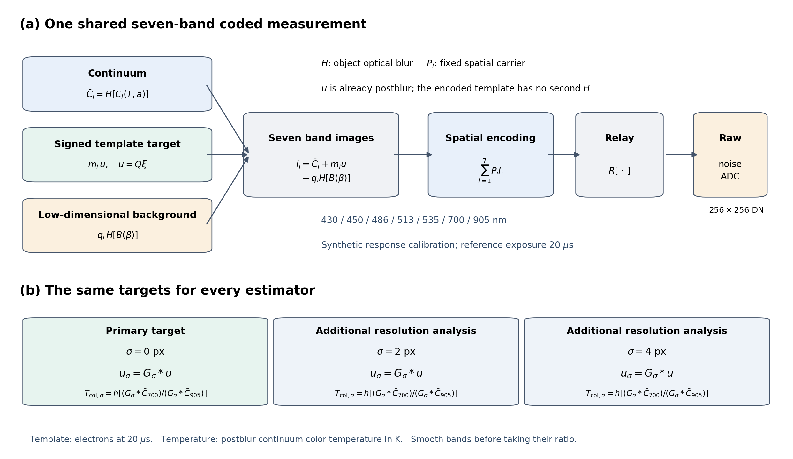
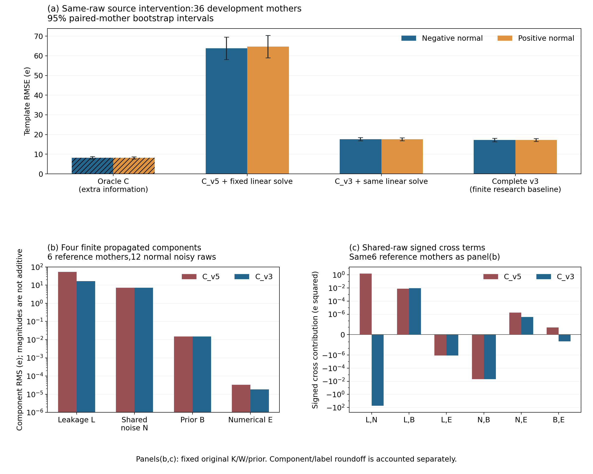
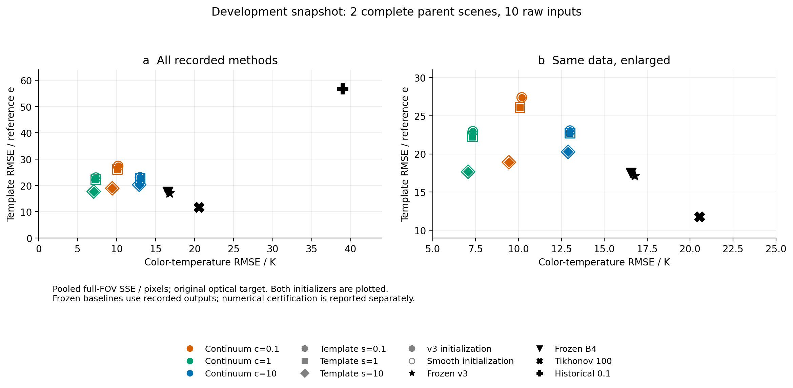

# 单帧七通道谱温反演中的连续谱泄漏、数值残差与适用边界

工作稿，证据截止2026-10-15。当前正文纳入已完成的来源干预、传统基线开发比较和数值修复实验。第5节列出尚待执行的独立评价；最终方法与封存评价结果将在方法冻结后填入。

## 摘要

单帧空间编码将多个光谱通道叠加到同一相机观测中，连续谱估计误差因而能够传播到弱模板分量。本研究在固定七通道合成测量模型下，采用相同raw的连续谱来源替换，结合泄漏、噪声、正则与数值残差的四项分解，分析色温和模糊后模板的误差来源。36个开发母场景中，将旧连续谱估计替换为同raw物理基线的连续谱后，正、负模板RMSE由约64 e降至约18 e。90份输入上的540个来源/背景组合通过线性数值核验，最大实际数值项约为1.003×10⁻⁴ e。独立前向检查进一步识别了采样Gaussian核与解析OTF之间的载频响应偏差，解释了一个平场反例中的约146 K色温偏差。全谱profile估计采用固定物理正则与条件线性消元；连续标定修复后的开发诊断已完成186个不同方法、初值和raw组合，均通过登记数值判据，科学选型尚待完整开发比较。结果将连续谱泄漏、光学标定差异和有限求解误差区分开，为后续分辨率、弱信号及区间评价提供可检验的目标。

关键词：单帧多光谱；色温；变量投影；连续谱泄漏；数值误差；共享观测

## 1 问题与文献边界

单帧多光谱成像用同一时刻的观测描述快速变化对象，空间频率复用提供了一种通道叠加方式。FRAME原始方法已说明编码分离及空间带宽代价[5]，随后有主动多物种成像[6]、被动复用与测温应用[1,2]。本研究沿用空间编码思想，研究固定相机观测下的连续谱与模板估计，并以相同输入的误差传播和方法取舍组织评价。

连续谱与弱模板共享raw，使连续谱误差和模板噪声相关。单独优化连续谱图像后再固定该结果，可能把连续谱中的可投影误差分配给模板。另一方面，有限迭代求解、光学响应偏离及未知发射率都能产生类似的最终图像偏差。区分这些机制，需要同输入干预、明确的光学输出目标和完整失败分母。

可分离非线性最小二乘及其光谱应用已有变量投影方法[3]。本文将这一结构用于当前编码算子，明确模板可观测坐标、条件线性求解和外层停止判据。区间评价按重复观测中的固定统计量定义；Bayesian像素或区域可信区间的已有研究[4]为区间对象的区分提供参照。

## 2 物理模型、单位与目标量

### 2.1 编码观测

将原始DN减去黑电平并转换为电子数后，观测写为

\[
y_e=R\!\left\{\sum_{m=1}^{7}P_m
\left[Hc_m(T,a)+M_m u+q_m H b_\beta\right]\right\}+\varepsilon.
\]

其中，\(P_m\)为空间编码图案，\(H\)为物方模糊，\(R\)为编码后relay响应，\(c_m\)为温度和灰体幅度决定的连续谱电子图，\(u\)为已处于物方模糊后尺度的模板电子图。\(M_m\)和\(q_m\)分别为固定模板和背景的带间系数。背景\(b_\beta\)采用三个固定空间基函数及其系数。\(u\)在编码时直接使用，以保持一次物方模糊的目标定义。

名义推理以raw和已知标定为输入。噪声权重由同一raw的非负电子计数、读出方差及ADC量化方差确定，两个初始化共享该权重。参考曝光为20 μs；已知曝光倍率同时缩放连续谱、模板与背景的电子标尺，ADC和读出单位保持相机定义。

### 2.2 输出目标与空间分辨率

温度评价对象是模糊后连续谱的共同色温映射，模板评价对象是参考曝光下的\(u\)。将连续谱各波段先作额外Gaussian平滑，再计算色温，得到额外\(\sigma=0,2,4\)像素的三个目标。模板采用相同额外平滑。这样，每个方法比较的是相同空间响应下的量。

模板在物方OTF支持内采用实Hermitian正交Fourier坐标；当前原生256×256配置有1153个实自由度。该坐标定义约束了被评价的空间频带。模板电子图的幅度和投影以这一定义解释。

图1(a)将连续谱、已处于模糊后尺度的有符号模板及低维背景编码到同一raw。模板的可观测坐标表示为\(u=Q\xi\)，编码时保持该尺度；背景和连续谱保留物方模糊。图1(b)固定主目标及额外\(\sigma=2,4\)像素的分析目标，先平滑各连续谱波段再取700/905比值。三种分辨率共用20 μs参考曝光、模板电子单位和色温定义，额外平滑结果单独报告。

本课题的光谱矩阵、平坦QE和带响应为工程合成设定。目标量为色温及固定谱模板的电子幅度；实测温度、分子浓度和硬件吞吐率需要各自的实验标定与验证。

## 3 连续谱来源与四项误差

### 3.1 固定线性目标下的分解

给定连续谱来源\(\hat c\)，将模板坐标和背景系数组合为\(x\)，并令\(K\)为其共同编码算子。固定权重与正则下，

\[
A=K^\top WK+\Lambda,\qquad
b=K^\top W(y_e-F\hat c),\qquad
r=b-A\hat x.
\]

这里\(F\)包含连续谱的物方模糊和编码。令\(P\)从\(x\)中取出目标模板图，在相同前向模型与表示空间内，有

\[
\hat u-u_\star=
 PA^{-1}K^\top WF(c_\star-\hat c)
 +PA^{-1}K^\top W\varepsilon
 -PA^{-1}\Lambda x_\star
 -PA^{-1}r.
\]

四项依次对应连续谱泄漏、噪声、正则偏差和实际线性求解残差。分量传播本身的有限求解误差也计入核验。各项共享raw时保留交叉项，平方误差按向量和及其交叉内积计算。独立渲染的模型差异另行评价，不归入相同模型下的数值残差。

### 3.2 相同raw的来源干预

来源实验复用原始输入，保持原\(K/W/\lambda\)配置。下表为36个开发母场景的正常含噪正、负模板比较；背景按原估计规则处理。

| 连续谱来源/方法 | 负模板RMSE/e | 正模板RMSE/e |
|---|---:|---:|
| 旧连续谱估计与原线性模板求解 | 63.760 | 64.627 |
| 同raw物理基线连续谱与相同线性求解 | 17.639 | 17.619 |
| 原完整物理基线v3 | 17.223 | 17.195 |

替换连续谱降低了当前来源组合的模板误差，并保留了与完整物理基线的差距。这个干预支持连续谱误差经后续线性求解传播的机制。各行RMSE之差不作为可相加的方差贡献。

六个母场景的90份输入构成540个来源/背景组合。所有组合完成数值认证，最大实际数值项为1.00317×10⁻⁴ e，最大修正后四项闭合为2.79919×10⁻¹² e。这两个量衡量固定线性目标中的求解与分解一致性；成像精度由外部真值比较给出。

图2(a)对36个开发母场景的正常正、负模板比较共同raw；Oracle行仅增加连续谱真值，背景仍估计，因而属于条件机制对照。误差条对36个父场景作10000次配对重采样，在方法和正负条件间共用每次抽样的父ID，显示逐项百分位95%区间。这是该开发样本的描述统计。图2(b,c)使用另一组六个参考母场景的12份正常含噪raw；四分量为有限传播的RMS，交叉贡献为(2\langle e_i,e_j\rangle/N)。两面板的母场景集合与(a)分开标识，不将其数值拼成配对性能差。分量求解、标签和代数舍入修正另列入数值账本；负交叉贡献说明分量幅度不能按独立方差直接相加。

## 4 全谱profile估计与数值修复

### 4.1 条件线性消元

设\(z\)包含温度及对数幅度场，联合目标为

\[
\min_z\left\{\min_x\;
 \tfrac12\|W^{1/2}[y_e-f(z)-Kx]\|_2^2
 +\tfrac12x^\top\Lambda x\right\}
 +\mathcal R_c(z).
\]

模板与背景用列平衡增广LSMR[7]求解，外层优化连续谱场。连续谱正则系数由共同raw和固定标定anchor定义，数值坐标缩放单独记录。两个可部署初值为同raw缓存物理基线和raw解调初始化；初值切换不改变同一版本下的物理目标。

九组预声明正则组合为连续谱和模板倍率各取\(0.1,1,10\)。原开发预筛在一个raw上得到18个有限输出，数值门槛使所有组合都未进入12+24母场景科学比较。修复后的目标有独立版本与登记；原排除结果保留为其实际执行配置的记录。

### 4.2 连续标定、数值可靠性与初步精度取舍

原连续谱查表采用5 K间隔分段直线。修复版本保留全部661×7标定节点、原标定缓冲和共同色温查表，仅在内部节点左右0.25 K连接单调Hermite段。其平场raw相对原查表的新增改动上界为0.0401176 e，密集温度网格的共同色温最大新增差为0.00224925 K。新插值同时改变anchor温度导数，因此作为显式新物理目标登记。

数值认证要求连续三个合格端点及两个在0.2 K/0.17 e内的输出平台。每个端点重算实际投影梯度，并用更紧内层解检查模板差。六个开发raw覆盖五个父场景，在两个初值下共十二格；其中四格复用原两份raw的端点，仅新增八次反演。十二格均在第三阶段通过，实际执行阈值依次为10⁻⁴、10⁻⁵、10⁻⁶。新增八格最终投影梯度为7.59×10⁻⁷至9.65×10⁻⁷，核心反演累计165.78 s；首个新调用至终态431.18 s包括缓存、评分及控制器开销。

| 同一六个开发raw的方法 | 色温RMSE/K | 模板RMSE/e | 指标来源 |
|---|---:|---:|---|
| 原v3 | 17.391 | 16.621 | 冻结缓存 |
| 强传统基线，λ=100 | 26.072 | 11.973 | 冻结缓存 |
| 原B4 | 17.079 | 16.213 | 冻结缓存 |
| C1，同raw缓存v3初始化 | 9.859 | 21.968 | 原生重建及重评分 |
| C1，raw解调初始化 | 9.859 | 21.968 | 原生重建及重评分 |

各格均以完整65536像素评分。原生GPU从保存参数重建十二格的canonical数组及潜连续谱，字节哈希全部一致；全域重评分亦与原记录一致。每个初值的统计单位是六个raw、五个父场景。两个初值的共同色温和模板输出RMS差分别不超过0.00152 K和0.00109 e。独立CPU复核新增blank和weak两个端点，在固定原GPU记录的共同anchor与坐标尺度后，真实梯度均通过10⁻⁶；更紧冷、热启动条件线性解引起的最大模板变化为9.57×10⁻⁹ e。此前四端点的独立CPU检查另保留。中间阶段只作保存日志和哈希的逻辑核验，独立参数重演覆盖已保存的最终端点。

该小面板表现出色温与模板精度的取舍。正常有符号模板三例中，C1模板RMSE为21.418 e，原v3为15.995 e，比例约1.339，超过预定1.05非劣界。色温改善因此不足以支持选择当前c1s1配置。诊断图见[补充图：开发小面板取舍](figures/supplement_quick_v003/C1_DEVELOPMENT_TRADEOFF_002.png)。

随后在同一positive_normal开发raw上完成原九组双初值预筛，共18格，其中2格复用c1s1，仅新增16次反演。18格均通过，实际终阈仍为10⁻⁶；54个端点阶段与36次输出平台比较全部留存。原生GPU重建18格canonical及潜连续谱的字节哈希，并重算全部65536像素指标，均与记录一致；此审计无优化或内层求解。独立CPU在两个正则比值极端的保存端点上复核实际梯度与更紧冷、热条件解，最大模板变化为8.46×10⁻⁹ e。新增16次核心计算累计647.86 s，首票至终态1114.17 s。两初值的共同色温、模板图RMS差分别不超过0.00131 K、0.00126 e。

该单raw诊断中，各组色温RMSE为7.45–13.96 K、模板RMSE为19.07–30.04 e；同raw原v3为17.60 K、18.20 e。[九组取舍图](figures/supplement_c1_prescreen/NINE_PAIR_DIAGNOSTIC.png)汇合两个初值的平方误差作描述，独立raw数仍为1。九组均进入完整12母场景开发计划，按小分片执行；这一预筛不承担科学选型或普遍精度结论。检出效能另待独立null校准。

完整开发计划的首个空白raw分片随后返回18/18有限且数值合格端点，其中2格复用，16格新增。原生GPU从原float64参数重建全部canonical及潜连续谱哈希，并重算26项全域评分字段，均与记录一致；审计未调用优化器或内层求解器。独立CPU对54阶段、36平台及两个固定极端正则端点复核通过，更紧冷、热条件线性解引起的最大模板变化为4.81×10⁻⁹ e。两个初值的共同色温、模板图RMS差分别不超过0.00183 K、0.00175 e。16次新反演核心累计1319.47 s，首票据至终态3115.42 s。空白下模板RMSE为约19.55–29.52 e；帧误报率另用独立null校准和评价。合并精确复用后，该分片结束时1080格开发矩阵覆盖44格、6个raw和5个父场景。

同一母场景的正弱raw分片新增18格，全部有限且通过数值判据。原生GPU重建哈希和26项全域评分一致，独立CPU复核54阶段、36平台及两个固定极端端点通过；更紧条件线性解引起的最大模板变化为6.23×10⁻⁹ e。两个初值的共同色温、模板图RMS差分别不超过0.00160 K和0.00122 e。九组参数的色温RMSE为7.88–13.84 K，模板RMSE为18.46–29.93 e；同raw原v3为16.92 K和17.65 e，体现色温与模板精度的取舍。18次新反演核心累计1511.07 s，首票据至终态3603.91 s。该分片结束时完整开发矩阵覆盖62/1080格、7个raw和5个父场景。

负弱、负正常分片再新增36格，全部有限且通过数值判据。36格原生重建及26项全域评分一致；独立CPU复核108阶段、72平台及两个指定最终端点通过，更紧条件线性解引起的最大模板变化为4.65×10⁻⁹ e。两个初值的共同色温、模板图RMS差分别不超过0.00174 K和0.00136 e。36次新反演核心累计1784.03 s，首票据至终态4295.99 s。该片结束时开发覆盖98/1080格、9个raw、5个父场景；当时982格待执行，九组候选各保留120格完整分母。

母场景0000已覆盖五种条件、九组倍率和双初值，共90格。按各条件的平方误差与完整像素数合并，九组倍率及两个初值的色温RMSE为7.41–13.95 K，模板RMSE为18.92–29.64 e；原v3为16.80 K和18.32 e，B1 λ=100为18.43 K和12.07 e。正常正负模板RMSE相对原v3的比值为1.031–1.620。该对照的独立母场景数为1，后续12母开发与24母确认用于最终选择。

母场景0005的空白与正弱输入再完成36格，其中34次新增、2格原c1s1端点精确复用。36格原生重建哈希及26项全域评分一致，独立CPU复核108阶段、72平台和两个指定最终端点通过；更紧条件内解引起的最大模板变化为6.49×10⁻⁹ e。双初值的共同色温、模板图RMS差分别不超过0.00160 K和0.00161 e。空白下C1色温/模板RMSE为6.60–11.78 K/16.04–24.21 e，原v3为16.88 K/15.00 e；正弱下为6.66–11.86 K/16.28–24.96 e，原v3为16.56 K/16.25 e。34次新反演核心累计1234.65 s，首新票至终态3196.26 s，两格旧结果未重复计费。该片结束时开发覆盖132/1080格、10个raw、5个父场景；当时948格待执行。

母0005剩余三种条件再新增54格并全部通过登记数值判据。由此，母0000与0005各完成五种条件、九组倍率和双初值，共180格；其余已缓存端点合计使开发覆盖达到186/1080格，尚有894格待执行。两个完整母场景的10份raw按完整平方误差和与655360像素合并，C1九组及两个初值的色温RMSE为7.06–13.00 K，模板RMSE为17.66–27.39 e；原v3为16.78 K/17.14 e，B1 λ=100为20.55 K/11.78 e，旧B4为16.56 K/17.50 e。正常正负模板RMSE比值为1.017–1.589。该开发中间比较保留两个初值及全部九组，最终选择仍按完整12母开发与24母确认执行。

图3开发快照：左为全部方法，右为同一统计量的放大视图；RMSE等于合并平方误差和除以合并像素数后开根号。颜色区分连续谱正则倍率，标记形状区分模板倍率，实心与空心区分两个初值。统计独立单位为2个母场景，10份raw包含同母场景的五种条件。

新标定使anchor温度正则系数降低0.6249%。保持新正则和相同最终参数、仅切回原插值时，条件profile投影梯度增至2.72×10⁻⁵–3.66×10⁻⁵。插值及anchor变化共同定义新估计器，旧停滞端点未保存的参数使其精确因果贡献仍待另设对照。后续科学选型使用预登记母场景与比较规则；第四阶段10⁻⁷阈值在本批未执行。

### 4.3 传统基线及有限迭代的取舍

传统解调Tikhonov基线在12母场景上比较\(\lambda=10,100,1000\)，选择100，并在剩余24母场景的120个含噪输入上确认：模板RMSE为13.3648 e、色温RMSE为20.8501 K。历史\(\lambda=0.1\)按原配置单独标识；100也与既有预选值一致。评价同时保留全域误差、幅度投影和结构指标，以描述平滑强度的取舍。

原v3在60个输入上的有限迭代对照未通过生产数值预算。更紧线性float64路线与原输出的模板差中位数为0.6473 e，色温差中位数为1.0660 K。当前v3以固定研究基线参与比较。原生256切线比较共登记四格：旧块对角预条件的两格分别经838和930步达到真实相对残差7.8350×10⁻¹¹和8.0502×10⁻¹¹，耗时5.854 s和6.359 s；新耦合Fourier预条件的两格均在构建时请求33.14 GiB显存而失败，未进入PCG。

分块v2仅对两条失败路线作显式新版本验证，并复用上述旧控制。同一精确系统上的两格分别经544和689步达到真实相对残差9.9015×10⁻¹¹和9.9723×10⁻¹¹，耗时86.296 s和108.000 s。两例显存失败得到修复，但总耗时增至旧控制的14.74和16.98倍，因此当前版本不接入非线性外层。源码每次字段预条件应用包含1024次小批求解调用；这一结构提示调度开销，但尚无GPU剖析将其确认为唯一原因。后续逐元素三角求解版本通过25项CPU合同，原生速度待验。旧控制未保存步数组，直接解差不可得；基于残差和谱下界的条件界不作为实际差值或非线性精度报告。

缓存先保存原精度参数，再以前向重建逐数组核验。四个旧端点通过原生资格检查后，八个新端点均完成同样校验；该存储校验调用优化器、内层求解器及完整反演的次数为零。D盘嵌套占位空间释放错误及其独立维护记录保留在复现材料，正式参数、输出哈希和失败记录保持不变。

## 5 独立实验、检出与区间评价

### 5.1 独立前向与光学响应

独立渲染使用有限非周期Airy核、密集带积分和像素积分。已完成的旧名义批次采用采样Gaussian relay，而核心标定采用解析Gaussian OTF；载频处两者响应比为1.076–1.487。平坦3100 K反例中，这一差异使700/905比值额外乘以0.92932255，得到2953.9185 K。旧批次按已登记的relay/标定失配压力解释。

匹配relay的新独立实现保留有限Airy、边界及像素积分的差异。正式24母场景、分辨率、光子预算、结构、强度、标定及动态结果在方法确定后填入本节。当前实现合同用于检查前向语义；正式误差和边界由完整反演给出。

### 5.2 固定帧误报率的检出

帧检测使用与方法和应用域绑定的模板字典分数。独立200个null母场景校准阈值，再用另200个null母场景评价误报率；信号母场景评价检出、符号和投影。数值认证、低信号、检测、饱和和标定状态分别输出。修复后新方法的检测阈值尚待该独立校准，开发结果中的历史阈值字段不用于新方法检出结论。

### 5.3 共享raw的区间

区间统计量为五个固定点位和中央ROI均值，分别对色温和电子模板形成12维输出。完整反演重复测量保留连续谱与模板共享raw的相关性。独立重复噪声用于评价覆盖；fitted-mean条件bootstrap用于估计条件尺度。局部方向传播另报步长稳定性、probe数与数值认证。

旧896次完整MC作为原有限估计器的重复测量记录保留。原校准/评价组的实际模板几何分别集中于blob/multipeak，统一raw亮度尺度也未区分色温和模板单位。新的12母场景方案在两组均覆盖六种实际几何，采用不重叠种子，并分别记录点位/ROI覆盖、宽度及失败分母。该更正方案尚未执行，相关正式结果在本节补齐。

## 6 适用范围与待完成评价

现有证据支持三个任务内结论：同输入的连续谱来源影响模板误差；编码载频的光学响应差异能造成系统色温偏差；有限求解残差与外部科学误差需要分别量化。连续标定修复后的数值检查为后续有限科学比较提供了合格候选，最终方法仍由完整开发与确认决定。

实际标定数据尚缺，模拟增益、PSF、配准及发射率分布按假定分布解释。当前电子模板来自固定工程谱矩阵，其物种定量含义需要实测光谱响应与独立浓度标定。模拟动态序列的时间积分与硬件帧率验收属于不同证据。

最终方法、源码依赖、参数、光学目标、阈值、区间校准、基线及统计计划冻结后，执行64个主任务和36个signed母场景的封存评价。最终表格保留所有失败母场景；最终结果用于报告而不再驱动方法选择。七组主图、独立评价汇总和干净环境复现将在这一阶段完成。

## 数据与复现声明（工作稿）

原始输入、历史权重与报告通过不可变哈希引用；新包保存源码版本、raw/标签清单、逐例指标及真实调用总账。同方法同raw的有限、未认证及失败状态均复用。正文数值对应关系见[声明—证据表](claims_to_evidence.md)。最终复现包将提供raw与标定接口、目标量定义、冻结参数及示例运行命令。

## 参考文献

1. Andersson等. [A light-efficient and versatile multiplexing method for snapshot spectral imaging](https://www.nature.com/articles/s41598-024-66386-2). Scientific Reports, 2024, 14:16116.
2. Andersson等. [Multispectral coded light for high-speed temperature imaging of aluminum combustion](https://doi.org/10.1364/OE.578636). Optics Express, 2026, 34:13393–13404.
3. Bärligea, Hochstaffl, Schreier. [A Generalized Variable Projection Algorithm for Least Squares Problems in Atmospheric Remote Sensing](https://elib.dlr.de/195878/1/mathematics-11-02839-v2.pdf). Mathematics, 2023, 11:2839.
4. Cai, Pereyra, McEwen. [Uncertainty quantification for radio interferometric imaging: II. MAP estimation](https://arxiv.org/abs/1711.04819). MNRAS, 2018, 480:4170–4182.
5. Ehn等. [FRAME: femtosecond videography for atomic and molecular dynamics](https://pmc.ncbi.nlm.nih.gov/articles/PMC6062331/). Light: Science & Applications, 2017, 6:e17045.
6. Li等. [Simultaneous multispectral imaging of flame species using FRAME](https://doi.org/10.1016/j.combustflame.2018.02.009). Combustion and Flame, 2018, 192:160–169.
7. Fong, Saunders. [LSMR: an iterative algorithm for sparse least-squares problems](https://web.stanford.edu/group/SOL/software/lsmr/). SIAM J. Sci. Comput., 2011, 33(5):2950–2971.
