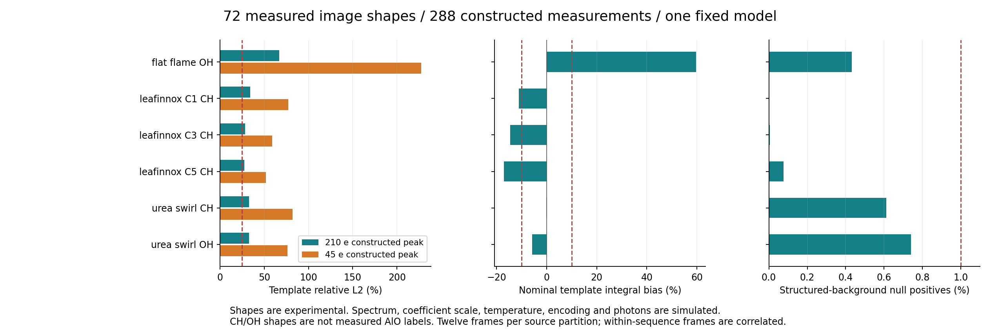
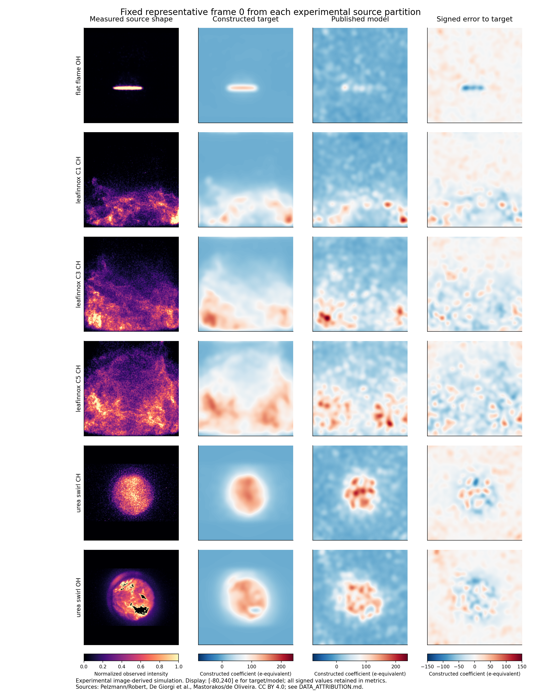
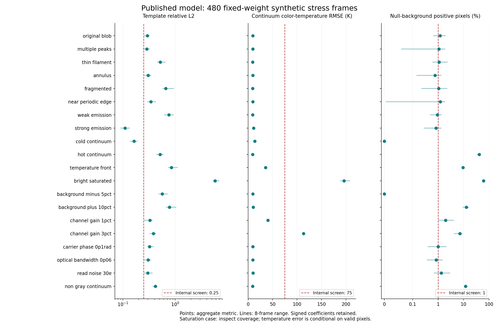

# Current selected model: expanded performance

Only the published checkpoint was tested. Its SHA256 stayed `d777888c53b086118128a824da007e1cba471f185ad9f8a973eb68c5edb434f1`; optimizer updates = 0. No architecture/CNN contribution controls were run.

The server completed 480 synthetic stress frames plus 288 experimental-image-derived simulated frames, using 72 observed image shapes from three public experimental datasets. All cases were registered, generated and hashed before their suite's first inference. All 768 predictions used the same weights.

The measured part of the second suite is image morphology/texture. Temperatures, seven-band spectra, coefficient amplitude, encoding and noise are simulated. The coefficient is the current synthetic AlO-named slot; observed CH/OH images do not provide measured AlO labels. These scores do not validate real gas temperature or concentration.

**Result:** only 2 of the 20 synthetic families passed all seven internal screens: strong emission and cold continuum. None of the six experimental-shape source partitions passed the spatial L2 screen. Normal-strength shape L2 ranged from 27.557% to 67.054%; weak-signal L2 from 51.824% to 227.223%.

## Experimental image shapes

Twelve selected frames per partition, each tested at nominal peak 210 e, weak peak 45 e, clean null, and a 100 e structured background. Image/frame selection and preprocessing were fixed before inference. Source sequences are correlated; these are source-specific diagnostics, not six independent real temperature validations.

| Source partition | Nominal L2 | Weak L2 | Nominal integral bias | Clean-null FP | Structured-background FP | Assumed-T RMSE (K) | Min. coverage |
|---|---:|---:|---:|---:|---:|---:|---:|
| flat_flame_OH | 67.054% | 227.223% | 59.592% | 0.010% | 0.432% | 8.929 | 100.000% |
| leafinnox_C1_CH | 34.200% | 77.045% | -11.086% | 0.001% | 0.000% | 9.453 | 100.000% |
| leafinnox_C3_CH | 28.553% | 58.846% | -14.610% | 0.000% | 0.005% | 10.057 | 100.000% |
| leafinnox_C5_CH | 27.557% | 51.824% | -16.989% | 0.003% | 0.076% | 10.297 | 100.000% |
| urea_swirl_CH | 32.576% | 81.932% | -0.206% | 0.000% | 0.613% | 9.493 | 100.000% |
| urea_swirl_OH | 32.997% | 76.232% | -5.765% | 0.000% | 0.740% | 9.645 | 100.000% |

Temperature errors above use an assumed synthetic continuum. They are not measured flame-temperature accuracy. All six source partitions had zero saturation in the newly constructed input frames; source-image ceiling masks and their uncertain calibration are recorded separately.

## Synthetic acquisition and shape stress

Eight frames per condition per family: signal, clean null, background null. The background-null condition has a +5% continuum error at 486 nm except for the explicitly negative/10% background families. Gains, phases, noise and blur perturb acquisition only; the model keeps the nominal calibration.

| Family | L2 | Integral bias | Color-T RMSE (K) | Clean-null FP | Background-null FP | Min. coverage | Saturated pixels | Passed screens |
|---|---:|---:|---:|---:|---:|---:|---:|---:|
| original_blob | 29.396% | -9.403% | 9.680 | 0.006% | 1.201% | 100.000% | 0 | 5/7 |
| multiple_peaks | 28.784% | -11.365% | 9.671 | 0.000% | 1.077% | 100.000% | 0 | 4/7 |
| thin_filament | 52.021% | 9.262% | 9.202 | 0.000% | 1.099% | 100.000% | 0 | 5/7 |
| annulus | 30.460% | -8.924% | 9.508 | 0.000% | 0.759% | 100.000% | 0 | 6/7 |
| fragmented | 66.402% | 36.409% | 9.302 | 0.002% | 1.060% | 100.000% | 0 | 4/7 |
| near_periodic_edge | 34.475% | -1.517% | 9.467 | 0.000% | 1.225% | 100.000% | 0 | 5/7 |
| weak_emission | 76.040% | 28.770% | 9.165 | 0.006% | 0.934% | 100.000% | 0 | 5/7 |
| strong_emission | 10.989% | -4.998% | 11.143 | 0.000% | 0.823% | 100.000% | 0 | 7/7 |
| cold_continuum | 16.317% | 1.725% | 13.515 | 0.000% | 0.000% | 100.000% | 0 | 7/7 |
| hot_continuum | 51.480% | -37.632% | 9.071 | 0.024% | 41.088% | 100.000% | 0 | 4/7 |
| temperature_front | 84.933% | -9.027% | 35.594 | 5.623% | 9.500% | 100.000% | 0 | 4/7 |
| bright_saturated | 582.402% | 231.939% | 196.278 | 59.149% | 60.626% | 52.496% | 702890 | 0/7 |
| background_minus_5pct | 56.495% | -67.538% | 9.802 | 0.030% | 0.000% | 100.000% | 0 | 5/7 |
| background_plus_10pct | 78.233% | 121.388% | 10.572 | 0.004% | 12.896% | 100.000% | 0 | 4/7 |
| channel_gain_1pct | 32.786% | -13.023% | 40.258 | 0.038% | 1.978% | 100.000% | 0 | 4/7 |
| channel_gain_3pct | 38.329% | -10.523% | 113.198 | 0.116% | 7.217% | 100.000% | 0 | 3/7 |
| carrier_phase_0p1rad | 32.332% | -11.716% | 9.758 | 0.000% | 1.005% | 100.000% | 0 | 4/7 |
| optical_bandwidth_0p06 | 30.526% | -11.435% | 9.722 | 0.000% | 0.841% | 100.000% | 0 | 5/7 |
| read_noise_30e | 30.000% | -8.667% | 10.195 | 0.004% | 1.332% | 100.000% | 0 | 5/7 |
| non_gray_continuum | 41.932% | 2.991% | 9.179 | 0.841% | 11.893% | 100.000% | 0 | 5/7 |

The matched blob control gave color-temperature RMSE 9.680 K, L2 29.396%, integral bias −9.403%, and background-null positive rate 1.201%. Compared with the old small test, this shows that the near-threshold background result was not stable across fresh samples.

The strong-emission and cold-continuum settings retain favorable template-to-continuum/noise conditions. Hot continuum at 3300 K raises background-null positives to 41.088%; a 3% alternating gain error raises color-T RMSE to 113.198 K; saturation reduces minimum valid coverage to 52.496%. These are sensitivity diagnostics for the declared fixture, not calibrated physical limits.

## Metric and verification definitions

- L2 = norm(predicted signed coefficient − target) / norm(target), over the full post-blur image. Invalid predictions are filled with zero for this metric. Negative estimates are retained.
- Integral bias = sum(prediction − target) / sum(target). Positive/negative regional errors can cancel; inspect the maps and L2.
- Null FP = valid pixels with signed coefficient >60 e divided by valid pixels. Weak peaks of 45 e are below this detection threshold; weak L2 measures coefficient reconstruction, not binary detection recall.
- Color-T RMSE is measured only on jointly valid pixels. Coverage and saturation are reported separately, and all image pixels still enter template L2.
- Internal screens: T RMSE ≤75 K; L2 ≤25%; absolute integral bias ≤10%; each null FP ≤1%; minimum case coverage ≥98%; zero saturation. These are prototype screens, not external acceptance criteria.

The process exited 0; source and model hashes remained fixed; the delivered archive and all 150 NPZ files were reopened. The evaluated source revision is `5eb991bacb65e6d478e96ef1f0404cd5363e7ce2`. Torch 2.12.0+cu130 / RTX 5070. The registered job took 110.04 seconds including source preparation, freezing, inference and serialization; this is not a camera-FPS measurement.

CSV tables and `performance_summary.json` accompany this report. Full per-case rows, fixture manifests, acquisition metadata and selected raw/prediction arrays are included under `synthetic/` and `experimental_shape_test/`. Processed observed shapes and their attribution/hashes are under `experimental_shapes/`. Full frozen generated frames and original source archives remain in the research archive and can be regenerated with the published entry points.

Scientific acceptance remains **not accepted**. Current useful evidence is bounded synthetic reconstruction and image-shape transfer; independent seven-channel overlapping-frame measurements and aligned temperature/species references are still absent.
