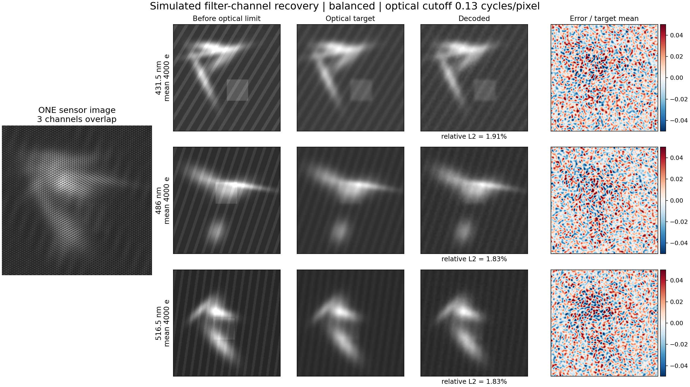
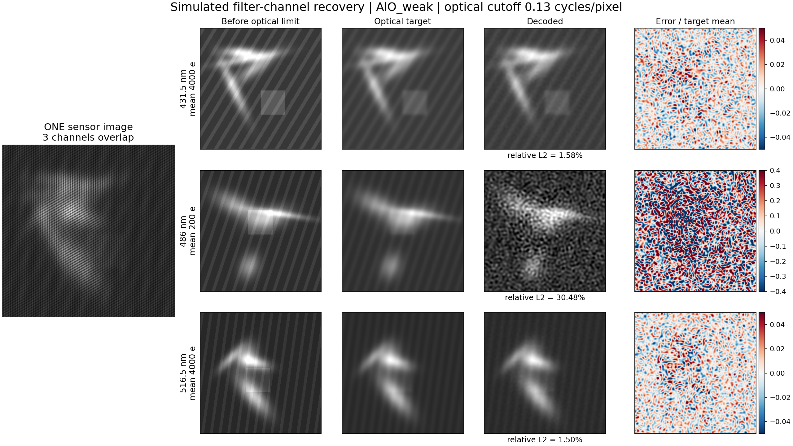
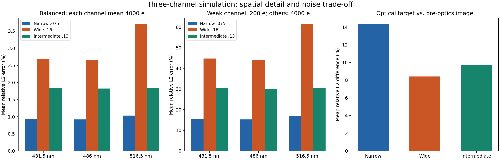

# 三个滤波通道的图像解码：首轮结果

目标已按用户澄清更正为：滤光片确定通道，算法还原通道的完整图像。三路在同一个视场、同一块传感器区域重叠编码。波段为431.5、486、516.5 nm，初始滤片带宽约10 nm；OH*310 nm留作紫外扩展。滤片透射率、实际相机、物镜响应和曝光尚未知。

本轮建立了不含温度/化学参数的图像解码基线，并完成三个固定空间编码几何的开发对照。没有神经网络训练。当前选用003作为均衡亮度下的开发基线；暗弱通道仍需改进。

| 几何 | 编码前光学造成的相对图像差异 | 均衡亮度时解码误差：431.5 / 486 / 516.5 nm | 各通道分别暗20倍时的解码误差 | 均衡亮度工程门槛 |
|---|---:|---|---|---|
| 001 | 14.33% | 0.93% / 0.92% / 1.03% | 15.44% / 15.28% / 17.09% | 通过 |
| 002 | 8.43% | 2.70% / 2.67% / 3.70% | 44.74% / 44.11% / 61.41% | 未通过 |
| 003 | 9.75% | 1.84% / 1.82% / 1.85% | 30.53% / 30.11% / 30.62% | 通过 |

表中解码误差为每幅图像的相对L2误差 `||估计图−目标图||₂/||目标图||₂` 的均值，比较对象为编码前已通过指定物镜的通道图像。均衡条件每通道平均4000电子；暗弱条件为200电子、另两路4000电子。每个条件包含8个母场景×8次噪声重复。三组共2304帧观测，复用8个母场景的形态，属于开发试验。

003的95分位相对图像误差分别为1.91%、1.89%、1.92%，低于预设5%；95分位绝对均值偏差均低于0.060%，低于2%；95分位去均值细节误差为5.32%、5.01%、5.73%，低于10%。没有饱和样本。002虽保留更多细节，但516.5 nm通道的去均值细节误差95分位达到11.06%，因此未通过全部门槛。

光学造成的相对图像差异由14.33%降到9.75%，减少31.95%。这是成像前后图像的L2差异，不是空间分辨率改善百分比；003的物镜截止频率是假设的0.13 cycles/pixel。更宽的空间带宽保留更多细节，也收进更多噪声。20倍暗弱通道在003下仍有约30%的相对图像误差，不能据均衡条件的约1.8%宣布所有通道条件都已精确恢复。

无噪声解码和纯单通道串扰均通过预登记数值门槛。全部原始ADC帧已重新打开，359个远端文件核对哈希，12个代表帧做本地CPU重放；与保存结果的最大绝对差为1.73×10⁻¹¹电子。三组真实退出码均为0，失败几何和全部数据保留。服务器完整解码2736次，本地合同检查与重放24次，原有6933次参数反演账本未修改。

图像和图表分别给出原始混合帧、编码前的光学图像、解码图及误差；当前所有结果都是假设已准确标定的合成仿真，尚无独立实测多波段图像或硬件验收。

下一步保持相同目标空间带宽，比较当前频域解调与使用raw噪声方差的独立三通道图像重建，同时检验暗弱通道的误差、细节和强度偏差。硬件参数给出后，再把假设传递函数换成实测标定。本轮作业已经结束，无运行任务、无定时任务。

波段依据：CH*/C₂*/OH*滤片中心和10nm带宽来自[Abu Saleh等的实验](https://eprints.whiterose.ac.uk/208382/1/ffuel-01-1296502.pdf)；AlO约486nm来自[Lucas等的原始光谱](https://doi.org/10.1021/acs.jpca.9b10697)，本地PDF第13页已核对。486nm的10nm带宽是本项目初始设计值，尚未选择实际滤片。通带光可能混合其他发光，仍属于当前图像恢复目标。
