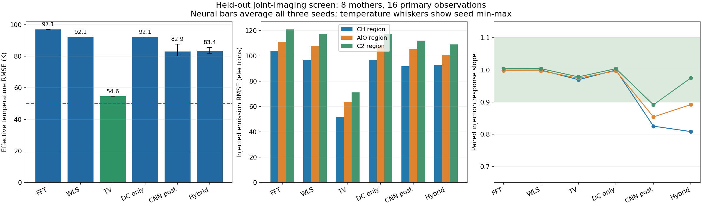
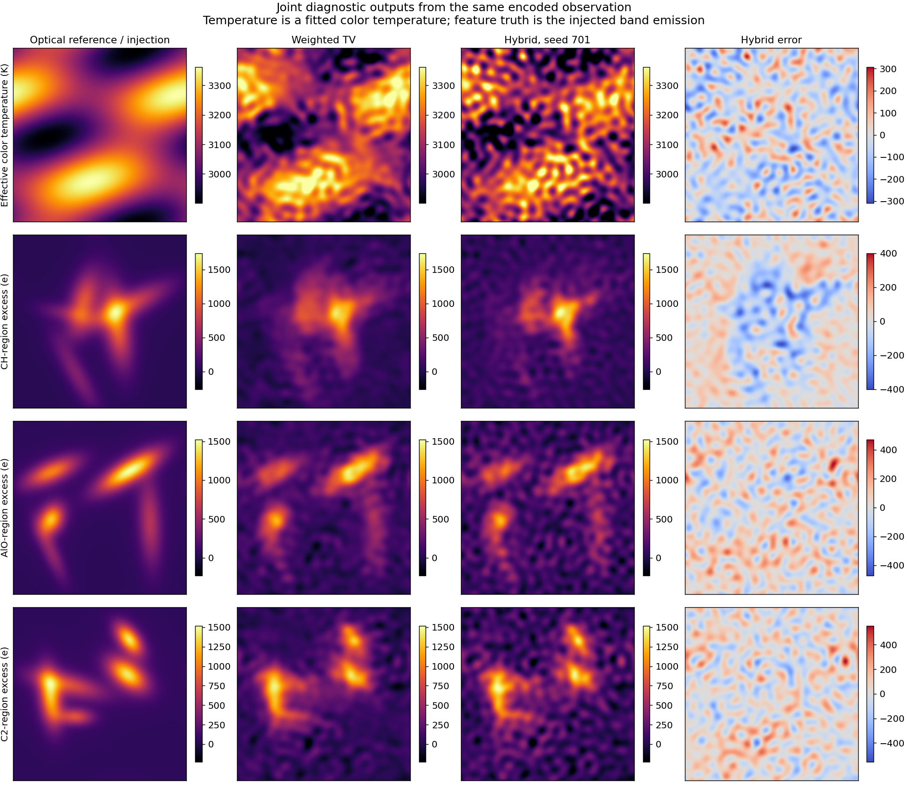

# 六通道测温与特征发光联合成像：第一轮结果

本阶段完成了从同一幅重叠编码raw恢复六通道图像、再读取连续谱有效色温与三类特征波段发光的完整对照。当前混合原型的三个随机种子均未通过预登记继续线；保留本轮噪声加权TV作为传统参考，当前网络不采用。创新机制仍待后续验证。

## 通道与物理量

测温候选为700、800、905 nm，特征发光通道为431.5 nm（CH*相关）、486 nm（AlO相关）和516.5 nm（C₂*相关）；本轮均为10 nm理想矩形通带。滤光片给定波长，算法恢复总通道图像。随后用三个测温通道拟合Planck光子辐射曲线与灰体幅度，并从可见通道另行计算相对该连续谱的超额发光。

目标应用为燃料燃烧、爆炸等超快发光场景。本轮温度定义为光学、视线及曝光积分条件下的连续谱有效色温；颗粒/液滴温度、AlO光谱温度与气体温度需要分别建立测量依据。原始文献与架构对照已写入[方案](../../research_joint_imaging/README.md)，包括FRAME、DAUHST与LRDUN。真实滤片响应、相机QE/IR截止、实际曝光光子数及光谱交叉响应仍未知。

## 对照与数据分母

44个独立合成母场景按训练24、验证6、阈值标定6、留出评价8划分。每母场景包括两档光子水平、六个注入条件及两次独立噪声重复，共1056幅原始ADC图。留出集为192幅图；下表主条件为8个母场景的16幅图，800 nm通道平均4000电子，三个特征波段各叠加平均200电子发光。三种子统计是训练随机性，不增加独立物理母场景数。

六次网络训练各300次更新，合计1800次更新。对照包括频域解码、噪声加权最小二乘、TV、关闭网络但保留三次物理近端步骤、CNN后处理、CNN与raw一致性求解结合。两类网络采用相同容量、训练数据、顺序和损失，分别训练三个种子。所有方法使用同一光学支持和同一raw。

传统参数与网络检查点于21:16:02 UTC冻结，十组阈值于21:16:42.444 UTC冻结，留出数据随后于21:16:42.543 UTC载入评价。留出数据的生成与保存发生在训练前，性能评价发生在冻结后。检测阈值仅使用独立空白标定母场景。

## 主条件结果

温度为全部像素合并RMSE。发光误差以实际注入的光学模糊后图像为真值，分别合并全部像素；神经方法表中为三个种子的指标均值，不是模型集成。

| 方法 | 色温RMSE，K | 431.5 nm发光RMSE，e | 486 nm发光RMSE，e | 516.5 nm发光RMSE，e |
|---|---:|---:|---:|---:|
| 频域解码 | 97.07 | 103.83 | 111.02 | 121.01 |
| 噪声加权最小二乘 | 92.12 | 96.97 | 107.83 | 117.53 |
| 噪声加权TV | 54.59 | 51.76 | 63.62 | 71.06 |
| 关闭网络的等步骤物理对照 | 92.12 | 96.95 | 107.82 | 117.52 |
| CNN后处理，三种子均值 | 82.93 | 91.83 | 105.44 | 111.97 |
| 混合重建，三种子均值 | 83.45 | 93.12 | 100.71 | 109.04 |

混合方法三个种子的色温RMSE为81.79、82.97、85.59 K；所选TV为54.59 K。混合方法各可见通道的平均图像相对L2为13.50%、7.48%、5.76%，三个测温通道为2.52%、1.35%、1.93%；对应TV为6.88%、4.45%、3.71%、1.89%、1.29%、1.25%。本轮TV也未达到预定的50 K及所有通道5%绝对筛查线。

弱注入响应同时揭示幅值问题：混合方法431.5 nm的配对响应斜率为0.783–0.832，低于预登记0.90下限；TV三路斜率为0.969、0.974、0.978。三个混合种子还未通过温度、图像及去均值细节相对TV不恶化5%、弱发光RMSE改善15%和平均强度偏差2%的门槛。数值检查、空白误报与有效像素条件通过。

空白帧误报通过不意味着所有条件均无串扰。混合方法的空白误报最大为1.46%，通过2%筛查；但在仅486 nm弱注入、没有431.5 nm注入的场景，431.5 nm检出比例为2.78%–5.95%，TV为0.94%。仅516.5 nm注入时也观察到431.5 nm误报升高。这是已有单通道注入对照的后续诊断，未改写原筛查规则。在本轮对角通道注入模型中，它是恢复/连续谱读出造成的假信号，具体误差来源还需下一步受控分解。

代表图固定使用留出母场景41001、4000电子、共同弱注入、第一次噪声以及种子701；没有按效果挑选种子。各通道真值与重建共享显示范围，温度及发光误差另列。

[六幅滤光图像对照](review_001/channel_reconstruction.png)

## 验证、修复及证据范围

TV选择值为0.003，是预登记三档中表现最好的一档；传统参考没有被当作全局最优。将迭代上限加倍后，两幅预登记验证观测的输出相对变化为3.28×10⁻⁵。CPU双精度编码恢复、伴随、预条件器和近端导数检查通过；服务器原生GPU前向/反向检查通过。

十组留出评价的1920幅预测数组全部重新打开并重新核对指标。每个方法在同一留出母场景的24帧上原生重放，共240帧，重放图像与保存结果逐元素一致。全部1056幅ADC及目标数组已重开，44个母场景和噪声种子无跨划分重复，全部无饱和。详细证据在[验证回执](review_001/VERIFICATION.json)。

原始程序在所有训练、标定和十组评价文件保存后，因最终JSON汇总包含NumPy布尔值退出。原始退出码1、日志和全部结果保留；修复阶段仅把汇总类型转换为原生JSON类型，并完成独立重放、指标和图像检查，新增训练更新与噪声抽样均为0。[修复完成回执](review_001/REVIEW_COMPLETION.json)区分程序退出与科学验收。

本轮采用周期离散网格、已知光学PSF和载频、理想通带与灰体辐射，属于合成工程对照。六载频在离散频率环面上检查分离，高载频涉及Nyquist边界绕回；采样前光学传递、像素MTF与实际载频必须由实测标定确认。目标图像取光学模糊后分辨率；主条件的前后光学图像L2差异，可见通道约10.9%–15.1%、测温通道约3.5%–4.3%，这些数值不是分辨率损失百分比。

连续谱物理控制说明了温度解释的必要性：同一曝光内等时混合2400与3600 K、相同灰体幅度时，拟合色温为3468.11 K，算术平均为3000 K；3000 K辐射乘以波长0.3次方发射率后，灰体拟合为2854.88 K，三个热通道相对拟合残差仍仅0.12%。少量通道的良好拟合不能独立验证单温度或灰体假设。本轮匹配场景的有效色温与潜在温度均方根差异平均22.65 K，未用线性模糊温度替代参考。

特征发光注入采用独立通道工程模型。本轮评估通道及波段超额发光，真实CH*/C₂*/AlO的唯一识别和浓度需要场景光谱与交叉响应标定；算法速度不转写为相机帧率。

## 下一阶段建议

后续沿传统算法与神经网络融合方向，先把已收敛TV解作为固定起点，建立“零神经修正时逐元素保持传统输出”的残差原型，再让网络学习受约束的修正，并保留原传统正则项。首先检查修正对测温通道比例、弱注入幅值以及其他通道注入时误报的影响。

固定传统正则与数据模型，对照网络关闭、独立训练的后处理、加入物理一致性的修正。新选择使用新的留出母场景；本轮192幅留出数据转为已公开诊断数据，不能继续作为未见测试。具体贡献应由这种耦合机制的对照收益和跨标定证据建立。本轮到此关闭，未启动后续训练。
