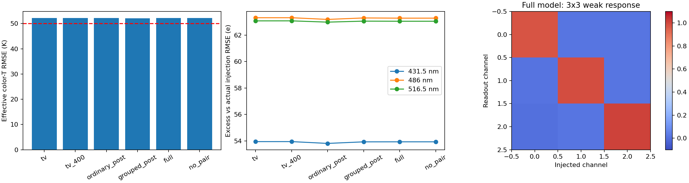
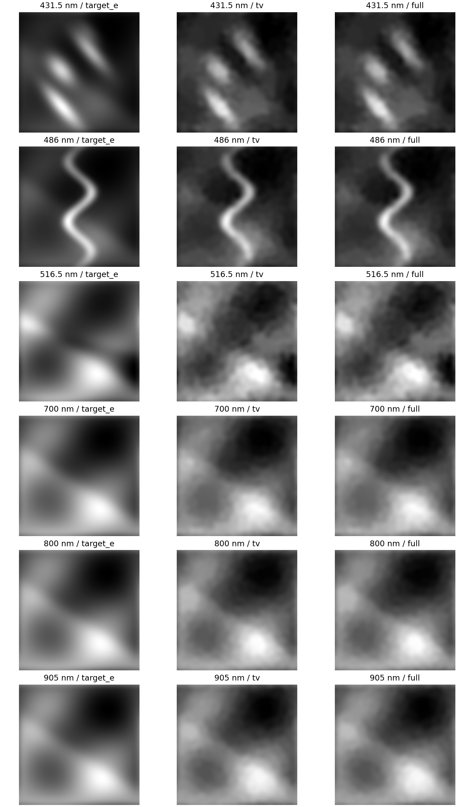

# TV-RRU 六通道开发对照

one independent mother per split, 96 acquired frames; three updates per method; software integration only, no performance selection for the larger study；四组神经方法各一个种子；TV强度统一为0.003，数值收敛锚点与固定400轮参考同时保留。

|方法|色温RMSE/K|CH波段总误差/e|AlO波段总误差/e|C2波段总误差/e|开发门槛|
|---|---:|---:|---:|---:|---|
|tv|52.159|53.941|63.324|63.086|reference|
|tv_400|52.160|53.942|63.324|63.088|reference|
|ordinary_post|52.200|53.806|63.196|62.990|False|
|grouped_post|52.115|53.924|63.307|63.066|False|
|full|52.148|53.926|63.292|63.058|False|
|no_pair|52.148|53.927|63.292|63.058|False|

发光总误差以实际注入为参照；相对无噪读出的算法误差另见各方法METRICS.json。单通道3×3响应矩阵按注入波段列、读出波段行记录。区间按独立母场景成组bootstrap，噪声副本和像素不增加物理样本数。

缓存后的推理时间不等于端到端时延；在线使用须计入TV初始化。当前为假设滤片与相机下的合成开发试验。
