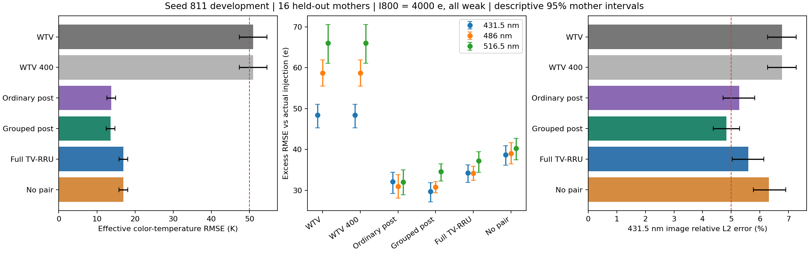
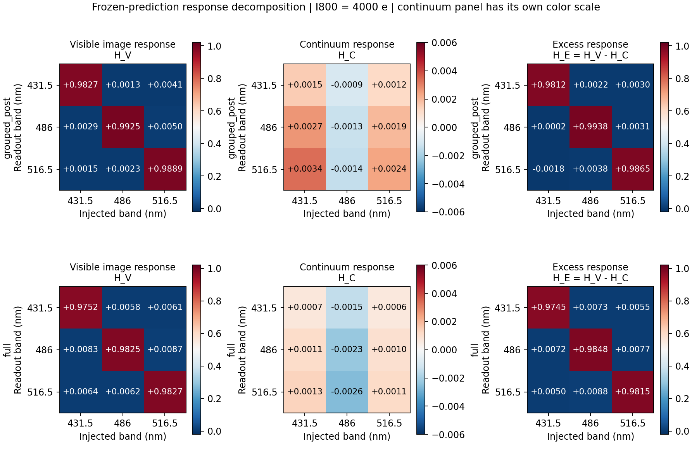

# TV-RRU 开发对照完成与复核

本批执行和交付已完成。**grouped_post（TV 起点＋分组先验后处理）是本批唯一通过全部原登记开发门槛的方法。完整 TV-RRU 明显优于 WTV，但在 431.5 nm 通道图的 5% 门槛上失败，也没有超过分组后处理。**

结果范围是一个种子 811、64/16/8/16 个新母场景的合成开发试验；假设滤片、QE、PSF、载频与噪声模型均按登记设置。它支持下一轮候选判断，尚未建立三种子稳定性、独立实测精度或硬件性能。

## 主条件与原门槛

主条件：800 nm 连续谱均值 4000 e、三路各 5% 弱注入；16 个新留出母场景，每个条件两次噪声重复，共 32 幅该条件 raw。每个方法完整评价 384 幅留出 raw。六路顺序为 431.5/486/516.5/700/800/905 nm。

|方法|有效色温 RMSE/K|431.5 nm 实际注入误差/e|486 nm/e|516.5 nm/e|原开发门槛|
|---|---:|---:|---:|---:|---|
|WTV|50.986|48.430|58.690|66.031|参考|
|WTV 400|50.987|48.432|58.690|66.032|参考|
|Ordinary post|13.723|32.106|30.959|32.038|未通过|
|Grouped post|13.593|29.754|30.784|34.565|通过|
|Full TV-RRU|16.898|34.252|34.159|37.197|未通过|
|No pair|16.939|38.734|39.034|40.310|未通过|

grouped_post 的三路实际注入 RMSE 分别比 WTV 降低 38.56%、47.55%、47.65%；色温 RMSE 降低 73.34%。

原门槛按点估计判断，沿用冻结值。ordinary_post 未过六图全部 5%、图像相对 WTV 不退化 5%、blank FPR≤2% 三项；full 和 no_pair 都只在六图全部 5% 项失败，其 431.5 nm 相对 L2 分别为 5.590% 和 6.316%。grouped_post 的 431.5 nm 点估计为 4.825%，其母场景区间应与点估计一起阅读。

这里的 5% 是六幅总滤光通道图的相对 L2 门槛。主条件每路弱注入的平均量设置为 200 e；grouped_post 的三路发光 RMSE 相当于该均值的约 14.88%/15.39%/17.28%。因此开发门槛通过不表示弱发光量已达到 5% 相对精度。

## 两种发光误差及母场景区间

下表为 RMSE 点估计 [逐项 95% 母场景区间]。actual 对实际 post-PSF 注入；clean 对无噪六图经过同一 Radiometry 得到的超额读出。区间来自 2000 次母场景重采样，整组携带重复、注入和方法配对，未进行多重比较校正。

|方法|温度/K|431.5 actual/e|486 actual/e|516.5 actual/e|431.5 clean/e|486 clean/e|516.5 clean/e|
|---|---|---|---|---|---|---|---|
|WTV|50.99 [47.28, 54.59]|48.43 [45.27, 51.10]|58.69 [55.49, 61.97]|66.03 [61.09, 70.54]|48.34 [45.18, 50.99]|58.64 [55.44, 61.99]|65.94 [61.01, 70.45]|
|WTV 400|50.99 [47.28, 54.59]|48.43 [45.27, 51.10]|58.69 [55.49, 61.97]|66.03 [61.09, 70.54]|48.34 [45.19, 50.99]|58.65 [55.44, 61.99]|65.94 [61.01, 70.45]|
|Ordinary post|13.72 [12.59, 14.92]|32.11 [29.27, 34.48]|30.96 [28.08, 33.89]|32.04 [28.91, 35.02]|31.86 [29.02, 34.23]|30.53 [27.63, 33.53]|31.87 [28.76, 34.81]|
|Grouped post|13.59 [12.39, 14.76]|29.75 [27.21, 31.91]|30.78 [29.41, 32.13]|34.57 [32.31, 36.50]|29.54 [27.03, 31.66]|30.47 [29.14, 31.79]|34.06 [31.81, 35.94]|
|Full TV-RRU|16.90 [15.74, 18.09]|34.25 [31.95, 36.26]|34.16 [32.46, 35.89]|37.20 [34.48, 39.50]|34.04 [31.73, 36.05]|34.03 [32.36, 35.75]|36.95 [34.27, 39.25]|
|No pair|16.94 [15.82, 18.09]|38.73 [36.20, 40.92]|39.03 [36.50, 41.72]|40.31 [37.48, 42.78]|38.49 [35.98, 40.66]|38.87 [36.35, 41.57]|40.02 [37.23, 42.49]|

每个光子水平、条件、六图、去均值细节、均值偏差、NIR 对数比例及响应矩阵的区间均在 [SUPPLEMENTAL_STATISTICS.json](closeout_audit_001/SUPPLEMENTAL_STATISTICS.json)。主条件与 TV 的配对 RMSE 比区间，以及不同神经方法之间的配对比区间，见该文件和 [PAIRED_METHOD_COMPARISONS.json](PAIRED_METHOD_COMPARISONS.json)。

## 六幅图、细节与均值

每格为六路的百分数，顺序见上。图误差为逐帧相对 L2 后取均值；细节误差为去均值误差相对去均值真值，分母另含登记的 1% 辐射范数地板；均值列为有符号相对偏差。

|方法|六路图相对 L2/%|六路去均值细节相对误差/%|六路均值偏差/%|
|---|---|---|---|
|WTV|6.772 / 4.381 / 3.490 / 1.811 / 1.256 / 1.203|14.583 / 11.120 / 9.533 / 6.001 / 4.569 / 4.737|0.160 / -0.054 / 0.015 / -0.029 / -0.020 / -0.008|
|WTV 400|6.772 / 4.381 / 3.490 / 1.811 / 1.256 / 1.203|14.584 / 11.120 / 9.533 / 6.002 / 4.569 / 4.737|0.160 / -0.054 / 0.015 / -0.029 / -0.020 / -0.009|
|Ordinary post|5.279 / 3.263 / 2.502 / 1.263 / 1.289 / 1.356|11.045 / 7.943 / 6.884 / 2.585 / 2.484 / 2.784|0.603 / 0.921 / 0.564 / 1.044 / 1.135 / 1.194|
|Grouped post|4.825 / 3.140 / 2.603 / 1.176 / 1.027 / 1.019|10.303 / 7.774 / 7.093 / 3.407 / 3.254 / 3.462|-0.514 / -0.622 / -0.465 / -0.595 / -0.510 / -0.515|
|Full TV-RRU|5.590 / 3.378 / 2.686 / 0.714 / 0.611 / 0.604|12.236 / 8.527 / 7.423 / 2.364 / 2.215 / 2.373|0.222 / -0.148 / -0.119 / 0.016 / -0.047 / 0.027|
|No pair|6.316 / 3.866 / 2.916 / 0.716 / 0.669 / 0.599|13.657 / 9.804 / 7.990 / 2.374 / 2.415 / 2.355|0.398 / 0.047 / 0.089 / -0.017 / -0.074 / -0.028|

full 的 NIR 单图误差低于 grouped_post，但两项 NIR 对数比 RMSE 为 0.00822/0.00829，grouped_post 为 0.00413/0.00335。这与后者色温更准确一致，说明当前差异需要从比例误差分析；本结果尚未确定差异具体来自近端强度、有限迭代还是训练后的 proposal。

## 完整单波段响应与误报

所有矩阵均为行=读出、列=注入，沿用实际 post-PSF 注入图作内积斜率分母；逐对计算，再按重复和母场景平均。

### 1000 e 光强

|方法|431.5 读出行|486 读出行|516.5 读出行|
|---|---|---|---|
|WTV|+0.9679 / -0.0045 / +0.0016|-0.0064 / +0.9698 / +0.0070|-0.0095 / -0.0060 / +0.9845|
|WTV 400|+0.9679 / -0.0045 / +0.0016|-0.0064 / +0.9698 / +0.0070|-0.0095 / -0.0060 / +0.9845|
|Ordinary post|+0.9850 / +0.0025 / -0.0025|-0.0089 / +0.9635 / +0.0018|-0.0092 / -0.0066 / +0.9693|
|Grouped post|+0.9742 / -0.0060 / +0.0010|-0.0023 / +0.9766 / +0.0058|-0.0054 / -0.0080 / +0.9839|
|Full TV-RRU|+0.9571 / +0.0089 / +0.0090|+0.0078 / +0.9459 / +0.0121|+0.0081 / +0.0032 / +0.9669|
|No pair|+0.9558 / +0.0057 / +0.0076|+0.0055 / +0.9566 / +0.0106|+0.0035 / +0.0006 / +0.9785|
### 4000 e 光强

|方法|431.5 读出行|486 读出行|516.5 读出行|
|---|---|---|---|
|WTV|+0.9688 / +0.0045 / +0.0045|-0.0003 / +0.9813 / +0.0039|-0.0013 / +0.0055 / +0.9776|
|WTV 400|+0.9688 / +0.0045 / +0.0045|-0.0003 / +0.9813 / +0.0039|-0.0013 / +0.0055 / +0.9776|
|Ordinary post|+0.9818 / -0.0004 / -0.0023|+0.0017 / +0.9912 / +0.0075|-0.0023 / +0.0008 / +0.9804|
|Grouped post|+0.9812 / +0.0022 / +0.0030|+0.0002 / +0.9938 / +0.0031|-0.0018 / +0.0038 / +0.9865|
|Full TV-RRU|+0.9745 / +0.0073 / +0.0055|+0.0072 / +0.9848 / +0.0077|+0.0050 / +0.0088 / +0.9815|
|No pair|+0.9765 / +0.0064 / +0.0046|+0.0060 / +0.9825 / +0.0058|+0.0041 / +0.0068 / +0.9815|

空白误报与非目标注入误报分开列出。后者为三个单波段注入条件中，两个未注入读出通道的最大像素检出率。各方法均使用独立 calibration 母场景预先冻结的阈值；未在留出集重调阈值。

|方法|1000 e blank 最大 FPR/%|4000 e blank 最大 FPR/%|1000 e 其他波段注入最大 FPR/%|4000 e 其他波段注入最大 FPR/%|
|---|---:|---:|---:|---:|
|WTV|1.202|1.177|1.136|1.287|
|WTV 400|1.202|1.176|1.135|1.286|
|Ordinary post|0.871|2.372|1.844|6.070|
|Grouped post|0.638|1.538|0.512|1.752|
|Full TV-RRU|0.653|1.534|0.624|1.706|
|No pair|0.680|1.496|0.696|1.640|

相应逐通道区间和相对 blank 的配对变化见 supplemental statistics；非目标注入误报保留为独立报告项，没有追认一个新的通过门槛。

full 中 486 nm 注入到 516.5 nm 读出的斜率为 +0.00882，可见图响应约 +0.00622，连续谱响应约 −0.00260，两者相减得到最终值。两条路径都存在；分组先验隔离没有移除测量与读出耦合。图中连续谱面板使用单独的颜色尺度，逐母场景区间均保留在 JSON 中。

配对损失在本批改善了实际注入误差：full 相对 no_pair 三路 RMSE 降低约 11.57%/12.49%/7.72%，但非对角响应并未全面降低。因此本批支持其幅值误差收益，尚不支持将串扰改善全部归因于该项。ordinary/grouped 比较还同时改变了坐标、输入特征和修正参数化，属于整套设计对照。

## 低光强与误差解释

|方法|1000 e all-weak 色温 RMSE/K|三路实际注入 RMSE/e|
|---|---:|---|
|WTV|99.069|23.936 / 28.832 / 32.269|
|WTV 400|99.069|23.936 / 28.832 / 32.269|
|Ordinary post|22.433|11.987 / 11.922 / 12.745|
|Grouped post|24.336|12.007 / 12.622 / 14.276|
|Full TV-RRU|31.166|13.736 / 14.624 / 15.826|
|No pair|31.107|16.088 / 16.511 / 17.159|

低光强下四种神经方法的上述点估计均较 WTV 改善；50 K/5% 等绝对指标按登记的主条件验收，不能把这一开发通过扩展到全部条件。`algorithm_mixing_cross_e2` 保留了实际注入 MSE、无噪读出 MSE和连续谱混合偏差之间的交叉项，未假设它们独立。三路无噪混合 RMSE 在主条件约为 2.65/3.26/3.28 e，算法误差仍占主要量级。

## 复核、时延和交付

原程序于 2026-10-18 03:58:58（UTC+8）以退出码 0 完成。原生复核于 04:12:44 完成：25 个源码文件、104 个缓存文件、原输出清单以及执行归档 SHA256 全部匹配；四组各 6000 步，日程均为 1500/1500/3000。验证权重先冻结，随后 calibration 阈值冻结，再进入新留出评价。ordinary_post 完整复用，旧 grouped_post 4182 步中断记录和全部数值测试失败均保留。

六种方法各重新打开并原生重放 384 幅预测，最大相对差为 0.0；报告指标与标定阈值本次均完全复现。该检查针对冻结权重推理，未重放优化器训练轨迹。完整复核用时 72.56 s，没有新训练或目标/阈值修改。

|方法|含 TV 初始化的单 raw→读出软件时延/s|TV 轮数|
|---|---:|---:|
|WTV|2.198|520|
|WTV 400|1.686|400|
|Ordinary post|2.414|520|
|Grouped post|2.177|520|
|Full TV-RRU|2.269|520|
|No pair|2.335|520|

计时是 RTX 5070 上登记母场景 81001、第 20 帧、batch=1 的单次软件测量，含电子转换、TV、网络和读出。一次计时不足以区分相近方法的速度差；它不包含真实设备采集、数据传输，也不表示相机采集帧率。缓存后额外推理计时另见原 METRICS；主运行峰值 PyTorch 分配显存约 3708 MiB。

- [原结果与图](server_results/RESULTS_zh.md)、[原门槛和全条件摘要](server_results/SUMMARY.json)、[原母场景 bootstrap](server_results/MOTHER_BOOTSTRAP.json)。
- [原生复核收据](closeout_audit_001/AUDIT_COMPLETION.json)、[源码/缓存/训练日程复核](closeout_audit_001/PROVENANCE_AUDIT.json)、[本地交付哈希](closeout_audit_001/LOCAL_DELIVERY_VERIFIED.json)。
- [附加统计](closeout_audit_001/SUPPLEMENTAL_STATISTICS.json)、[配对方法比较](PAIRED_METHOD_COMPARISONS.json)、[审计源码](closeout_audit_001/audit.py)。
- 成功权重、末次权重及可恢复的 latest 状态位于 `server_results/`；实际执行源码保存在原 `source_snapshot/`。重放时将 audit.py 放到服务器执行根目录的 `reports/joint_imaging_v2_closeout_audit_001/` 中运行；不覆盖已有审计输出。

本地仅下载源码、报告、PNG、日志与权重。10,715,430,944 字节 TV/raw 缓存和六份大预测数组保留在服务器；逐文件 SHA256 见交付清单。stderr 的 Matplotlib Axes3D 导入警告原样保留，所需二维 PNG 已生成并检查。

## 下一步判断

当前将 grouped_post 保留为最有支持的开发候选，同时保留 full 的改善和失败。先在固定验证小集分析 proposal 到物理更新后的幅度与比例变化，核对加倍 ADMM/PCG 后输出是否稳定，再决定是否调整近端；该诊断尚未执行。若要声称分组后处理收益稳定，再预登记另外两个种子，并报告全部种子。当前 16 个留出母体已公开，后续模型改动后的科学结论须用新的未见母体。256/32/32/64 扩展、三种子正式验收和真实标定试验均需另登记；本次不自动开始扩展训练。

