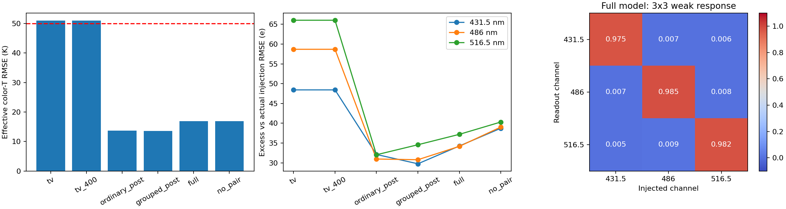
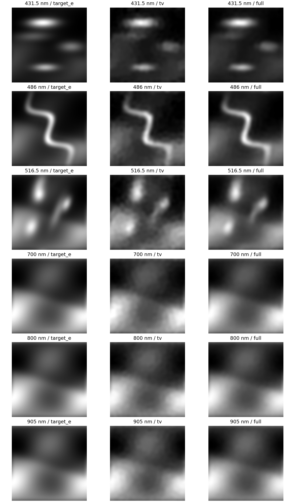

# TV-RRU 六通道开发对照

64/16/8/16 new mothers, one seed; implementation and controlled development before the proposed 256/32/32/64 formal study；四组神经方法各一个种子；TV强度统一为0.003，数值收敛锚点与固定400轮参考同时保留。

|方法|色温RMSE/K|CH波段总误差/e|AlO波段总误差/e|C2波段总误差/e|开发门槛|
|---|---:|---:|---:|---:|---|
|tv|50.986|48.430|58.690|66.031|reference|
|tv_400|50.987|48.432|58.690|66.032|reference|
|ordinary_post|13.723|32.106|30.959|32.038|False|
|grouped_post|13.593|29.754|30.784|34.565|True|
|full|16.898|34.252|34.159|37.197|False|
|no_pair|16.939|38.734|39.034|40.310|False|

发光总误差以实际注入为参照；相对无噪读出的算法误差另见各方法METRICS.json。单通道3×3响应矩阵按注入波段列、读出波段行记录。区间按独立母场景成组bootstrap，噪声副本和像素不增加物理样本数。

缓存后的推理时间不等于端到端时延；在线使用须计入TV初始化。当前为假设滤片与相机下的合成开发试验。
