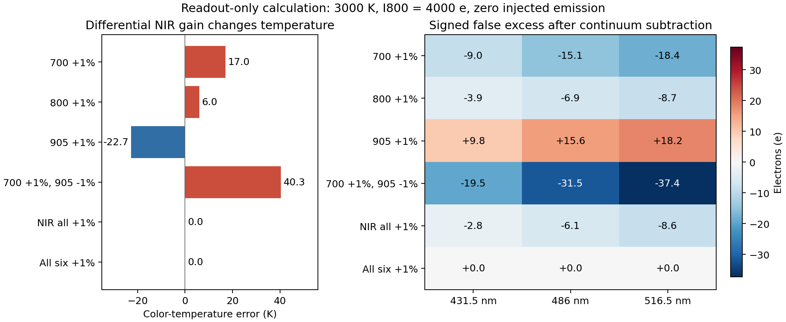

# TV-RRU 空闲期调研与下一轮判断计划

日期：2026-10-18（Asia/Singapore）。代码审阅基点：`bb46a40d2c96bc19449e4db26a9f8b9b70529ef9`，分支 `research/hybrid-residual-001`。本次核对八项一手来源，并完成一组短时 CPU 辐射读出计算。训练、模型选择、检测阈值和验收目标沿用已冻结登记。

**下一步优先解释本轮四组对照：修正是否被 TV 近端削弱、跨波段响应从哪里传入、读出对标定偏差有多敏感。** 只有明确的失败机制或稳定收益，才支持下一轮训练投入。

## 1. 文献给出的定位

| 一手来源与核对范围 | 已有机制 | 对当前项目的具体决定 |
|---|---|---|
| [MoDL，作者摘要，v4](https://arxiv.org/abs/1712.02862v4) | 共享神经先验与数值 CG 数据一致性层结合 | 将共享展开视为已有范式；本项目需证明保留 TV、辐射分组和配对约束带来的实际收益 |
| [NAFNet，作者摘要，v4](https://arxiv.org/abs/2204.04676v4) | 用简化恢复结构和乘法等运算替代常规激活函数 | 保留现有轻量骨干；“activation free”仍含非线性，图像恢复 PSNR 不能代替测温与弱发光评价 |
| [DAUHST，方法 §2.2](https://arxiv.org/html/2205.10102v3) | 从测量和编码掩膜估计展开参数；数据步利用 CASSI 中 ΦΦᵀ 的对角结构 | 后续可研究退化条件化；当前六载频、空间变噪声权重和公共 DC 的算子继续用原求解器 |
| [LRDUN，v2 低秩成像与交替更新公式](https://arxiv.org/html/2511.18513v2) | 将高光谱图分成低维谱基与空间系数 | 三路独立可见注入不支持强制全六路低秩；NIR 的亮度—比例变换仍保留三个自由度 |
| [Passive FRAME，2024，全文](https://pmc.ncbi.nlm.nih.gov/articles/PMC11245627/) | 逐谱段空间载频编码、傅里叶解码、黑体/平场标定和温度成像 | 单相机空间编码测温已有先例；空间带宽、动态范围和相对辐射标定应进入比较 |
| [铝燃烧 FRAME 测温，2026，作者机构摘要](https://portal.research.lu.se/en/publications/multispectral-coded-light-for-high-speed-temperature-imaging-of-a/) | 被动 FRAME 配合单台高速单色相机；摘要报告 50 kHz 采集及 2000–4000 K 温度图 | 这是直接的测温先例。该摘要不足以支持逐项精度比较，采集频率也不等于重建吞吐率 |
| [SGDE，CVPR 2026，官方摘要与论文引言](https://openaccess.thecvf.com/content/CVPR2026/html/He_SGDE_Self-supervised_Geometry_Degradation_Estimation_Framework_for_Coded_Aperture_Compressive_CVPR_2026_paper.html) | 显式仿射掩膜失配与自监督联合估计 | 先测本系统对增益、载频相位和 PSF 误差的敏感性，再判断是否需要估计退化；不能据此假定六载频盲标定可辨识 |
| [Parikh–Boyd，2014，§2.3](https://stanford.edu/~boyd/papers/pdf/prox_algs.pdf) | 凸近端的固定点与牢固非扩张性质 | 用来设计近端修正保留量的诊断；有限 ADMM 及完整神经网络须另行核验 |

完整题名、版本、已读范围和访问限制见 [SOURCES.json](SOURCES.json)。本次没有将其他论文的恢复分数换算为本系统温度收益。

可检验的贡献假设是：**在共同光学带宽、同一 raw 和同一 WTV 基准下，按任务分组的神经修正与保留 TV 的近端，能同时改善三路弱发光的幅值响应、热通道比例和跨波段误报。** 本轮数据将决定这个假设能保留多少；组合本身尚不足以建立新颖性。

## 2. 优先诊断一：把超额发光串扰拆成两条路径

沿用当前读出 `E_k = V_k − C_k(N)`：`V` 是重建可见图，`N` 是三幅 NIR 图，`C` 是同一 Radiometry 拟合后外推的连续谱。对同一母场景的 blank 与仅注入第 j 路的样本，恒有：

\[
\Delta E_{kj}=\Delta V_{kj}-\Delta C_{kj},\qquad
H^Q_{kj}=\frac{\langle\Delta Q_{kj},S_j\rangle}{\|S_j\|^2},\quad
H^E=H^V-H^C.
\]

`S_j` 为实际 post-PSF 注入图；行表示读出通道，列表示注入通道。对每对样本先算斜率，再按原评价方式平均。三张 3×3 矩阵的分母、母场景、噪声重复和单位完全一致。这个分解对非线性 Radiometry 仍是代数恒等式。

| 冻结权重后观察到的现象 | 可支持的解释 | 后续动作 |
|---|---|---|
| `H^V` 的非对角项较大 | 可见重建图中已出现跨波段响应 | 比较普通/分组先验，以及物理更新前后的变化 |
| `H^V` 较小而 `H^C` 较大 | 热通道变化经连续谱扣除传到可见读出 | 检查 NIR 比例偏差、公共 DC 耦合与两档光子水平 |
| `H^E` 较小，但 `H^V` 与 `H^C` 都大且相抵 | 好看的最终响应依赖两种误差抵消 | 同时展示三张矩阵，检查逐母场景稳定性 |
| full 优于 no_pair，且目标斜率、非目标响应和误报共同改善 | 配对约束在该开发分布中有支持证据 | 先复核逐母场景结果，再补种子 |

现有 `*_METRICS.json` 已给出最终 `H^E` 所需列。新增的 `H^V/H^C` 可从服务器上的冻结 `*_heldout_predictions.npz`、缓存 metadata 与 `emission_e` 重算。先用母场景、光子水平、condition、repeat 对齐索引，再计算；无须新训练。

同时补出读出误差的交叉项。令 `a=R_E(Xhat)−R_E(Xtruth)`，`b=R_E(Xtruth)−E_injected`，则

\[
\mathrm{MSE}_{actual}=\mathrm{MSE}_{clean}+\mathrm{MSE}_{mixing}+2\operatorname{mean}(ab).
\]

这里是未中心化的乘积均值，并非自动等于协方差。已有三种 MSE 可以直接求出它。若实际注入误差变小却无噪读出误差变大，应检查是否只是抵消了连续谱模型偏差，不能将二者按独立误差平方和相减。

## 3. 优先诊断二：TV 近端保留了多少神经修正

对固定的一帧、固定 `W/λ/M`，记精确近端为 `P(z)=argmin_x J0(x)+½‖x−z‖²_M`。若 `J0` 为含线性支持约束的闭凸目标、`M` 正定且 `x0` 是其最小点，则 `P(x0)=x0`。由凸次梯度单调性，令 `r=P(x0+δ)−x0`，得到

\[
\|r\|_M^2\le\langle r,\delta\rangle_M,\qquad
\|r\|_M\le\|\delta\|_M.
\]

这是对标准近端性质的加权坐标推导。因此近端可削弱修正，不能把 proposal 大小直接当成最终可恢复幅度。局部光滑近似下，响应约为 `(H_J0+M)^{-1}Mδ`；非光滑 TV 不能无条件套用普通 Hessian。

实际实现每阶段 12 轮 ADMM × 8 次 PCG，并继承 d/u。需按阶段记录：支持投影后的 `δ`、更新后 `x−x0`、M 范数保留率、二者内积及夹角、各通道修正 e-RMS、tanh 饱和比例、原始残差和 ADMM stationarity。**M 范数的整体约束不等于逐通道欧氏幅度约束，也不证明整套网络对 raw 稳定。** 跨 raw 的 W 和基准会变化。

若 full 落后于 grouped_post，先在固定验证小集、固定训练权重下对比原预算与 24×16 预算：

- 输出变化大：先处理有限求解预算或训练/推理不一致；保留原结果。
- 输出稳定但有效修正很小，且 proposal 对真值的校正方向有用：近端强度或残差幅度是后续候选原因。
- proposal 自身方向错误：增加物理迭代不能修复先验；回到损失和失败场景分布。

proposal 对真值的关系只用于离线诊断。部署不访问真值，不以 `J0(x_new)≤J0(x0)` 拒绝非零修正。任何 μ 或迭代策略改变都需另登记；加倍迭代只用于求解敏感性检查，不能直接作为重新挑选的最佳留出结果。

## 4. 已完成的小计算：比例正确仍不足以保护发光

本次直接调用未修改的 `research_joint_imaging/core.py::Radiometry`，用 CPU float64 在 2400/3000/3600 K、800 nm 为 1000/4000 e 的六个均匀灰体点计算。参数读取 recovery_002 的冻结 protocol，采用六个 10 nm 顶帽波段、九节点积分、固定十步拟合。冻结协议与主目录协议的差异在恢复登记、路径和资源预算，科学参数一致。输入无噪且无实际发光；扰动加在进入读出的六幅强度上，尚未经过重新编码和重建。

在 3000 K、800 nm 为 4000 e 时，有限 1% 增益扰动得到：

| 强度误差情形 | 色温偏差 K | 431.5 nm 假超额 e | 486 nm 假超额 e | 516.5 nm 假超额 e |
|---|---:|---:|---:|---:|
| 700 nm +1% | +16.98 | −9.03 | −15.12 | −18.36 |
| 905 nm +1% | −22.69 | +9.81 | +15.59 | +18.18 |
| 700 nm +1%、905 nm −1% | +40.35 | −19.54 | −31.54 | −37.35 |
| 仅 NIR 三路共同 +1% | 0.00 | −2.82 | −6.09 | −8.55 |
| 六路共同 +1% | 0.00 | 约 0 | 约 0 | 约 0 |

这说明 NIR 的共同增益即使不改变色温，也会改变连续谱扣除。700/905 反向偏差的有限扰动结果为 40.35 K；原设计的 39.80 K 是一阶导数估计，二者对应不同计算。以本条件 200 e 的弱注入均值作量级参照，37.35 e 已占约 18.7%；这不是网络误差或真实标定容差。

两档光强下该均匀场温度偏差相同，电子误差按光强缩放。六路共同增益的近零超额只适用于这里的无发光基准；存在真实发光时，其电子幅值也会随共同增益变化。

分析 Jacobian 与原生 `fit` 的两个中心差分步长（log 强度 1e−4、1e−5）一致，最大逐行相对误差 `2.38e−8`；读出分解残差为 0。结果、源码指纹和所有情形见 [CALIBRATION_SENSITIVITY.json](CALIBRATION_SENSITIVITY.json)。它验证读出公式与诊断接口，不评价任何训练权重。

## 5. 当前对照能回答什么

| 比较 | 可回答的问题 | 解释边界 |
|---|---|---|
| ordinary_post 对 WTV | 容量相近的全六路输入先验能否修正 TV | 先报告六图、细节和均值，再看读出 |
| grouped_post 对 ordinary_post | 整套任务分组设计是否有收益 | 当前两者还同时改变了坐标、输入特征和修正参数化，不能把差值全部归因于通道隔离 |
| full 对 grouped_post | 加入保留 TV 的物理融合后的整体收益与代价 | 各自独立训练，观察到的是完整训练方案差异 |
| full 对 no_pair | 配对损失在本方案中的贡献 | 同时检查对角幅值、非对角响应及其他波段注入误报 |
| WTV 对 fixed400 | 参考求解收敛程度的影响 | λ=0.003、raw、W、尺度一致；报告实际执行配置，不能套用继承配置中未执行的旧参数选择文字 |

源码核对还发现两个交付时应补清的统计范围：当前 `mother_bootstrap` 只覆盖 **4000/all_weak** 的温度及两类三路发光误差；其他条件的点估计已有，但还没有相应区间。`detected_fraction` 在各条件均有记录，而既有门槛明确检查的是 blank FPR；“其他波段注入时的非目标误报”应独立汇总，沿用冻结阈值。

因此在原结果旁追加只读统计：每个光子水平的三张响应矩阵及其母场景区间、六路图/细节/均值的区间，以及非目标注入 FPR 和相对 blank 的变化。仍以母场景为重采样单位，整组携带重复、注入条件和方法配对；矩阵先对每个母场景的重复取均值。多个终点的逐项 95% 区间属于描述性不确定性，不能冒充经过多重比较控制的联合通过率。既有验收门槛保持原样。

## 6. 按证据推进的执行顺序

**P0：完成当前批次的原登记交付。** 核对四组各 6000 步、1500/1500/3000 日程、最佳验证权重、阈值冻结顺序、新留出及所有失败。重新打开预测数组，原生重放后复算原指标。三路发光同时报告 clean-readout 与 actual-injection 误差；报告 3×3 响应、两类误报、色温、六图、细节、均值和母场景 bootstrap。端到端时延含 raw→TV→三阶段→Radiometry，并保留单帧计时范围，不能把缓存后速度称为在线速度。

**P1：在不训练的条件下定位。** 从冻结结果补齐第 2 节分解及第 5 节统计。若需要求解器诊断，预先固定验证母体 61001、61002，各取两档光强、blank/三个单波段弱注入、repeat=0，共 16 帧；复用原缓存，检查原预算和加倍预算。仅在服务器新目录运行，单次最多 30 分钟、最多 2 GiB 新诊断输出，沿用 9500 MiB 显存上限；超过预算记录未完成。当前训练完成后再登记并执行，不与它争用 GPU。

**P2：有针对性地选择一个分支。**

| 证据 | 下一项工作 | 停止或保留规则 |
|---|---|---|
| 原开发门槛通过，逐母场景收益与响应改善方向一致 | 冻结当前单种子结果，预登记另外两个种子验证稳定性 | 三个种子全部报告；相同 16 个母体并不因种子增加而变成 48 个独立场景 |
| grouped_post 有收益，full 没有增益 | 先完成 P1 的 proposal/近端保留分析 | 若只是成本更高、收益不明确，保留 grouped_post 作为候选，不先扩大网络 |
| 温度改善但弱发光下降，或反之 | 按 `H^V/H^C` 和误差交叉项确定主要路径 | 一次仅登记一个与证据对应的改变，保留其余目标和强基线 |
| 各神经方法均未超过 WTV | 保留 WTV 作为当前参考，做一次有界失败机制检查 | 没有可检验原因前，不扩到 256 个训练母体或换大型骨干 |
| 算法在名义模型下有稳定收益 | 预登记增益、载频相位、PSF/滤光响应失配的冻结权重测试 | 每类失配只改变一个物理因素；使用同一失配 raw 比较各方法 |

P2 的标定测试优先区分 NIR 内部差分增益、可见—NIR 共同尺度差和全部六路共同尺度。先用 ±0.5%、±1%、±2% 作为**设计扰动**；实测滤光透过率、QE、载频/PSF 数据取得后再替换为测量支持的范围。几何失配应重新编码 raw，读出层增益计算不能代替这一测试。名义重建与“已知真实扰动算子”的控制分开报告，可区分模型失配和求解能力。

256/32/32/64 扩展及正式三种子验收另登记。当前 16 个留出母体公开后只能用于历史诊断，下一轮模型开发后的结论需要新的未见母体。实际滤光片、相机 QE、光子预算、非灰发射率与视线混合的验证次序由测量条件决定，暂不安排新硬件采购。

## 7. 本次交付与复算

- `SOURCES.json`：八项一手文献及已核对范围。
- `calibration_sensitivity.py`：调用现有 Radiometry 的短时 CPU 计算。
- `CALIBRATION_SENSITIVITY.json`：六个温度/强度点、完整 Jacobian、六种增益情形和校验误差。
- `plot_sensitivity.py`、`calibration_sensitivity.png`：读取 JSON 生成的科研图。
- `VERIFICATION.json`：复核与文件 SHA256 收据。

从仓库根目录使用含 Torch 的 Python 执行 `python -B reports/joint_imaging_v2_research_20261018/calibration_sensitivity.py`，再使用含 NumPy/Matplotlib 的 Python 执行同目录的 `plot_sensitivity.py`。脚本先导入仓库 runtime，将临时文件和绘图缓存放在 E 盘 checkout；本次绘图库单独放入 `_runtime/research_plot_lib`，未修改训练环境。正式服务器作业、成功权重和 TV 缓存均未因本次调研改变。
