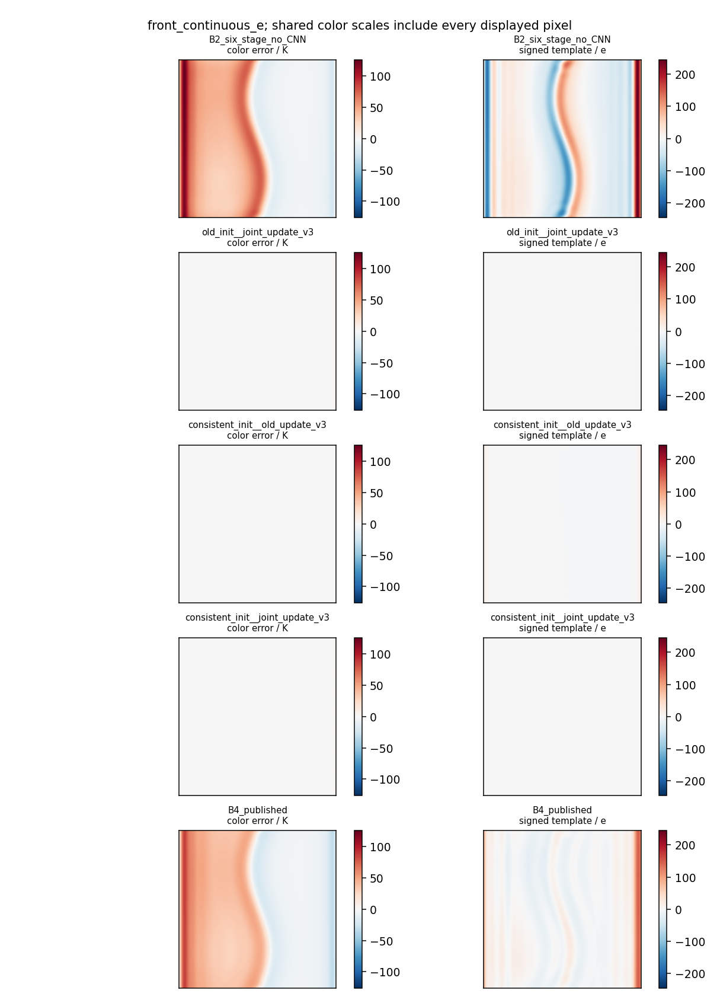
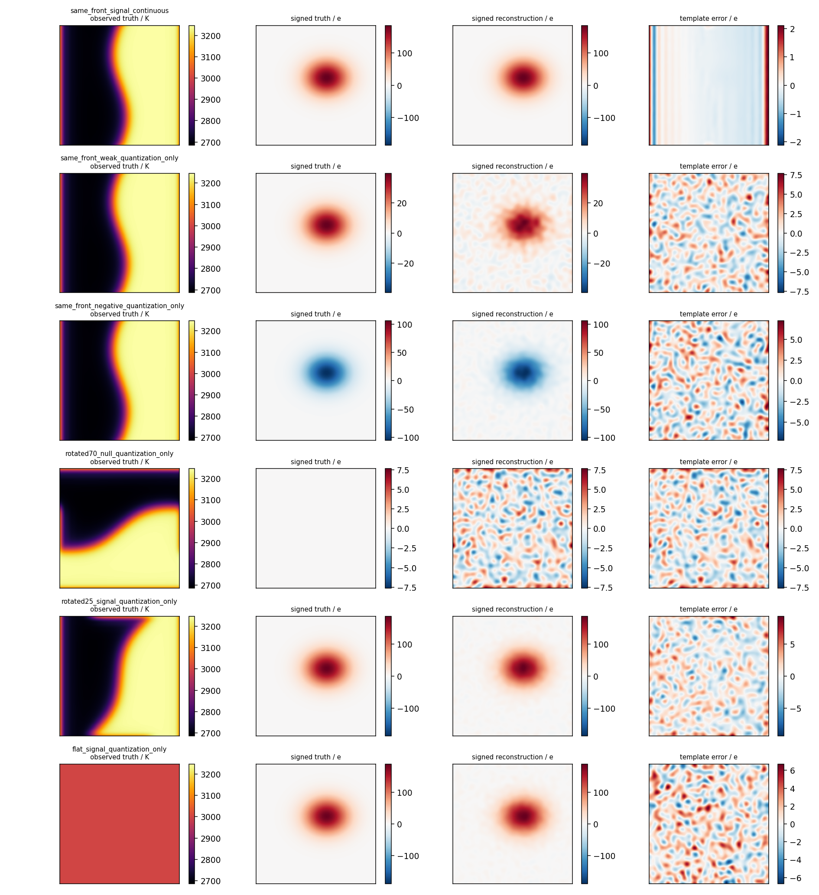

# 单帧七通道光谱测温：物理求解修复 v3

<!-- V3_OUTCOME_BEGIN -->
本轮在本机 RTX 4060 完成，未训练。16/16 物理开发门禁通过：原空白连续前沿的色温/模板 RMSE 为 **0.302 K / 0.465 e**，仅量化为 **1.106 K / 1.896 e**，两者历史 >60 e 误报均为零。正模板、弱模板、负模板、不同前沿方向和平坦场一起回归。

四组合显示**初始化和更新包各自能修复前沿问题，联合更新包对最终模板误差的改善更大**。两者组合通过全部门禁；单帧消融没有证明 warm start 对最终结果必不可少，量化前沿上仅改更新还略好且更快。带噪声 smoke 的结论单独报告，不能据无噪声门禁声称取代 CNN。
<!-- V3_OUTCOME_END -->

基于 `5f2ae6307a644dbfbbab426b9c239397981d24b7`。保留原 physics.forward/object_blur、旧 solver、网络和权重；新增 repair_v3，不训练。

正式物理测试通过 14 项，旧结果复用隔离测试另通过 1 项，共 15 项。开发门禁 16/16 通过，全部通过=True。详细门禁及输入哈希见 `gate_receipt.json`。

## 初始化与联合更新

初始化只从 raw 解调获取 700/905 波段及旧初值，约束优化 latent T/loga，使 H[a C700(T)]、H[a C905(T)] 接近解调波段。前向的 object_blur 没有删除，没有直接除以 OTF，也没有访问真值。暖启动不作为第二份测量进入最终目标。

联合步同时使用原 JVP/VJP 更新归一化 T、loga、活跃有符号模板和 beta。固定的 raw 观测导出方差权重使每步比较同一个目标；它是工程加权最小二乘，不声称严格 Poisson 似然。空间邻域二次正则进入总目标和梯度/Hessian；LM 对角阻尼只进入求步系统。接受要求实际下降为正、投影后预期下降为正且比值 >=0.05，并执行步长搜索、拒绝增大阻尼。PCG 使用相对真实残差停止，上限与未收敛标记保留。

旧步的首次光谱/温度子块分别重算并记录增量、CG 残差、接受步长与触边比例；旧完整终点直接按哈希复用。联合步是原子的，首次“光谱分量预览”只用于评分展示，随后加入温度分量为真正接受的完整联合步；预览从不反馈求解或影响接受。truth 只进入评分。

## 同一冻结前沿的四组合消融

四组合的共同比较基准是纯物理 12 次更新。旧 B2 六阶段共 12 个旧 data-step，直接复用；B4 另作保留 CNN 的旧发布参照，不能把 B2 当 B4。三个新组合也最多 12 次更新，空间一致初始化另有最多 30 次 warm start，耗时应一起计入。

|输入|方法|色温 RMSE K|模板 RMSE e|历史 >60e 空白误报|旧结果复用|
|---|---|---:|---:|---:|---|
|front_continuous_e|B2_six_stage_no_CNN|41.5811|63.2828|0.0997|True|
|front_continuous_e|B4_published|33.5834|29.7995|0.0581|True|
|front_continuous_e|old_init__joint_update_v3|0.3105|0.4990|0.0000|False|
|front_continuous_e|consistent_init__old_update_v3|0.1069|3.0626|0.0000|False|
|front_continuous_e|consistent_init__joint_update_v3|0.3016|0.4647|0.0000|False|
|front_quantization_only|B2_six_stage_no_CNN|41.9405|62.3489|0.0990|True|
|front_quantization_only|B4_published|33.6506|29.6861|0.0573|True|
|front_quantization_only|old_init__joint_update_v3|1.0365|1.8697|0.0000|False|
|front_quantization_only|consistent_init__old_update_v3|1.4153|3.7780|0.0000|False|
|front_quantization_only|consistent_init__joint_update_v3|1.1062|1.8959|0.0000|False|
|front_old_noisy_quantized|B2_six_stage_no_CNN|43.0780|70.2336|0.1208|True|
|front_old_noisy_quantized|B4_published|34.4273|34.6643|0.0617|True|
|front_old_noisy_quantized|old_init__joint_update_v3|14.4482|42.5930|0.0800|False|
|front_old_noisy_quantized|consistent_init__old_update_v3|21.0528|51.4651|0.1108|False|
|front_old_noisy_quantized|consistent_init__joint_update_v3|15.5646|43.9538|0.0889|False|

## 回归门禁与范围

16 个门禁帧：原冻结前沿空白的连续/仅量化两帧；同前沿 +210/+45/−120 e、70°空白前沿、25°非零前沿、3000 K 平坦空白/非零模板各两种输入。非零模板同时要求 L2<=0.25，零估计 L2=1，不能靠全零通过。负模板必须恢复符号。原有带噪声前沿另作诊断，不要求达到无噪声门禁。所有数字是开发目标；这些场景已被用于开发，并非最终锁定测试。

## 原 48 帧 smoke 与标定分层

新方法在原 48 帧上执行 48 次，另 8 个同输入已知真实标定 oracle；24 个独立 validation-null 仅用于新方法检测阈值。旧 smoke 的 384 个结果按实际输入、冻结容器及预测文件哈希复用，不重跑原 954 项。

新方法阈值仅在旧独立验证母场景拟合，历史 >60 e 仍保留。已知标定行主动给定 A_true，不代表从单帧识别增益。名义组排除增益和非灰体，避免互相掩盖；reference/observed 色温误差分别保存。

|类别|强度|方法|pooled 模板 L2|observed 色温 RMSE K|reference 色温 RMSE 均值 K|
|---|---|---|---:|---:|---:|
|nominal|signal_nominal|consistent_init__joint_update_v3|0.7754|18.7598|18.6998|
|nominal|signal_nominal|B4_published|0.4739|20.5536|17.8286|
|nominal|signal_nominal|B2_six_stage_no_CNN|0.8022|23.8862|20.4741|
|nominal|signal_nominal|B1_tikhonov|0.6320|16.6752|16.4011|
|nominal|signal_weak|consistent_init__joint_update_v3|3.5841|18.2847|18.2630|
|nominal|signal_weak|B4_published|1.7159|19.9681|17.3412|
|nominal|signal_weak|B2_six_stage_no_CNN|3.7230|24.0677|20.5756|
|nominal|signal_weak|B1_tikhonov|2.9342|16.6508|16.3812|
|nominal|null_clean|consistent_init__joint_update_v3|N/A|18.3465|18.3232|
|nominal|null_clean|B4_published|N/A|19.8167|17.2314|
|nominal|null_clean|B2_six_stage_no_CNN|N/A|24.0197|20.5383|
|nominal|null_clean|B1_tikhonov|N/A|16.6373|16.3698|
|nominal|null_structured_background|consistent_init__joint_update_v3|N/A|19.9654|19.9070|
|nominal|null_structured_background|B4_published|N/A|19.6449|17.1969|
|nominal|null_structured_background|B2_six_stage_no_CNN|N/A|24.0108|20.5315|
|nominal|null_structured_background|B1_tikhonov|N/A|16.6966|16.4224|
|unknown_channel_gain_3pct|signal_nominal|consistent_init__joint_update_v3|0.7784|90.5821|90.5742|
|unknown_channel_gain_3pct|signal_nominal|B4_published|0.4845|111.7445|111.7416|
|unknown_channel_gain_3pct|signal_nominal|B2_six_stage_no_CNN|1.0814|106.6632|106.6610|
|unknown_channel_gain_3pct|signal_nominal|B1_tikhonov|0.7106|108.4472|108.4462|
|known_calibration_oracle|signal_nominal|consistent_init__joint_update_v3|0.7292|20.4091|20.1312|
|unknown_channel_gain_3pct|signal_weak|consistent_init__joint_update_v3|3.6289|90.4180|90.4112|
|unknown_channel_gain_3pct|signal_weak|B4_published|1.7232|112.1268|112.1255|
|unknown_channel_gain_3pct|signal_weak|B2_six_stage_no_CNN|5.0376|106.6569|106.6545|
|unknown_channel_gain_3pct|signal_weak|B1_tikhonov|3.3460|108.4466|108.4456|
|known_calibration_oracle|signal_weak|consistent_init__joint_update_v3|3.2509|18.3990|18.3344|
|unknown_channel_gain_3pct|null_clean|consistent_init__joint_update_v3|N/A|90.7314|90.7200|
|unknown_channel_gain_3pct|null_clean|B4_published|N/A|112.4817|112.4809|
|unknown_channel_gain_3pct|null_clean|B2_six_stage_no_CNN|N/A|106.6335|106.6314|
|unknown_channel_gain_3pct|null_clean|B1_tikhonov|N/A|108.4307|108.4297|
|known_calibration_oracle|null_clean|consistent_init__joint_update_v3|N/A|18.1507|18.0998|
|unknown_channel_gain_3pct|null_structured_background|consistent_init__joint_update_v3|N/A|90.6835|90.6758|
|unknown_channel_gain_3pct|null_structured_background|B4_published|N/A|113.0254|113.0254|
|unknown_channel_gain_3pct|null_structured_background|B2_six_stage_no_CNN|N/A|106.5835|106.5819|
|unknown_channel_gain_3pct|null_structured_background|B1_tikhonov|N/A|108.3835|108.3827|
|known_calibration_oracle|null_structured_background|consistent_init__joint_update_v3|N/A|19.9094|19.7587|
|non_gray_continuum|signal_nominal|consistent_init__joint_update_v3|0.7663|22.2102|53.8686|
|non_gray_continuum|signal_nominal|B4_published|0.6208|11.8431|63.7206|
|non_gray_continuum|signal_nominal|B2_six_stage_no_CNN|1.1399|12.9757|58.5788|
|non_gray_continuum|signal_nominal|B1_tikhonov|0.5500|14.2846|60.3653|
|non_gray_continuum|signal_weak|consistent_init__joint_update_v3|3.5747|22.1947|53.9187|
|non_gray_continuum|signal_weak|B4_published|2.2805|11.1480|63.7758|
|non_gray_continuum|signal_weak|B2_six_stage_no_CNN|5.3117|12.9530|58.5861|
|non_gray_continuum|signal_weak|B1_tikhonov|2.5520|14.3030|60.3479|
|non_gray_continuum|null_clean|consistent_init__joint_update_v3|N/A|22.1001|53.9105|
|non_gray_continuum|null_clean|B4_published|N/A|11.0951|64.0093|
|non_gray_continuum|null_clean|B2_six_stage_no_CNN|N/A|12.9666|58.6078|
|non_gray_continuum|null_clean|B1_tikhonov|N/A|14.3015|60.3580|
|non_gray_continuum|null_structured_background|consistent_init__joint_update_v3|N/A|23.2539|54.3650|
|non_gray_continuum|null_structured_background|B4_published|N/A|11.4441|64.3537|
|non_gray_continuum|null_structured_background|B2_six_stage_no_CNN|N/A|13.0016|58.6234|
|non_gray_continuum|null_structured_background|B1_tikhonov|N/A|14.3470|60.3855|

## 收敛证据与限制

外层联合步的 PCG 相对残差门限达到比例为 0.0274；固定迭代上限或不再接受步均不证明全局最优/KKT。CG 历史、每次尝试的阻尼、alpha、实际/预期下降，以及 T/loga/S/beta 增量和触边比例保存在 per_case.jsonl。

295 个原已跟踪文件的 SHA256 全部未变，checkpoint SHA256 `d777888c53b086118128a824da007e1cba471f185ad9f8a973eb68c5edb434f1`。失败记录和开发单帧试跑均保留。本轮没有 CNN 迁移或训练；门禁通过也不代表消除了低光噪声、未知标定或非灰体不可辨性。

复现：先在 E/D checkout 中设置 PYTHONDONTWRITEBYTECODE=1，使用本机 GPU PyTorch 解释器执行 `python -B repair_next.py --phase gates --resume`；只有 gate_receipt 全部通过，才执行 `--phase smoke --resume`。使用带 matplotlib 的报告解释器执行 `python -B repair_next.py --phase summarize --device cpu`。初次 prepare 先运行 `python -B -m pytest tests/test_repair_v3.py --junitxml=reports/repair_v3/run_001/tests.xml`，再执行 `--phase prepare`；已有 registration 时不可再次 prepare。冻结数组在被忽略的 outputs/repair_v3/run_001，旧冻结目录也必须存在；跨机器需要复制并核验，不能重新抽样冒充同输入。

<!-- OFFLINE_V3_SUPPLEMENT -->

## 四类 smoke 总览

下表在各类别的全部强度/空白输入上合并像素，逐强度结果保留在上面的分层表和 stratified_summary.json。已知标定类别没有原注册队列中的匹配 B4 结果，因此不补造旧已知标定基线。

|类别|方法|帧数|pooled 色温 RMSE K|pooled 模板 RMSE e|历史 >60e 空白像素误报率|新/旧各自验证阈值的空白帧误报率|
|---|---|---:|---:|---:|---:|---:|
|nominal|consistent_init__joint_update_v3|32|18.851|36.396|0.0587|0.0000|
|nominal|B4_published|32|19.999|18.913|0.0194|0.0000|
|known_calibration_oracle|consistent_init__joint_update_v3|8|19.241|35.809|0.0509|0.0000|
|channel_gain_3pct|consistent_init__joint_update_v3|8|90.604|39.787|0.0733|0.0000|
|channel_gain_3pct|B4_published|8|112.346|20.674|0.0222|0.0000|
|non_gray_continuum|consistent_init__joint_update_v3|8|22.445|44.494|0.1084|0.0000|
|non_gray_continuum|B4_published|8|11.386|29.434|0.0531|0.0000|

新方法的检测阈值仅从 24 个独立 validation-null 得到：pixel=94.7813 e、frame score=140.8350 e。固定阈值 >60 e 也完整保留，避免高阈值掩盖背景误差。验证集很小，不声称统计保证的 1% 帧误报控制。

## 两项修复分别解决什么

旧解调的 700/905 色温已经处于 postblur 波段域；B1 的约 0.009 K 不等于把该值放进 latent T 再前向模糊也有 0.009 K。旧 latent 初值前向得到的色温误差为 39.010 K。空间一致 warm start 将其降到 0.00912 K，保持模板初值 2.2605 e 不变；它校正了初值的空间域，而非调用真实温度或真实模板。

|同一输入|只改初始化：色温/模板 RMSE|只改更新：色温/模板 RMSE|两者组合：色温/模板 RMSE|
|---|---:|---:|---:|
|front_continuous_e|0.1069 K / 3.0626 e|0.3105 K / 0.4990 e|0.3016 K / 0.4647 e|
|front_quantization_only|1.4153 K / 3.7780 e|1.0365 K / 1.8697 e|1.1062 K / 1.8959 e|
|front_old_noisy_quantized|21.0528 K / 51.4651 e|14.4482 K / 42.5930 e|15.5646 K / 43.9538 e|

连续前沿：旧纯物理模板 63.2828 e，初始化单改为 3.0626 e，更新单改为 0.4990 e，两者为 0.4647 e。仅量化：更新单改为 1.0365 K / 1.8697 e，组合为 1.1062 K / 1.8959 e。组合在连续输入上的小幅模板优势不构成统计优越性证据。

这里“更新包”同时改变了耦合求解、预条件、CG 预算和 LM 接受规则；本轮没有进一步拆解这些因素，不能将改善全部归因于“联合”二字。旧 CG 是光谱 4 次加温度 1 次，新联合 CG 每个 LM 尝试最多 120 次；两者最多 12 次外层更新，计算量并不相等。三个新组合在连续前沿上的实测推理耗时分别约 8.07、15.07、20.81 s；包含 warm start 和 trace，未包含加载模型。

原带噪前沿：保留的旧 CNN 模板 RMSE 为 34.6643 e，组合纯物理为 43.9538 e；组合色温为 15.5646 K，旧 CNN 为 34.4274 K。温度与模板存在不同方向的变化，这也是继续保留 CNN、把迁移/重训留到下一提交的证据。

## 第一次 data_step 的证据

下表统一用观测导出的固定权重评分 raw 目标。旧算法实际接受用的是旧预测导出权重；评分目标与旧接受目标不混称。raw 目标下降同时伴随模板恶化，说明只检查 raw 残差不足以辨别状态串扰。

|初始化/更新|阶段|色温 RMSE K|模板 RMSE e|固定权重 raw 目标|
|---|---|---:|---:|---:|
|B2_six_stage_no_CNN|initialization|39.00997|2.26047|1.60901e+06|
|B2_six_stage_no_CNN|old_spectral_subblock|41.08799|185.57293|56352.1|
|B2_six_stage_no_CNN|old_temperature_subblock|39.93946|185.57293|48102.8|
|old_init__joint_update_v3|initialization|39.00997|2.26047|1.60901e+06|
|old_init__joint_update_v3|joint_spectral_components_preview_only|39.68970|12.27072|1.06546e+06|
|old_init__joint_update_v3|joint_temperature_components_added_atomic_step|18.84468|12.27072|17783.9|
|consistent_init__old_update_v3|initialization|0.00912|2.26047|4459.71|
|consistent_init__old_update_v3|old_spectral_subblock|0.05947|8.69375|42.3581|
|consistent_init__old_update_v3|old_temperature_subblock|0.08558|8.69375|39.1916|
|consistent_init__joint_update_v3|initialization|0.00912|2.26047|4459.71|
|consistent_init__joint_update_v3|joint_spectral_components_preview_only|0.02180|2.26646|111.383|
|consistent_init__joint_update_v3|joint_temperature_components_added_atomic_step|0.27107|2.26646|1.4941|

旧光谱子块的 latent 活跃模板增量 RMS 为 266.45 e，输出域模板 RMSE 跳到 185.57 e；温度子块保持模板不变。修复后的联合步没有独立的光谱/温度接受顺序，分量预览只是从已接受的同一增量中暂时隐藏温度分量，标记 `feeds_solver=false`，不反馈求解。完整 T/loga/S/beta 增量、边界比例和 CG/LM 明细见 [first_step_diagnostics.json](first_step_diagnostics.json) 与 [per_case.jsonl](per_case.jsonl)。

## 目标、约束与数值边界

`F(z,beta)=encode(H[a C(T)+M S+B(beta)])`，H 仍为原 object_blur。归一化 latent 温度为 `(T−3000)/1000`，模板为 `S/60`；沿用原 T、loga、signed S 和 beta 约束。活跃模板仍由原配置指定（当前一项），没有新增 S=0 特判或模板正值掩码。

`Jraw = 0.5 sum_i (F_i−y_i)^2 / (max(y_i,0)+sigma_extra^2)`；`R = 0.5 sum_c lambda_c (||Dx z_c||^2+||Dy z_c||^2)`。T/loga/S 正则系数分别为 1e−5、1e−5、1e−3；inactive 模板系数为零。正则在目标与 Hessian 中，LM 的 `mu D` 只进入求步系统。预期下降基于约束投影后增量、raw+R 的 Gauss–Newton 模型，不把 LM 惩罚当数据收益。

warm start 单独拟合 `H[a C700(T)]` 和 `H[a C905(T)]`，最多 30 次，不访问 OTF 逆。最终 12 次联合更新只拟合 raw，解调波段不构成另一份独立观测。warm start 与 raw 目标不能跨阶段拼接成一条似然下降曲线。

103 个新结果含至少一个未达到 1e−4 相对真实残差的 CG 求解，明细保存在 [numerical_limitations.json](numerical_limitations.json)。线性迭代到上限与非线性步被接受是两个不同事件，全部已接受步的实际/预期下降另经离线核查；没有宣称全局最优或 KKT 收敛。

## smoke 的配对结果与负面记录

同原 48 帧、同输入哈希逐帧与保留的 B4 比较，纯物理 v3 有 47/48 帧模板 RMSE 更大，32/48 帧色温 RMSE 更大。明细见 [paired_smoke_CNN_comparison.json](paired_smoke_CNN_comparison.json)，包括改善和退化的全部帧。数值执行成功不等于研究指标达标；负面结果见 [negative_findings.json](negative_findings.json)，执行异常/门禁失败见 [failure_records.json](failure_records.json)。

四类汇总只覆盖原冻结工程仿真 smoke：名义、已知真实标定 oracle、未知通道增益失配、非灰体。已知 oracle 直接给定 true_config，不使用真实温度/模板，也不代表自动标定能力。既有响应矩阵、QE 和滤波器参数仍是未实测的工程假设；本轮没有新增真实仪器数据或修改它们。

## 复用、封存与交付核查

原 audit_v2 的 journal 含两条额外的已知标定 resume-probe，它们不在原注册的八方法队列中。进入 smoke 前仅修正旧结果复用白名单；保留它们和旧 journal 原字节，不作为 v3 失败或重复测量。原 registration 没有改写；修正前 run.py 原件、兼容封条及逐函数 AST 比较证明求解/评分/执行函数完全未改。见 [orchestration_compatibility_v3_001.json](orchestration_compatibility_v3_001.json)。

所有 295 个原已跟踪文件（含网络、physics.forward、solver、旧权重和原报告）逐字节 SHA256 不变。旧完整 audit_v2 推理重跑 0 次；只为补齐子块日志重算 3 个旧前沿的第一次 data_step。新计算为 23 个门禁/消融组合、48 帧 smoke、8 个同输入已知标定 oracle、24 个 validation-null。旧结果复用 390 条，其中 smoke 为 48×8=384 条。

数值输入、预测数组及缓存位于 E 盘被忽略的 outputs/_runtime，GitHub 交付代码、配置、哈希、逐例 JSONL、图、测试 XML、失败记录和报告。已有 registration 的复制复现需要同时复制并校验冻结 NPZ；公开仓库不包含这些大数组，缺少时必须明确失败，不能重新抽样后称作同一冻结输入。精确路径/哈希见 [input_hash_inventory.json](input_hash_inventory.json)。

本次 GPU 解释器为 `E:/GAN/runtime_envs/local_cuda_retry_20261007073613_UTC/venv/Scripts/python.exe`，Torch 2.12.0+cu130，TF32 关闭；报告解释器为本机 Python 3.13（读取程序可在 C，全部写入 E）。运行命令与主机/GPU预算见两份 `local_*_launcher_receipt.json`。

门禁阶段尚未完成时用 `python -B repair_next.py --phase gates --resume`；本次门禁已封存，不必再调用 gates。已有且已核验的 run_001 可直接 `--phase smoke --resume`；随后报告环境执行 `--phase summarize --device cpu` 和 `python -B reports/repair_v3/run_001/complete_report.py --mode final`。首次创建其他登记应从 5f2ae63 checkout 配合本轮修复源码、测试 XML 开始，不能在任意新 HEAD 冒充原基线重新 prepare。

下一提交再做修复后纯物理、旧 CNN 迁移、同规模 CNN 重训三者对照；训练场景需覆盖多方向/尺度前沿、平坦、多峰与非平稳背景，先小规模验证，再扩展数据与种子。本轮没有启动该训练。

## 图像与记录

更多收据：[gate_receipt.json](gate_receipt.json)、[smoke_receipt.json](smoke_receipt.json)、[stratified_summary.json](stratified_summary.json)、[delivery_QA.json](delivery_QA.json)。
