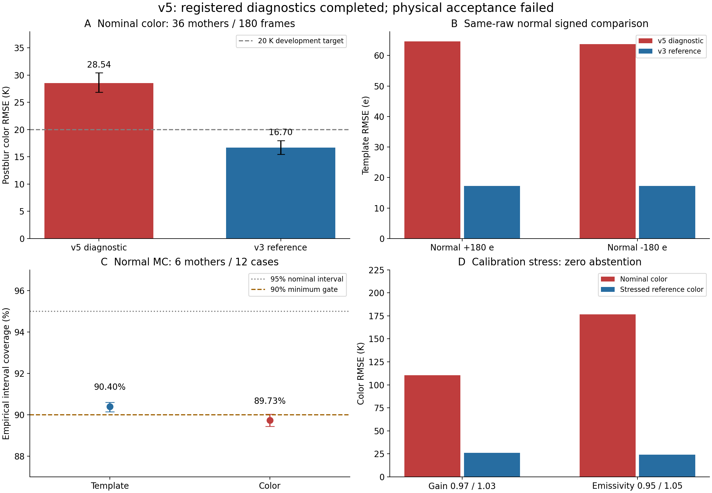

# v5 最终研究报告：物理估计未通过，按科学停止条件收口

本轮完成冻结任务书中适用的诊断与开发实验，得到负结果：当前两步 v5 物理估计不能作为通过验收的候选。CNN 未训练；候选与最终协议未建立；原 64 个最终母场景及 36 个 signed 确认母场景继续封存。最终集性能未知。

## 实际工作与执行边界

| 项目 | 实际证据 |
|---|---|
| 冻结 | 原基线 1452 文件逐字节 SHA256 一致；旧 12869 数组的大小、纳秒 mtime 和只读属性一致；33 个冻结 v5 顶层源码及 protocol 保持哈希一致。旧封存数组未开载荷。 |
| Oracle | 12 母场景 ×5 系数 ×3 输入形态=180 输入，同 raw 四级=720 结果；84 输入的四基线=336 结果。 |
| 信息与数值 | 12母场景的24次线性化、13个有限S模式及有限nuisance子空间；192 有限差分通过。原 float32 内积 6/2016 失败；同探针 float64 2016/2016 以 3e-11 门槛通过，最大误差 3.95194e-13。 |
| 开发网格 | 新 36 母场景（6×6）×5 系数×3 输入=540；4 alpha 与4基线各2160行，共4320唯一行；4318 SUCCESS，2个非选中alpha求解失败保留。 |
| 独立 null | 校准/评价分别12母场景×8噪声=96，母场景互斥；阈值先校准后冻结，评价不回调。 |
| 不确定度 | 固定6母场景正常±共12例，每例8次完整连续谱及signed重估；8个Hessian探针实际运行；36压力输入×5方法=180行。 |

原 development-compare 在 21626.928 s 以 TimeoutError 结束，未在原 21600 s 预算内完成。原失败回执保留；另注册 5400 s 补充诊断，实际 2299.515 s。完整网格、选参、独立 null 和已有三例 MC 不重跑，只完成余9例 MC、8探针及压力实验。补充 END 为 COMPLETED_WITH_SUPPLEMENTAL_DIAGNOSTICS，全部诊断已记录；numerical_execution_passed=false，原因包含 Hessian 数值失败。

前三例 MC 的 sigma、区间、均值和有效比例数组完好，逐重复 CG/时延/裁剪日志未持久化。有效比例全部为1，按冻结的8重复循环可推断8次贡献；未知明细保持 unavailable。该执行偏离和日志缺口限制可审计性，不把补充执行说成原预算内成功。

## 连续谱与 signed 模板

每个 raw 只做一次连续谱拟合，再对固定连续谱运行四个 alpha；模板步骤与 CNN 均不反向修改 T/loga。正式目标只有一次 raw 测量似然，object blur 经 CodedOperator 进入一次。真值只用于生成、oracle 或外部评价。名义主指标使用全固定真值域，拒绝像素仍在误差分母内。

选定 alpha_g=1 是所有网格均不满足约束后的诊断 fallback（selection_feasible=false），不是合格模型。传统参考按原规则选为 v3_physics；old_B4 是已有学习模型，其较小色温误差不能据此改选为传统参考。v4.4_final_continuum_fixed 只固定最后 C，内部 C 仍变化。

| 180 noisy 帧 /36 母场景 | 色温 RMSE K（母场景95% CI） | 色温 bias K | 模板 pooled RMSE e | 有效比例 | raw加权RMSE |
|---|---:|---:|---:|---:|---:|
| v5_physics | 28.540 [26.834, 30.409] | 0.206 | 64.009 | 1.000000 | 1.0061 |
| B1_tikhonov | 36.238 [34.122, 38.506] | 0.357 | 58.821 | 0.998804 | 1.3001 |
| v3_physics | 16.702 [15.492, 17.963] | -0.543 | 17.141 | 0.999100 | 0.9795 |
| old_B4 | 15.405 [13.737, 17.009] | -1.812 | 18.408 | 0.999992 | 0.9948 |
| v4.4_final_continuum_fixed | 16.702 [15.492, 17.963] | -0.543 | 24.314 | 1.000000 | 1.1093 |

v5 名义色温 RMSE 28.540 K 超过20 K；相对潜在温度 RMSE 为35.963 K，不能与模糊后色温混称。观测等效 reference 在名义条件等于 nominal。各母场景/条件/方法分布见 [PER_MOTHER_NOMINAL.csv](root_review_001/PER_MOTHER_NOMINAL.csv)。区间以36母场景为单位重采样2000次，seed53130，对母场景平均MSE的百分位区间开平方；每次保留同母体所有符号与噪声记录，不按像素假独立。区间是同一开发集上的描述性结果，含选参后的选择效应，不是最终验证。

| 正常信号 | v5 RMSE /参考 e | RMSE比（母场景95% CI） | v5投影 /参考投影 | 结果 |
|---|---:|---:|---:|---|
| positive，36配对母体 | 64.629 / 17.195 | 3.759 [3.563, 3.939] | 1.022731413 / 1.001839060 | RMSE和投影均失败 |
| negative，36配对母体 | 63.761 / 17.223 | 3.702 [3.517, 3.879] | 0.976627468 / 0.983261418 | RMSE和投影均失败 |

RMSE比上限为1.05。投影遵照任务4B与冻结 final 规则 abs(projection−1) ≤1.05×abs(reference_projection−1)；两符号均失败。冻结 development 布尔门禁漏含投影，因此 root 用同一选定模型和参考补充复核，未修改源码或阈值。全部180选中noisy求解达到真实相对残差≤1e−4，最大9.84244e−5；数值收敛没有带来科学正确性。平均实际路线时延26.451 s/帧，含共用连续谱估计，不能转述为10 kHz。

无噪 O0 正常± pooled RMSE0.00561248 e，支持规定光学带宽下的模糊后可逆性。有噪正常±中 O0 为8.120/8.052 e；O1（估计连续谱、真背景）69.963/67.259 e；O2（真连续谱、估计背景）8.402/8.334 e；O3 为62.104/60.594 e。该干预阶梯支持连续谱误差传播为本设置主要瓶颈。不能用仅无噪的 collapse=false 布尔量忽略此噪声退化。模糊前单位RMS有限模式的45 e系数，在投影有限T/loga/beta空间后的联合模态SNR为21.78–62.11（此系数不等于weak场景的45 e几何模板系数）、O0弱L2约0.577/0.583，均不能证明全图自由场的可辨识性，也不支持“实际弱失败证明光子信息不存在”。

## 检出、拒绝与区间

独立 null 的全视场 max(abs(S)/sigma_proxy) 阈值为48.1619529724（校准分数.95 higher分位），冻结后评价帧FP2/96=2.0833%，母场景95% CI[0,5.2083%]；像素FP1.096725e−5。经验点值满足5%门槛，区间上界仍超过5%，不保证真实仪器控制率。开发集自身 blank 为3/36阈值交叉，不替代独立评价。

sigma_proxy 是来自观测 raw 的均匀W/平稳后模糊噪声近似，省略连续谱和beta传播；它是操作性标准化量，不是MC sigma、置信区间或CRLB。各基线原有检测阈值不同，本报告不把它们与 v5 的独立null阈值召回作同阈值优劣比较。

| 条件 | pooled L2 | 符号正确率（无阈值） | 支持区正确阈值召回 | 全视场阈值交叉帧 |
|---|---:|---:|---:|---:|
| positive_normal | 1.232255 | 0.900107 | 0.000157829 | 6/36 |
| negative_normal | 1.215714 | 0.899869 | 0.000688591 | 10/36 |
| positive_weak | 4.884330 | 0.682874 | 0.000000000 | 2/36 |
| negative_weak | 4.837728 | 0.646338 | 0.000000000 | 0/36 |

固定真值支持区为 abs(S_truth)≥0.2×该帧真值峰值；召回分母为全部支持像素，分子同时要求正确符号、阈值越界和有效。零估计的weak L2=1。72帧weak阈值支持召回全为0；操作性幅度阈值范围209.76–532.92 e。

weak正两帧（mother0000/0018）L2为12.4107/5.3516，对应传统参考2.8347/1.4758；仅2/1个像素越界，root重开数组确认3个像素全部位于固定真值支持区外。它们是全视场代理阈值交叉，不能称为已检出、正确定位的弱信号；不存在可用于支持CNN门禁的正负可靠weak子集。这是事后既定阈值评价，不用于重选模型。

预定12例正常± MC（6母体×2符号，各8次完整重估）名义95%水平的有限MC正态近似区间的模板平均覆盖90.3969%，母场景95% CI[90.147, 90.594]%；色温覆盖89.7292%，CI[89.436, 90.032]%。冻结接受下限90%，色温未通过；接近门槛不允许事后放宽。八次重复和6母场景不足以保证覆盖；weak未做MC覆盖，不能从正常案例外推。

Hessian在一个固定正常case上的8个Rademacher探针均达200迭代上限，真实相对残差约1.01e11–3.73e12，成功0/8；65539维latent S/beta的对角及sigma全NaN，有效坐标0。它提供了数值失败证据，未提供有效协方差、postblur sigma或全图精确CRLB。不能据MC数组有限而称全部不确定度检查通过。

## 标定失配：误差大且未自动拒绝

固定6母体×blank/正常±×两种stress=36输入；每种stress18帧，v5加四基线共180条全部保留。以下stress不混入名义RMSE，不参与选参或阈值标定。

| v5 stress | 名义色温RMSE K | 观测等效reference RMSE K | 潜在温度RMSE K | raw加权RMSE | 有效/拒绝比例 |
|---|---:|---:|---:|---:|---|
| relative_gain_700_905 | 110.464 | 26.236 | 108.990 | 1.0270 | 1 / 0 |
| emissivity_700_905 | 176.521 | 24.259 | 174.232 | 1.0626 | 1 / 0 |

700/905增益乘数为0.97/1.03，发射率乘数为0.95/1.05。每帧名义色温RMSE分别为100.69–124.72 K、160.30–198.73 K。reference使用失配后的等效连续谱色温，因此小reference误差不代表恢复原名义温度。所有36帧有效比例1、拒绝比例0，算法没有验证成功的失配拒绝机制；raw残差接近1也不证明温度正确。部署必须满足外部标定/发射率条件，当前版本不能保证从单帧自行识别这些失配。其余四方法的独立压力汇总见RESULT_SUMMARY.json。

## 适用性、停止与交付

名义色温、正常±RMSE和投影、MC色温覆盖失败已独立触发阶段2严格停止。Hessian失败和失配零拒绝进一步限制可靠性。阶段3、候选与final-once在本负结果路线中不适用，不制造checkpoint或最终准确率。已实现的模块和CPU检查仅是实现证据。

后续研究方向由oracle指向700/905连续谱估计、噪声传播和外部标定边界，需另行登记；本轮不增加网格、阈值、网络或v5.x训练。合成正模板是发射增量，负系数是数值诊断而非负浓度；合成AlO模板不是实测物种分布。本结果可用于可复现的失败机制与适用范围研究，不能支持真实气体绝对温度、浓度、可靠部署或10kHz的论断。

- [一页六问题决策](V5_SCIENTIFIC_DECISION.md)
- [100项root实际数据审计](root_review_001/ROOT_DATA_AUDIT.json)，包括2998个科学载荷文件逐文件SHA256和全部raw/label manifest绑定。
- [逐项完成审计](COMPLETION_AUDIT.json) 与 [原审阅计划](ROOT_ACCEPTANCE_REVIEW_PLAN_001.json)。
- [独立Sol6.1/max终审](root_review_001/INDEPENDENT_FINAL_REVIEW.json) 与 [条件阶段关闭记录](CONDITIONAL_STAGE_CLOSURE.json)。
- [实际补充END](execution_recovery_001/END.json)、[原始物理报告](development/PHYSICS_ONLY_V5_REPORT.md)、[完整root汇总](root_review_001/RESULT_SUMMARY.json)。
- [可运行入口与数据包说明](../../../research_v5/delivery/README.md)。GitHub完成以上传成功回执为准，不重新下载核对。
