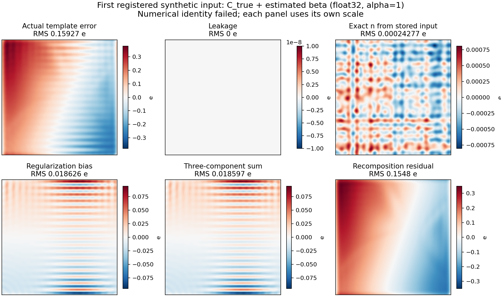
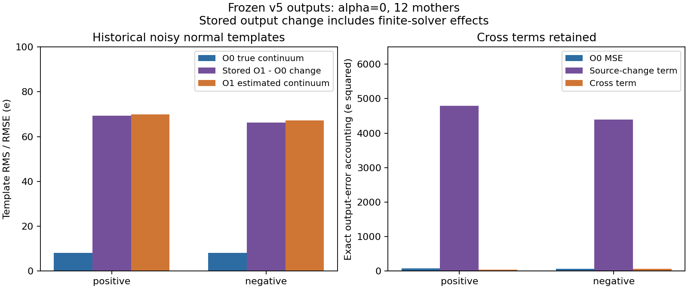

# v6 阶段 A：数值门槛停止报告

**结论：阶段 A 按预登记数值门槛提前停止，本轮关闭。** 720 个 raw 已全部完成哈希／形状审计；正式推理处理1个已查看的 oracle raw，得到原 v3 输出1行及线性置换4行。阶段 B、设计优化、训练与封存评估均未执行。

## 首个实际输入的分解

输入：`v4_validation_mother_0000_v5_negative_normal_continuous`，negative_normal、continuous；固定 alpha=1、W、正则、float32 和200次最大PCG预算。

|连续谱|背景|实际模板误差 RMS (e)|泄漏 RMS (e)|噪声 RMS (e)|正则偏差 RMS (e)|重组残差 RMS (e)|门槛|
|---|---|---:|---:|---:|---:|---:|---|
|C_true|true_beta|0.0144965|0|0.000490846|0.0144129|0.0015209|通过|
|C_v5|true_beta|0.119842|0.118706|0.000490846|0.0144129|0.00153158|通过|
|C_v3|true_beta|0.930039|0.926646|0.000490846|0.0144129|0.00156488|通过|
|C_true|estimated_beta|0.159271|0|0.000242773|0.0186257|0.154804|失败|

C_true＋estimated_beta 的重组残差 0.154804 e，超过0.05 e绝对门槛，同时未满足0.005相对门槛。实际解与三项分量CG均报告收敛；法方程代数相对残差 2.14e-07，未发现尺度、beta单位、重复blur或W改变。

按相同系统和预算计算实际法方程残差的贡献，其 RMS 为0.154853 e；解释后的剩余为0.000142348 e。固定原始RHS和标定缓冲的float64参考仍有0.154525 e重组差。主要原因是相对大RHS停止的有限PCG逆随RHS而变，不能视为精确可加的K逆。

这是数值停止结论，不能作为信息耗尽、真实器件极限或算法总体不可能改善的证据。原门槛、权重与输出均未替换。

## 历史 O0／O1 的返回输出差异核对

只读复用12个已查看oracle母场景的180对历史输出，alpha=0。令D为保存的O1输出减O0输出，则E1=E0+D及MSE1=MSE0+MSE_D+2mean(E0D)可直接核验。D包含连续谱来源改变导致的返回输出差异和有限求解差异；它不能冒充本轮尚未通过恒等检查的纯物理K逆泄漏。

|正常含噪组|O0 RMSE (e)|D RMS (e)|O1 RMSE (e)|O0 MSE|D平方项|交叉项|
|---|---:|---:|---:|---:|---:|---:|
|positive|8.1199|69.244|69.963|65.9323|4794.68|34.1793|
|negative|8.052|66.322|67.259|64.8347|4398.6|60.3573|

180对输出的最大场恒等残差为0 e。全部normal正负、weak正负、blank及三个输入版本的历史核对均单列；本轮alpha=1统计不会与它混合。

## 未执行项与决策范围

continuum_source_comparison.jsonl保留5040个固定case×method记录：5个实际返回，5035个明确NOT_EXECUTED。development36母场景的正式置换、正常含噪正负、弱信号和blank的本轮总体比较均未执行。它们未被删除，也未被记为通过；全组聚合为不完整。

唯一下一方向：**终止此轮算法研究，保留冻结v3为比较基准。** 当前没有合格无网络候选；不启动B、调参或封存确认。

## 复核与交付

注册协议：research_v6/protocol.json；逐例物理分解：continuum_leakage_decomposition.jsonl；数值归因：FAILED_CASE_FLOAT64_DIAGNOSTIC.json；历史核对：historical_o0_o1_output_accounting.jsonl；不变性和范围审计：CLOSEOUT_AUDIT.json。

所有量仍属于冻结合成标定中的postblur色温和有符号数值模板。外部定标、非灰体、真实光谱、真实物种浓度、实际设备与10kHz端到端吞吐量，以及36 signed confirmation和64 final母场景均未验证。
