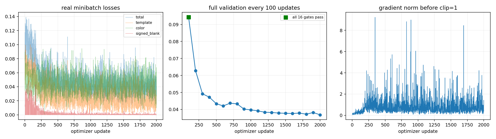
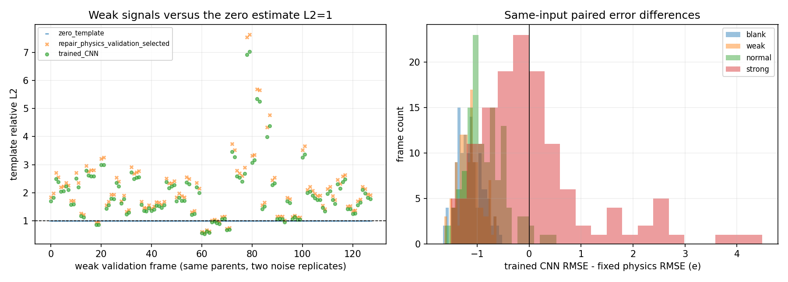
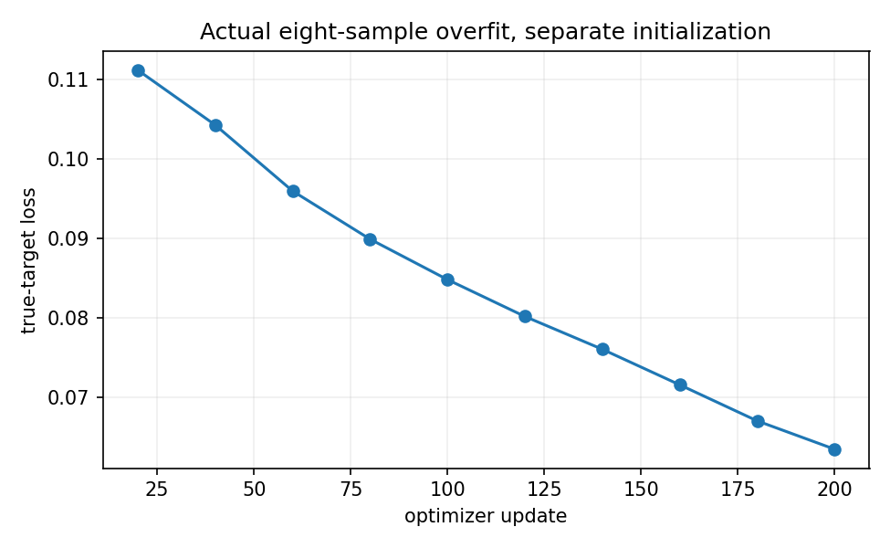

# TRAIN_V4_REPORT：物理反演后 CNN 校正器

基于 `9a7ac7e86339ba9b9d3006765fef731f10941029`。本轮实际训练并保存新 checkpoint，模型为 5,797 参数的 19→16→16 共享 CNN、两个残差头，六次有界校正。原 physics/object_blur、repair_v3、旧 CNN/权重和旧报告均保留。

正式完成种子 101，每个种子 2,000 次 Adam optimizer updates、8,000 次 microbatch、每 100 次完整验证。首个训练 checkpoint 的选择更新为 100；新参数已实际改变。明确验证收益=False，弱信号 pooled L2=1.4765，零估计 L2=1。本次未达到扩种子条件，停止于一个正式种子。可训练接口与真实训练已完成，但不能把它宣称为全部性能目标通过。

末次第 2,000 次权重在含噪弱信号上 L2=0.6864，正常模板 RMSE=9.5930 e，说明小 CNN 确实学到了恢复能力；但原门禁只有 4/16 通过，因此它是诊断权重。受保护的第 100 次权重通过16/16，却仍未胜过弱信号零估计。这两种结果不能合并成一个“全部达标”结论。

## 骨干的有限选择

不含 warm start 的原 joint_update 通过原 16 项门禁。32 个新验证 raw 上，组合 v3 的监督评分 0.34977，old_init + joint_update 为 0.31961。选中 old_init__joint_update_v3，模板正则 0.1，并通过全部 16 项门禁。组合 v3 仍作为原始参考保留，未完整重跑旧 audit。

|模板正则|32 帧验证评分|
|---:|---:|
|0.001|0.319613|
|0.01|0.219675|
|0.1|0.116082|

只有验证数据用于该三点参数选择，固定开发门禁只作可接受性约束。传统解调 Tikhonov 同样仅在这 32 个验证 raw 上作三点选择。没有扩大求解器搜索。

跨帧批处理因 float64 CG 轨迹与逐帧结果不一致而被拒绝，其失败测试和日志保留。生产直接调用原 v3 scalar warm/LM/PCG，只缓存每个线性步不变的 Jacobian；并行任务之间独立，不做跨帧 CG。

## 数据、缓存和梯度接口

256 个训练母场景与 64 个验证母场景，四条件各两次独立 Poisson/read-noise/ADC 噪声，共 2,048/512 个主 raw；另加每母场景一个干净身份 raw，共 256/64。全部为原 256×256 编码器。最终测试的 64 个母场景只登记，生成与评估均为零。原 expanded/audit/repair 只作开发/回归，没有进入主训练。

温度、幅度、模板形态使用独立随机流。多方向前沿、多峰、环/条、平坦和平滑随机场通过场景坐标旋转/平移/缩放后再编码，未直接旋转或裁剪 raw。父场景派生的条件、噪声与身份样本从不跨 split。

标签独立保存在 labels/，仅由真实合成 latent 场经原物理模块得到 postblur 模板、色温和七波段。B4/v3 输出从未用作真值。所有 raw 的匹配缓存保存 state/beta；键包含 actual raw dtype/shape/bytes hash、物理配置、标定、固定求解器和引擎 hash。噪声变化使 raw hash 改变，旧缓存不能通过检查。缓存的逐例 CG 停止原因、未达到相对残差条件的步数和 LM 接受记录摘要保存在 cache_solver_diagnostics.jsonl，完整历史在独立的缓存元数据中；没有把数值未收敛帧删除。

网络从缓存 tensor 开始，在每阶段重算 19 通道物理特征。逆过程与缓存 tensor detach，六次 CNN→物理输出保持可导；没有从 NumPy 预测反传，也没有把整个 warm/LM/PCG 纳入图。它明确是“物理反演后CNN校正器”，不是完整展开训练。

## 身份与实际训练检查

零头六阶段输出与物理缓存恒等；活跃 continuum/emission 头梯度非零，第一次零头时主干梯度为零符合链式求导，第二步主干梯度出现。Adam 确实改变参数。标准化残差的 RMS 在 sqrt 前 clamp，以保证恰好零残差的干净样本也有有限梯度。

8 样本独立诊断运行 200 次真实更新，损失由 0.115337 降为 0.063426，参数 hash 改变并保存 overfit_eight.pt。该诊断权重没有用于正式初始化。

主损失为 template/60 的平方误差、0.2×color/75、0.2×bands/300、0.01×raw 加权一致性，以及空白的有符号平方误差。弱信号主损失不除真值能量。Adam lr=1e−4，batch=1，累积4，clip=1；不使用 U-Net、注意力、新网络模块、阈值提高或删除失败帧。

## 同输入六方法对照

下表主验证含噪 raw 的每组 128 帧。另 64 个身份样本在 paired_summary 中单独保留。所有方法使用同一 raw，物理配置与标定一致；旧 CNN 迁移指把旧两个头及主干接在新固定物理缓存之后，未经训练，与原完整 B4 区分。零模板的色温未定义，不填假结果。

|条件|方法|帧数|模板 RMSE e|模板 pooled L2|色温 RMSE K|空白 >60e 像素误报|失败数|
|---|---|---:|---:|---:|---:|---:|---:|
|blank|zero_template|128|0.0000|N/A|N/A|0.0000|0|
|blank|old_B4|128|11.3594|N/A|14.9776|0.0055|0|
|blank|traditional_validation_selected|128|54.0042|N/A|38.1388|0.1235|0|
|blank|repair_physics_validation_selected|128|16.1916|N/A|17.7191|0.0004|0|
|blank|old_CNN_transfer|128|12.0548|N/A|17.6632|0.0000|0|
|blank|trained_CNN|128|15.0416|N/A|17.4874|0.0002|0|
|weak|zero_template|128|10.2093|1.0000|N/A|N/A|0|
|weak|old_B4|128|11.7565|1.1515|14.9401|N/A|0|
|weak|traditional_validation_selected|128|54.1806|5.3070|38.0826|N/A|0|
|weak|repair_physics_validation_selected|128|16.2333|1.5900|17.6797|N/A|0|
|weak|old_CNN_transfer|128|12.2595|1.2008|17.6343|N/A|0|
|weak|trained_CNN|128|15.0743|1.4765|17.4495|N/A|0|
|normal|zero_template|128|55.4188|1.0000|N/A|N/A|0|
|normal|old_B4|128|15.7353|0.2839|15.4761|N/A|0|
|normal|traditional_validation_selected|128|54.1354|0.9768|38.2963|N/A|0|
|normal|repair_physics_validation_selected|128|16.3698|0.2954|17.8632|N/A|0|
|normal|old_CNN_transfer|128|19.2538|0.3474|17.8710|N/A|0|
|normal|trained_CNN|128|15.5171|0.2800|17.6519|N/A|0|
|strong|zero_template|128|113.5258|1.0000|N/A|N/A|0|
|strong|old_B4|128|17.4791|0.1540|15.6804|N/A|0|
|strong|traditional_validation_selected|128|54.2333|0.4777|38.3267|N/A|0|
|strong|repair_physics_validation_selected|128|16.8918|0.1488|18.0277|N/A|0|
|strong|old_CNN_transfer|128|28.4981|0.2510|18.1820|N/A|0|
|strong|trained_CNN|128|16.9831|0.1496|17.9686|N/A|0|

逐帧配对的误差差值保存在 paired_differences.jsonl。paired_confidence_intervals.json 使用母场景为单位的 2,000 次 bootstrap，同一母场景的噪声副本一起重采样；这些区间仅用于结果分析，不用于选参或 checkpoint 选择。

末次 2000 更新的诊断配对保存在 terminal_2000_paired_diagnostic.jsonl，与旧 B4、纯物理逐例按同一 raw/cache hash 对齐，复用已经完成的完整验证记录，没有新增推理，也没有参与模型选择。

## 门禁与训练目标的取舍

下表保留所有保存候选的验证成绩。完成 2,000 次训练与选中哪次更新是两个不同事实：最终权重始终保存，只有通过全部门禁的候选可以被选为受保护版本。低验证损失不能抵消确定性回归。

|更新|完整验证 loss|门禁通过数/16|含噪弱模板 L2|含噪正常模板 RMSE e|
|---:|---:|---:|---:|---:|
|100|0.094274|16|1.4765|15.5171|
|200|0.062817|5|1.0572|13.0836|
|300|0.049226|7|0.8510|11.8298|
|400|0.047186|8|0.7722|11.3774|
|500|0.043366|8|0.7503|10.5209|
|600|0.042060|8|0.7478|10.3714|
|700|0.043679|3|0.7831|10.3733|
|800|0.043256|0|0.7237|10.2111|
|900|0.040202|6|0.7605|10.1265|
|1000|0.039714|6|0.7663|10.1259|
|1100|0.039145|6|0.7086|9.8746|
|1200|0.038345|4|0.6989|9.7925|
|1300|0.038201|5|0.6995|9.7813|
|1400|0.037864|2|0.6994|9.7522|
|1500|0.037722|5|0.7124|9.8249|
|1600|0.037614|4|0.7103|9.7396|
|1700|0.037840|2|0.6664|9.6801|
|1800|0.037204|5|0.6941|9.6987|
|1900|0.038173|5|0.7449|9.8106|
|2000|0.036812|4|0.6864|9.5930|

新增训练母场景的模板为正幅度，推理输出仍有符号；原门禁中的负模板照常评分。对这些回归不能使用 ReLU、固定零输出或更高阈值遮掩。门禁拒绝详情与旧批处理加速失败均在 failure_records.json，所有原始候选权重保留。

## Checkpoint、曲线与限制

- 种子 101：最终训练 checkpoint `E:\CodexWork\thermometry\public_repository_001\outputs\training_v4\run_001\checkpoints\seed_101\update_2000.pt`，SHA256 `b052aeefce20b43339afdba396aef13d67420b79e3723d197ca1260b7b3f149f`；验证选中更新 `100`。
  可下载的保存副本：[最终 2000 更新](../../../training_v4/checkpoints/seed_101_final_2000.pt)、[门禁约束下验证选中](../../../training_v4/checkpoints/seed_101_validation_selected.pt)。两个文件均逐字节匹配原训练保存文件，native_identity_and_checkpoint_receipt.json 记录完整 hash 与 Adam 实际 step。

每次验证都保存逐例 JSONL；开发门禁失败的候选 checkpoint 保留而不进入选中集合。最终测试没有打开；当前数字是开发验证结果，非最终泛化或实测相机性能。原响应矩阵/QE 仍为工程合成假设。

原目录复现使用同一本机 GPU PyTorch 解释器，E/D checkout 下执行 `python -B -m training_v4.run --phase data`、`--phase select`、`--phase overfit`、`--phase train --seed 101`、`--phase compare --seed 101`。然后运行 `python -B -m training_v4.verify_delivery`，报告环境执行 `--phase report`。全新目录用 `training_v4/reproduce.ps1 -Worktree E:\CodexWork\thermometry\v4_reproduction_001`，避免覆盖本次日志；该入口创建 9a7ac7e 基线 worktree 并只恢复 16 项门禁输入，不重跑旧954项。冻结输入、标签、缓存与详细 hash 在 data_manifest.json / cache_hash_inventory.json，数组位于 E 盘 ignored outputs/training_v4/run_001。

本轮止于可训练的小 CNN 校正器。接回物理更新以及完整六阶段展开训练属于后续独立研究，没有作为本轮开始训练前的阻塞项。
