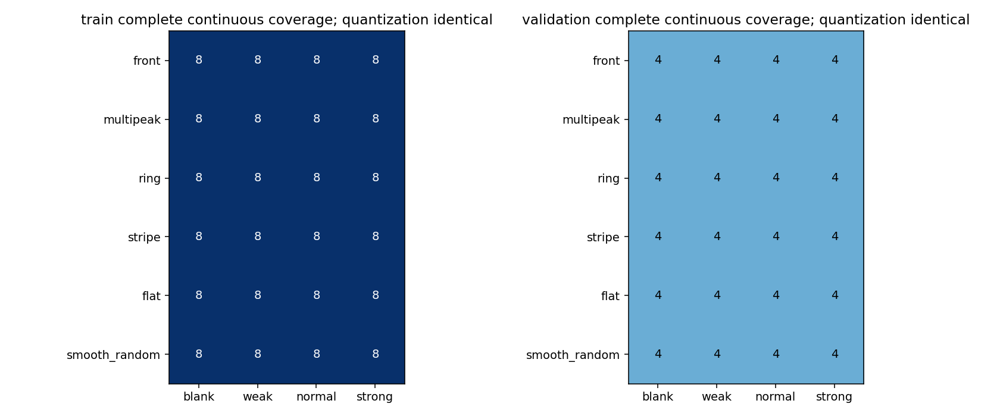
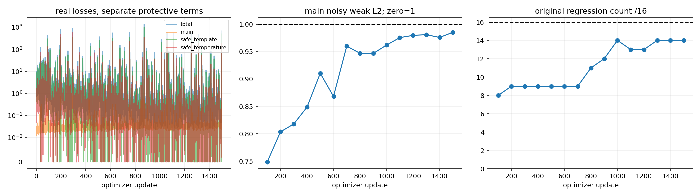
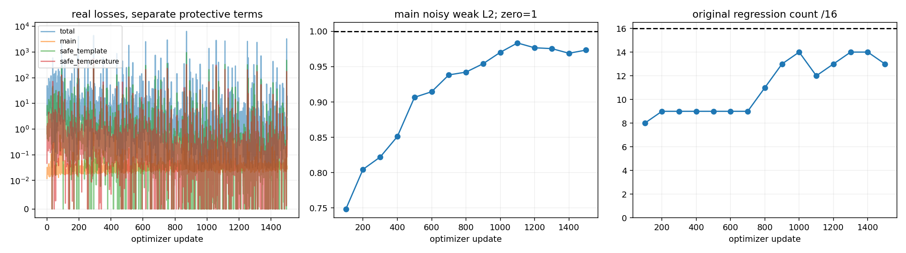
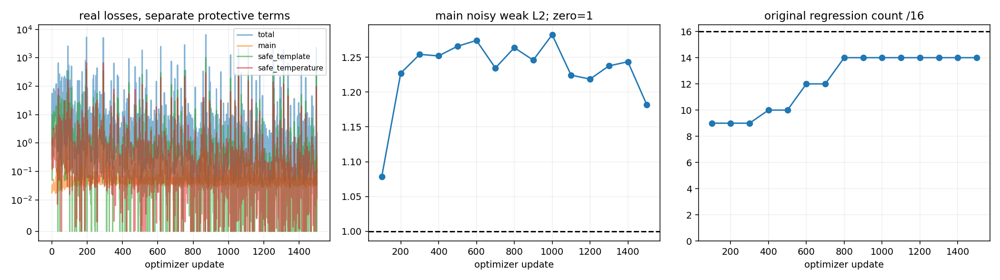

# TRAIN_V4_1_REPORT：保护性校正训练

基于 `62538a8bb4a0014c764bd395cfa8cb9d915e9c97`。物理骨干、旧权重、旧报告均保持原字节；不重跑旧954项，不打开最终测试。

5797 参数、19 通道、六次共享有界校正。从 v4 update2000 的 CNN 参数初始化并重置 Adam。主标签均为真实合成 postblur 输出。每次更新严格为2个完整噪声、1个连续保护、1个仅量化保护；强度在各采样流平衡，5%有符号辅助样本轮流混入四种位置。

## 覆盖与物理缓存

训练选48个、验证选24个原母场景：每种温度几何分别8个/4个，同时平衡模板形态。每母场景补齐四强度的连续和仅量化输入。96个 split×温度几何×强度×输入类型单元全非空；原v4每split的24种干净组合缺12种，现已补齐，包括干净弱信号温度前沿。

另有独立训练12个/验证6个有符号母场景，包含正负弱/正常系数与三种输入，共216帧。生成阶段为正负对使用相同强度缩放，仅为确保七波段非负、测量期望合法；实际强度、范围与缩放逐例记录在 signed_expectation_legality.json。原16检查帧从未用于梯度训练。

共复用2560个原含噪raw，补充576个保护raw与216个有符号raw。旧物理缓存按actual raw、物理配置、标定及原求解器hash匹配复用；新缓存独立保存。标签独立，物理基线MSE仅在单独评分文件保存，绝不进入物理求解或推理。

## 保护损失与有限对照

保留原真实合成监督，新增两项输出域hinge：模板MSE超过固定物理MSE+0.25 e²，温度MSE超过固定物理MSE+0.04 K²时分别惩罚。各项除以固定物理MSE+1（对应单位平方），避免近零分母；不除真值能量，不约束latent高频状态。所有四个microbatch均计算保护损失。

推理只接收raw、cached_state、cached_beta。clean_identity、condition、case_id与truth均不传入网络。Adam lr=3e-5、累积4、clip=1，各正式试验1500次真实更新，每100次保存checkpoint与776帧分层验证。safe1与safe5若均执行，初始参数与完整抽样序列完全一致。

初始两轮保留原残差特征。只有两个safe对照都无合格候选，且最保护性候选仍在>5%保护帧出现小残差（物理加权raw RMS<0.2）与大输出校正（模板>2e或色温>0.5K），才执行一次固定训练残差标尺的幅度保留特征消融，不加模块。

合格候选必须原16/16、新保护各几何/强度/输入组均无超容差平均MSE退化，主含噪弱L2<1，含噪温度无系统性退化（各组温度MSE<=1.05×物理+.04）。<=0.85弱L2和<=12e正常RMSE是争取目标，不能当作既有性能。

## 各checkpoint独立结果

### safe1

|试验|更新|原门禁/16|新保护组通过/96|含噪温度通过|主弱L2|正常RMSE e|可接受|
|---|---:|---:|---|---|---:|---:|---|
|safe1|100|8|2/96|False|0.7484|10.0046|False|
|safe1|200|9|1/96|False|0.8035|10.5521|False|
|safe1|300|9|2/96|False|0.8177|10.6297|False|
|safe1|400|9|2/96|False|0.8486|10.8733|False|
|safe1|500|9|0/96|False|0.9105|11.3297|False|
|safe1|600|9|7/96|False|0.8682|11.0413|False|
|safe1|700|9|7/96|False|0.9601|11.6512|False|
|safe1|800|11|10/96|False|0.9470|11.5928|False|
|safe1|900|12|8/96|False|0.9468|11.5831|False|
|safe1|1000|14|9/96|False|0.9620|11.7425|False|
|safe1|1100|13|12/96|False|0.9757|11.7952|False|
|safe1|1200|13|7/96|False|0.9798|11.8264|False|
|safe1|1300|14|11/96|False|0.9811|11.8372|False|
|safe1|1400|14|11/96|False|0.9760|11.8159|False|
|safe1|1500|14|12/96|False|0.9853|11.8787|False|

safe1曾受外部进程中断影响，从更新400的已验证checkpoint恢复完整Adam状态。重算100次更新，损失相对差最大为0；原曲线与部分验证原字节保存在 interruption_01。最终权重Adam step仍为1500，额外重算不计为新更新，不拼接权重。

### safe5

|试验|更新|原门禁/16|新保护组通过/96|含噪温度通过|主弱L2|正常RMSE e|可接受|
|---|---:|---:|---|---|---:|---:|---|
|safe5|100|8|2/96|False|0.7485|10.0057|False|
|safe5|200|9|1/96|False|0.8047|10.5624|False|
|safe5|300|9|1/96|False|0.8221|10.6448|False|
|safe5|400|9|2/96|False|0.8511|10.8872|False|
|safe5|500|9|1/96|False|0.9067|11.3157|False|
|safe5|600|9|3/96|False|0.9146|11.3302|False|
|safe5|700|9|9/96|False|0.9384|11.5069|False|
|safe5|800|11|8/96|False|0.9423|11.5586|False|
|safe5|900|13|9/96|False|0.9542|11.6247|False|
|safe5|1000|14|8/96|False|0.9703|11.8039|False|
|safe5|1100|12|5/96|False|0.9836|11.8620|False|
|safe5|1200|13|11/96|False|0.9768|11.8047|False|
|safe5|1300|14|11/96|False|0.9756|11.8185|False|
|safe5|1400|14|12/96|False|0.9690|11.7714|False|
|safe5|1500|13|11/96|False|0.9735|11.7869|False|

### amplitude_safe5

|试验|更新|原门禁/16|新保护组通过/96|含噪温度通过|主弱L2|正常RMSE e|可接受|
|---|---:|---:|---|---|---:|---:|---|
|amplitude_safe5|100|9|3/96|False|1.0788|12.8172|False|
|amplitude_safe5|200|9|7/96|False|1.2272|13.9249|False|
|amplitude_safe5|300|9|9/96|False|1.2541|14.2346|False|
|amplitude_safe5|400|10|9/96|False|1.2519|14.1022|False|
|amplitude_safe5|500|10|10/96|False|1.2658|14.1663|False|
|amplitude_safe5|600|12|9/96|False|1.2741|14.3229|False|
|amplitude_safe5|700|12|8/96|False|1.2345|13.8678|False|
|amplitude_safe5|800|14|10/96|False|1.2637|14.1418|False|
|amplitude_safe5|900|14|9/96|False|1.2459|13.9082|False|
|amplitude_safe5|1000|14|9/96|False|1.2824|14.2638|False|
|amplitude_safe5|1100|14|13/96|False|1.2243|13.6625|False|
|amplitude_safe5|1200|14|10/96|False|1.2186|13.6207|False|
|amplitude_safe5|1300|14|9/96|False|1.2376|13.7495|False|
|amplitude_safe5|1400|14|12/96|False|1.2435|13.8115|False|
|amplitude_safe5|1500|14|9/96|False|1.1817|13.2233|False|

## 同输入对照与空间细节

zero、old_B4、固定物理、v4 update100、v4 update2000和每个新候选在相同raw上逐例配对；另加独立验证选参的传统Tikhonov。旧预测只有raw、标签、缓存hash全匹配时才复用，逐例标记。主含噪组与独立有符号组分开，连续与仅量化保护逐帧保存。

有符号支持域为abs(truth)>=0.2*max(abs(truth))，正目标用预测>60e、负目标用预测<−60e，分别报告召回与正负空白误报。未提高阈值、未删除失败帧。配对差值在各试验 paired_all_checkpoints.jsonl，所有更新单独保留，不能拼接不同权重的好处。

|同一组输入|方法/独立checkpoint|帧数|模板RMSE e|模板L2|色温RMSE K|
|---|---|---:|---:|---:|---:|
|noise/main/blank|zero|128（失败0）|0.0000|N/A|N/A|
|noise/main/blank|old_B4|128（失败0）|11.3594|N/A|14.9776|
|noise/main/blank|fixed_physics|128（失败0）|16.1916|N/A|17.7191|
|noise/main/blank|v4_update100|128（失败0）|15.0416|N/A|17.4874|
|noise/main/blank|v4_update2000|128（失败0）|2.2801|N/A|16.0293|
|noise/main/blank|tikhonov_validation_selected|128（失败0）|10.6204|N/A|20.2475|
|noise/main/blank|safe1/1500（末次独立权重）|128（失败0）|8.8367|N/A|16.3196|
|noise/main/blank|safe5/1500（末次独立权重）|128（失败0）|8.6477|N/A|16.2934|
|noise/main/blank|amplitude_safe5/1500（末次独立权重）|128（失败0）|11.4784|N/A|16.8086|
|noise/main/weak|zero|128（失败0）|10.2093|1.0000|N/A|
|noise/main/weak|old_B4|128（失败0）|11.7565|1.1515|14.9401|
|noise/main/weak|fixed_physics|128（失败0）|16.2333|1.5900|17.6797|
|noise/main/weak|v4_update100|128（失败0）|15.0743|1.4765|17.4495|
|noise/main/weak|v4_update2000|128（失败0）|7.0075|0.6864|16.1881|
|noise/main/weak|tikhonov_validation_selected|128（失败0）|10.7989|1.0577|20.1094|
|noise/main/weak|safe1/1500（末次独立权重）|128（失败0）|10.0590|0.9853|16.4215|
|noise/main/weak|safe5/1500（末次独立权重）|128（失败0）|9.9385|0.9735|16.4020|
|noise/main/weak|amplitude_safe5/1500（末次独立权重）|128（失败0）|12.0645|1.1817|16.8449|
|noise/main/normal|zero|128（失败0）|55.4188|1.0000|N/A|
|noise/main/normal|old_B4|128（失败0）|15.7353|0.2839|15.4761|
|noise/main/normal|fixed_physics|128（失败0）|16.3698|0.2954|17.8632|
|noise/main/normal|v4_update100|128（失败0）|15.5171|0.2800|17.6519|
|noise/main/normal|v4_update2000|128（失败0）|9.5930|0.1731|16.6501|
|noise/main/normal|tikhonov_validation_selected|128（失败0）|15.6895|0.2831|20.1874|
|noise/main/normal|safe1/1500（末次独立权重）|128（失败0）|11.8787|0.2143|16.8997|
|noise/main/normal|safe5/1500（末次独立权重）|128（失败0）|11.7869|0.2127|16.8819|
|noise/main/normal|amplitude_safe5/1500（末次独立权重）|128（失败0）|13.2233|0.2386|17.2011|
|noise/main/strong|zero|128（失败0）|113.5258|1.0000|N/A|
|noise/main/strong|old_B4|128（失败0）|17.4791|0.1540|15.6804|
|noise/main/strong|fixed_physics|128（失败0）|16.8918|0.1488|18.0277|
|noise/main/strong|v4_update100|128（失败0）|16.9831|0.1496|17.9686|
|noise/main/strong|v4_update2000|128（失败0）|11.0323|0.0972|16.9158|
|noise/main/strong|tikhonov_validation_selected|128（失败0）|25.8497|0.2277|20.2073|
|noise/main/strong|safe1/1500（末次独立权重）|128（失败0）|13.0572|0.1150|17.1584|
|noise/main/strong|safe5/1500（末次独立权重）|128（失败0）|12.9705|0.1143|17.1425|
|noise/main/strong|amplitude_safe5/1500（末次独立权重）|128（失败0）|14.2739|0.1257|17.4331|
|noise/signed_aux/negative|zero|12（失败0）|39.5039|1.0000|N/A|
|noise/signed_aux/negative|old_B4|12（失败0）|24.9868|0.6325|15.2477|
|noise/signed_aux/negative|fixed_physics|12（失败0）|19.6786|0.4981|15.5624|
|noise/signed_aux/negative|v4_update100|12（失败0）|19.1280|0.4842|15.5024|
|noise/signed_aux/negative|v4_update2000|12（失败0）|39.3013|0.9949|26.0617|
|noise/signed_aux/negative|tikhonov_validation_selected|12（失败0）|15.2279|0.3855|17.4277|
|noise/signed_aux/negative|safe1/1500（末次独立权重）|12（失败0）|31.4288|0.7956|20.1864|
|noise/signed_aux/negative|safe5/1500（末次独立权重）|12（失败0）|30.8711|0.7815|20.0987|
|noise/signed_aux/negative|amplitude_safe5/1500（末次独立权重）|12（失败0）|29.6977|0.7518|18.9148|

传统解调平滑lambda独立从0.1、1、10、100、1000验证选择，选中 `100.0`；它与物理求解器latent模板系数0.1不是同一个量。

|解调lambda|验证目标|保留频带最小传递率|中位传递率|
|---:|---:|---:|---:|
|0.1|0.866073|0.9760|0.9879|
|1.0|0.709372|0.8027|0.8908|
|10.0|0.254060|0.2892|0.4493|
|100.0|0.093920|0.0391|0.0754|
|1000.0|0.319207|0.0041|0.0081|

|解调lambda|正常模板RMSE e|正常投影系数|预测/真值空间梯度能量|
|---:|---:|---:|---:|
|0.1|54.1354|1.0002|54.1921|
|1.0|48.9985|0.9972|41.7163|
|10.0|29.2557|0.9717|10.2485|
|100.0|15.6895|0.8420|0.7043|
|1000.0|26.2533|0.5653|0.0491|

## 新保护与有符号诊断

|试验/末次独立权重|模板退化帧/保护帧|温度退化帧/保护帧|小残差大校正比例|
|---|---:|---:|---:|
|safe1/1500|132/240|154/240|0.5875|
|safe5/1500|145/240|162/240|0.5833|
|amplitude_safe5/1500|171/240|167/240|0.4458|

退化以逐帧输出MSE超过同输入固定物理基线MSE加既定小容差定义。完整776帧×15次验证、96个保护子组和原16项均保存；该表是诊断，不据此删除帧或放宽筛选。

|负系数含噪输入|独立方法/权重|帧数|模板L2（zero=1）|负目标召回 <−60e|
|---|---|---:|---:|---:|
|negative_normal|fixed_physics|6|0.3676|0.6004|
|negative_weak|fixed_physics|6|1.4342|0.0070|
|negative_normal|old_B4|6|0.6048|0.1017|
|negative_weak|old_B4|6|0.9745|0.0000|
|negative_normal|tikhonov_validation_selected|6|0.3029|0.5689|
|negative_weak|tikhonov_validation_selected|6|1.0286|0.0006|
|negative_normal|v4_update100|6|0.3663|0.5262|
|negative_weak|v4_update100|6|1.3561|0.0007|
|negative_normal|v4_update2000|6|0.9934|0.0000|
|negative_weak|v4_update2000|6|1.0179|0.0000|
|negative_normal|zero|6|1.0000|0.0000|
|negative_weak|zero|6|1.0000|0.0000|
|negative_normal|safe1/1500|6|0.7789|0.0000|
|negative_weak|safe1/1500|6|1.0269|0.0000|
|negative_normal|safe5/1500|6|0.7664|0.0000|
|negative_weak|safe5/1500|6|0.9919|0.0000|
|negative_normal|amplitude_safe5/1500|6|0.7230|0.0000|
|negative_weak|amplitude_safe5/1500|6|1.1151|0.0000|

正负召回、正负空白误报、每个输入类型、每个独立checkpoint和空间细节统计见 signed_detection_and_detail_summary.json。支持域均按abs(truth)定义；原16项同输入逐权重配对另见 original_16_paired_checkpoints.jsonl。

tikhonov_selection.json与tikhonov_validation_grid.jsonl同时记录真值和预测的空间梯度能量、模板投影系数。降低噪声梯度不等于保留细节；大lambda的真实结构幅度损失须与RMSE一起判断。

## 本轮结论与交付

本轮已完成实际训练与checkpoint保存，但没有一个同一checkpoint同时通过全部保护和含噪收益条件。所有末次权重按诊断用途交付，旧模型保持不变；不合并不同checkpoint的优点。

幅度消融按预登记规则触发：safe5 更新1400仍有67.5%保护帧满足小残差大校正。固定标尺由64个训练raw计算，weighted-adjoint RMS中位数=0.0052964557。末次该现象比例为44.58%，原16项过14项、弱L2=1.1817、正常RMSE=13.2233e；该单一特征变化未产生合格候选。

safe1末次原门禁14/16，新保护通过12/96，含噪负正常目标召回=0.0000。
safe5末次原门禁13/16，新保护通过11/96，含噪负正常目标召回=0.0000。
amplitude_safe5末次原门禁14/16，新保护通过9/96，含噪负正常目标召回=0.0000。

相同含噪负正常输入下，固定物理的负目标召回为0.6004。这些结果分别归属各checkpoint，构成本轮不选替换权重的证据。

新权重在 training_v4_1/checkpoints/：每组全部15个每100次检查点与末次导出均保留。native_checkpoint_receipt.json核查重置Adam、真实1500 step、5797参数、原物理缓冲区一致和重新加载重复推理。6项测试通过。raw/cache/标签库存见 input_cache_hash_inventory.json，覆盖、保护逐例、原16检查、配对与失败记录均保留。

复现按 training_v4_1/README.md：data→tests→prepare_cache→safe1→controls→tikhonov→compare→verify→report。原目录的训练试验不可覆盖，另建E/D工作目录；CLI环境必须是同一本机GPU PyTorch。

这些是开发与回归结果，最终测试未打开，未提供实测相机泛化承诺。光谱响应/QE仍沿用原工程合成配置。
