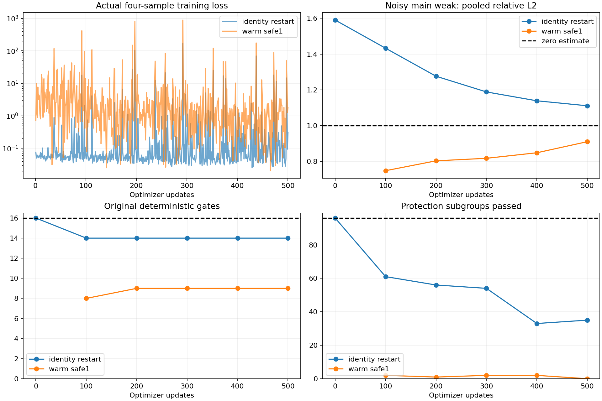
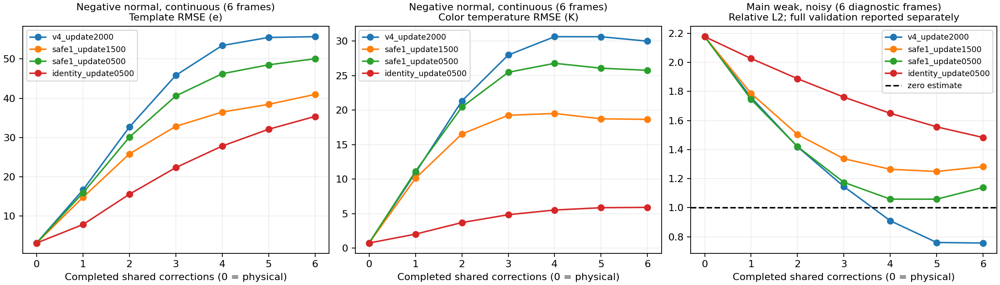

# TRAIN_V4_2_REPORT：恒等起点短程对照

基于 `281a81b`，实际完成500次Adam更新，保存初始化与每100次checkpoint。**本次500次内没有满足全部既定要求的替换模型。**

唯一训练变量：继承v4 update2000共享主干，将两个残差头的权重和偏置清零。物理骨干、5797参数、19特征、原残差归一化、六次共享校正、保护权重1、lr=3e-5、累积4、clip=1、seed=4101和前500次抽样均不变。Adam从空状态开始。所有推理仅接收raw、cached_state、cached_beta。

旧safe1前500次按采样ID、raw hash、label hash和cache key匹配复用。额外复现其首批前后向损失与梯度，未执行旧控制的optimizer step。新初始化在144个按元数据分层选择的验证帧上逐项与物理输出严格相等；零头时首步主干梯度为零、活跃输出头有梯度，符合预期。

## 本轮能确定的结论

同为500次更新，清零残差头将原门禁从9/16提高到14/16，新保护通过组从0/96提高到35/96；主含噪弱L2则从0.9105变为1.1112。初始化影响了保护/降噪取舍，尚未消除取舍。

六个干净负正常模板诊断帧上，旧v4 update2000的模板RMSE从物理起点3.163 e，第一步升至16.670 e，六步后为55.648 e。错误从第一步出现，随后继续累积。

新模型初始严格恒等，但训练500次后，同组第一步RMSE为7.861 e，六步后仍为35.354 e。错误校正在训练后重新出现；本次仅清零残差头不足以修复。

本轮保留旧共享主干，因而没有排除主干继承偏置，也未检验整网重新初始化或更长训练。按预先约定停止在500次，不把初始16/16与后期的降噪结果合并为合格模型。

## 同更新次数对照

|方法|更新|原门禁/16|保护组/96|主含噪弱L2|正常模板RMSE e|含噪温度通过|合格|
|---|---:|---:|---:|---:|---:|---|---|
|identity_restart|0|16|96|1.5900|16.370|True|False|
|identity_restart|100|14|61|1.4326|15.140|True|False|
|warm_safe1|100|8|2|0.7484|10.005|False|False|
|identity_restart|200|14|56|1.2762|14.014|True|False|
|warm_safe1|200|9|1|0.8035|10.552|False|False|
|identity_restart|300|14|54|1.1884|13.412|True|False|
|warm_safe1|300|9|2|0.8177|10.630|False|False|
|identity_restart|400|14|33|1.1389|13.191|True|False|
|warm_safe1|400|9|2|0.8486|10.873|False|False|
|identity_restart|500|14|35|1.1112|12.897|True|False|
|warm_safe1|500|9|0|0.9105|11.330|False|False|

每一行对应独立checkpoint，不拼接不同权重的优势。原16项和96个新保护子组保持原标准；弱信号零估计L2=1，正负检测阈值仍为±60 e。所有776帧保留，最终测试未生成或打开，旧954项未重跑。



## 末次500权重的分层结果

|方法|辅助组|条件|输入|帧数|模板RMSE e|模板L2|色温RMSE K|
|---|---|---|---|---:|---:|---:|---:|
|identity_restart|False|blank|continuous|24|0.731|N/A|0.217|
|identity_restart|False|blank|noise|128|10.648|N/A|17.285|
|identity_restart|False|blank|quantization|24|0.825|N/A|1.549|
|identity_restart|False|normal|continuous|24|1.796|0.0288|0.741|
|identity_restart|False|normal|noise|128|12.897|0.2327|17.534|
|identity_restart|False|normal|quantization|24|1.885|0.0302|1.681|
|identity_restart|False|strong|continuous|24|3.238|0.0259|1.430|
|identity_restart|False|strong|noise|128|13.875|0.1222|17.743|
|identity_restart|False|strong|quantization|24|3.334|0.0267|2.035|
|identity_restart|False|weak|continuous|24|0.786|0.0687|0.191|
|identity_restart|False|weak|noise|128|11.344|1.1112|17.275|
|identity_restart|False|weak|quantization|24|1.295|0.1132|1.553|
|identity_restart|True|negative_normal|continuous|6|35.354|0.6523|5.909|
|identity_restart|True|negative_normal|noise|6|37.250|0.6873|16.502|
|identity_restart|True|negative_normal|quantization|6|35.383|0.6528|6.053|
|identity_restart|True|negative_weak|continuous|6|7.005|0.5170|0.876|
|identity_restart|True|negative_weak|noise|6|14.838|1.0950|15.027|
|identity_restart|True|negative_weak|quantization|6|7.025|0.5184|1.325|
|identity_restart|True|positive_normal|continuous|6|3.206|0.0592|0.724|
|identity_restart|True|positive_normal|noise|6|17.087|0.3153|15.778|
|identity_restart|True|positive_normal|quantization|6|3.244|0.0599|1.226|
|identity_restart|True|positive_weak|continuous|6|0.941|0.0694|0.233|
|identity_restart|True|positive_weak|noise|6|14.721|1.0864|15.058|
|identity_restart|True|positive_weak|quantization|6|1.278|0.0943|1.015|
|warm_safe1|False|blank|continuous|24|1.884|N/A|0.917|
|warm_safe1|False|blank|noise|128|7.533|N/A|16.154|
|warm_safe1|False|blank|quantization|24|1.762|N/A|1.711|
|warm_safe1|False|normal|continuous|24|2.516|0.0403|1.461|
|warm_safe1|False|normal|noise|128|11.330|0.2044|16.775|
|warm_safe1|False|normal|quantization|24|2.600|0.0417|2.051|
|warm_safe1|False|strong|continuous|24|3.673|0.0294|1.970|
|warm_safe1|False|strong|noise|128|12.771|0.1125|17.053|
|warm_safe1|False|strong|quantization|24|3.795|0.0304|2.431|
|warm_safe1|False|weak|continuous|24|1.973|0.1725|1.039|
|warm_safe1|False|weak|noise|128|9.295|0.9105|16.285|
|warm_safe1|False|weak|quantization|24|1.971|0.1723|1.780|
|warm_safe1|True|negative_normal|continuous|6|50.036|0.9232|25.759|
|warm_safe1|True|negative_normal|noise|6|49.981|0.9222|30.129|
|warm_safe1|True|negative_normal|quantization|6|50.069|0.9238|25.915|
|warm_safe1|True|negative_weak|continuous|6|11.892|0.8777|5.151|
|warm_safe1|True|negative_weak|noise|6|14.668|1.0826|15.219|
|warm_safe1|True|negative_weak|quantization|6|11.854|0.8748|5.222|
|warm_safe1|True|positive_normal|continuous|6|5.710|0.1054|3.054|
|warm_safe1|True|positive_normal|noise|6|17.121|0.3159|15.520|
|warm_safe1|True|positive_normal|quantization|6|5.678|0.1048|3.130|
|warm_safe1|True|positive_weak|continuous|6|3.800|0.2805|1.707|
|warm_safe1|True|positive_weak|noise|6|14.230|1.0502|14.748|
|warm_safe1|True|positive_weak|quantization|6|3.760|0.2775|1.912|
|fixed_physics|False|blank|continuous|24|0.056|N/A|0.068|
|fixed_physics|False|blank|noise|128|16.192|N/A|17.719|
|fixed_physics|False|blank|quantization|24|1.059|N/A|1.567|
|fixed_physics|False|normal|continuous|24|1.622|0.0260|0.745|
|fixed_physics|False|normal|noise|128|16.370|0.2954|17.863|
|fixed_physics|False|normal|quantization|24|1.941|0.0311|1.698|
|fixed_physics|False|strong|continuous|24|3.296|0.0264|1.476|
|fixed_physics|False|strong|noise|128|16.892|0.1488|18.028|
|fixed_physics|False|strong|quantization|24|3.478|0.0279|2.072|
|fixed_physics|False|weak|continuous|24|0.299|0.0262|0.145|
|fixed_physics|False|weak|noise|128|16.233|1.5900|17.680|
|fixed_physics|False|weak|quantization|24|1.087|0.0951|1.567|
|fixed_physics|True|negative_normal|continuous|6|3.163|0.0584|0.742|
|fixed_physics|True|negative_normal|noise|6|19.921|0.3676|15.725|
|fixed_physics|True|negative_normal|quantization|6|3.334|0.0615|1.258|
|fixed_physics|True|negative_weak|continuous|6|0.794|0.0586|0.201|
|fixed_physics|True|negative_weak|noise|6|19.433|1.4342|15.398|
|fixed_physics|True|negative_weak|quantization|6|1.290|0.0952|1.021|
|fixed_physics|True|positive_normal|continuous|6|3.217|0.0594|0.736|
|fixed_physics|True|positive_normal|noise|6|20.489|0.3780|16.017|
|fixed_physics|True|positive_normal|quantization|6|3.374|0.0623|1.240|
|fixed_physics|True|positive_weak|continuous|6|0.800|0.0591|0.199|
|fixed_physics|True|positive_weak|noise|6|19.958|1.4729|15.382|
|fixed_physics|True|positive_weak|quantization|6|1.286|0.0949|1.022|
|v4_update2000|False|blank|continuous|24|2.524|N/A|1.005|
|v4_update2000|False|blank|noise|128|2.280|N/A|16.029|
|v4_update2000|False|blank|quantization|24|2.437|N/A|1.753|
|v4_update2000|False|normal|continuous|24|4.020|0.0644|1.694|
|v4_update2000|False|normal|noise|128|9.593|0.1731|16.650|
|v4_update2000|False|normal|quantization|24|4.069|0.0652|2.210|
|v4_update2000|False|strong|continuous|24|4.525|0.0362|2.061|
|v4_update2000|False|strong|noise|128|11.032|0.0972|16.916|
|v4_update2000|False|strong|quantization|24|4.769|0.0382|2.466|
|v4_update2000|False|weak|continuous|24|6.943|0.6071|2.711|
|v4_update2000|False|weak|noise|128|7.008|0.6864|16.188|
|v4_update2000|False|weak|quantization|24|7.153|0.6255|3.132|
|v4_update2000|True|negative_normal|continuous|6|55.648|1.0267|29.981|
|v4_update2000|True|negative_normal|noise|6|53.842|0.9934|33.317|
|v4_update2000|True|negative_normal|quantization|6|55.633|1.0265|30.140|
|v4_update2000|True|negative_weak|continuous|6|15.684|1.1575|6.245|
|v4_update2000|True|negative_weak|noise|6|13.792|1.0179|15.761|
|v4_update2000|True|negative_weak|quantization|6|15.586|1.1503|6.309|
|v4_update2000|True|positive_normal|continuous|6|7.688|0.1418|2.928|
|v4_update2000|True|positive_normal|noise|6|14.617|0.2697|15.507|
|v4_update2000|True|positive_normal|quantization|6|7.025|0.1296|2.625|
|v4_update2000|True|positive_weak|continuous|6|9.134|0.6741|3.104|
|v4_update2000|True|positive_weak|noise|6|9.341|0.6894|14.760|
|v4_update2000|True|positive_weak|quantization|6|10.010|0.7388|3.529|

正负辅助样本与主样本分开；支持域使用abs(truth)。six-stage诊断选144验证帧：六种几何×主四强度×三种输入，以及六种几何×正负弱/正常×三种输入，每格按case_id选首帧，不按误差挑帧。

## 六次校正的诊断

阶段0为固定物理输出，阶段1—6严格保留原stage索引和原correction调用；第6次输出已逐帧核对等于原forward。truth仅用于评分。图中每个切片有6帧；右图是固定诊断子集，不是主含噪弱组128帧总体指标，不能混用两者的L2。



|checkpoint|阶段|负正常连续模板RMSE e|负正常连续色温RMSE K|
|---|---:|---:|---:|
|identity_update0500|0|3.163|0.742|
|identity_update0500|1|7.861|2.029|
|identity_update0500|2|15.568|3.706|
|identity_update0500|3|22.344|4.841|
|identity_update0500|4|27.824|5.525|
|identity_update0500|5|32.100|5.855|
|identity_update0500|6|35.354|5.909|
|safe1_update0500|0|3.163|0.742|
|safe1_update0500|1|15.918|11.131|
|safe1_update0500|2|30.082|20.433|
|safe1_update0500|3|40.570|25.472|
|safe1_update0500|4|46.222|26.775|
|safe1_update0500|5|48.485|26.067|
|safe1_update0500|6|50.036|25.759|
|safe1_update1500|0|3.163|0.742|
|safe1_update1500|1|14.784|10.117|
|safe1_update1500|2|25.827|16.533|
|safe1_update1500|3|32.843|19.251|
|safe1_update1500|4|36.470|19.508|
|safe1_update1500|5|38.434|18.737|
|safe1_update1500|6|40.960|18.655|
|v4_update2000|0|3.163|0.742|
|v4_update2000|1|16.670|10.913|
|v4_update2000|2|32.651|21.322|
|v4_update2000|3|45.806|27.981|
|v4_update2000|4|53.398|30.633|
|v4_update2000|5|55.453|30.624|
|v4_update2000|6|55.648|29.981|

## 梯度与裁剪

固定12个训练探针：主空白/弱、辅助正/负正常，各连续/量化/含噪。分别用autograd计算主损失和保护损失梯度；不执行optimizer step，也不改变采样。诊断中的单样本裁剪因子不等同于正式四样本累积梯度。

|方法|实际更新数|发生clip的更新数|裁剪前梯度范数中位数|平均主loss|平均保护loss|
|---|---:|---:|---:|---:|---:|
|warm_safe1|500|498|395.4|0.039021|9.5533|
|identity_restart|500|277|1.427|0.048722|1.1816|

|方法|更新|保护梯度活跃探针数|主/保护梯度夹角为钝角的探针数|活跃探针的保护/主梯度范数比中位数|
|---|---:|---:|---:|---:|
|identity_restart|0|0|0|N/A|
|identity_restart|100|2|0|2.18e+03|
|identity_restart|300|2|0|2.18e+03|
|identity_restart|500|5|0|2.87e+03|
|warm_control|0|8|0|1.82e+03|
|warm_control|100|8|0|1.63e+03|
|warm_control|300|8|2|1.79e+03|
|warm_control|500|6|2|2.41e+03|

进一步从初始化、100、300次的权重重构实际第1、101、301次更新所用四个样本的累积梯度。合成总梯度范数与真实训练日志核对；不执行额外optimizer更新。

|方法|实际更新|主梯度范数|保护梯度范数|余弦|实际clip系数|
|---|---:|---:|---:|---:|---:|
|warm_safe1|1|0.3977|231.6|0.6927|0.004312|
|warm_safe1|101|0.3102|251.8|-0.4227|0.003973|
|warm_safe1|301|1.309|2271|0.8635|0.0004402|
|identity_restart|1|1.189|0|N/A|0.841|
|identity_restart|101|0.736|0|N/A|1|
|identity_restart|301|0.3754|439.6|0.0137|0.002275|

裁剪频率、梯度冲突或阶段误差只能用于定位现象，不能单独证明唯一原因。恒等起点效果的因果解释仅限于本次固定主干、固定样本序列、一个种子和500次更新；未排除更长训练或其他初始化的可能。

## 复现与保留

原代码、物理模块、缓存、旧权重与旧报告按preserved_files.json保留原字节。新代码在training_v4_2，新checkpoint在training_v4_2/checkpoints，新报告在本目录，全部位于E盘。大数组仍使用已有E盘开发缓存，不上传重复副本。

需要原v4.1开发数据及物理缓存。将新代码复制到有这些冻结输入的新E/D工作副本，且该副本的reports/training_v4_2/run_001中没有训练曲线，然后执行：

```powershell
powershell -NoProfile -ExecutionPolicy Bypass -File training_v4_2/run.ps1
& $GpuPython -B -m training_v4_2.verify
& $GpuPython -B -m training_v4_2.batch_gradients
& $ReportPython -B -m training_v4_2.analyze
```

解释器路径与测试命令见training_v4_2/README.md。已有结果不覆盖；输入/缓存哈希、完整采样前缀身份、每帧验证、配对、阶段记录、梯度、真实曲线和失败记录均已保存。物理推理与最终验收分开，不宣称本试验达到实测性能。
