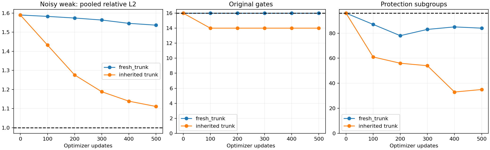

# v4.3本地有限对照：fresh_trunk

新结果仅本地保存；未推送公开仓库。固定物理后的5797参数、19通道、六次共享CNN校正器，属于物理反演后CNN校正，未反传LM/PCG。

本臂仅将v4.2继承的共享主干换成新的随机初始化，两个残差头仍为零。保持seed4101、lr3e-5、safe1、累积4、clip1、相同原始数据与前500次抽样。物理与特征不变；不打开最终测试，不重跑旧954项。

|更新|新臂原门禁/16|v4.2原门禁/16|新臂保护/96|v4.2保护/96|新臂弱L2|v4.2弱L2|新臂正常RMSE e|新臂合格|
|---:|---:|---:|---:|---:|---:|---:|---:|---|
|0|16|16|96|96|1.5900|1.5900|16.370|False|
|100|16|14|87|61|1.5828|1.4326|16.302|False|
|200|16|14|78|56|1.5743|1.2762|16.225|False|
|300|16|14|83|54|1.5638|1.1884|16.130|False|
|400|16|14|85|33|1.5464|1.1389|15.985|False|
|500|16|14|84|35|1.5369|1.1112|15.902|False|



每行是独立checkpoint；恒等初始化的保护性不与后期降噪合并报告。负模板使用abs(truth)支持域及负阈值检测，未改原门禁。

## 末次分层结果

|辅助组|条件|输入|帧数|模板RMSE e|L2|色温RMSE K|
|---|---|---|---:|---:|---:|---:|
|False|blank|continuous|24|0.386|N/A|0.097|
|False|blank|noise|128|15.638|N/A|17.705|
|False|blank|quantization|24|1.063|N/A|1.567|
|False|normal|continuous|24|1.500|0.0240|0.733|
|False|normal|noise|128|15.902|0.2869|17.851|
|False|normal|quantization|24|1.881|0.0301|1.695|
|False|strong|continuous|24|3.010|0.0241|1.440|
|False|strong|noise|128|16.571|0.1460|18.016|
|False|strong|quantization|24|3.244|0.0260|2.055|
|False|weak|continuous|24|0.452|0.0395|0.157|
|False|weak|noise|128|15.691|1.5369|17.666|
|False|weak|quantization|24|1.086|0.0950|1.566|
|True|negative_normal|continuous|6|3.761|0.0694|0.740|
|True|negative_normal|noise|6|19.653|0.3626|15.711|
|True|negative_normal|quantization|6|3.937|0.0726|1.258|
|True|negative_weak|continuous|6|0.852|0.0629|0.208|
|True|negative_weak|noise|6|18.910|1.3956|15.386|
|True|negative_weak|quantization|6|1.312|0.0968|1.022|
|True|positive_normal|continuous|6|3.081|0.0569|0.725|
|True|positive_normal|noise|6|19.976|0.3686|16.006|
|True|positive_normal|quantization|6|3.268|0.0603|1.237|
|True|positive_weak|continuous|6|0.851|0.0628|0.205|
|True|positive_weak|noise|6|19.357|1.4286|15.369|
|True|positive_weak|quantization|6|1.291|0.0952|1.023|

完成500次实际更新与原生checkpoint/Adam步数重开，3个代表帧原生预测已复现。数据、标签和缓存键逐例匹配v4.2；生成4656条同输入配对。初始144帧物理恒等和活跃头梯度检查已执行。

本比较限于一个种子和500次预算；较保守的输出不等同于有效降噪，较低loss也不替代联合门禁。完整新结果、阶段误差、梯度与失败均在同目录保留。

复现：在含冻结E/D开发数据、尚无本臂训练曲线的新工作副本中，使用既有CUDA解释器执行：

```powershell
& $GpuPython -B -m training_v4_3.fresh_trunk
& $ReportPython -B -m training_v4_3.analyze
```

需设置PYTHONDONTWRITEBYTECODE=1、TMP/TEMP/CUDA_CACHE_PATH至E/D工作副本；解释器路径见training_v4_2/README.md。时限按本地时段注册，跨日期复现时必须明确改为新的有界截止。
