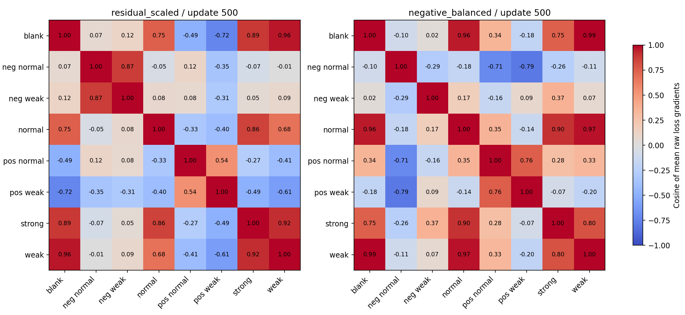

# 500次末点训练梯度诊断

两个权重各读取48个已有含噪训练输入：八个条件×六种几何，每格按case_id选首个。共96次前向及对应main/safe梯度计算，optimizer更新0次。输入选择未使用误差、验证结果或最终测试。

这些是裁剪与Adam预条件之前的原始损失梯度。余弦描述当前权重附近的局部关系，不能等同实际optimizer更新方向、证明唯一原因或替代独立验证。

## 主弱信号与负模板的局部关系

|权重|损失分量|参数组|weak vs negative_weak|weak vs negative_normal|
|---|---|---|---:|---:|
|residual_scaled|main|all|0.368369|0.050292|
|residual_scaled|main|trunk|0.320395|0.085599|
|residual_scaled|main|continuum_head|0.842068|-0.081029|
|residual_scaled|main|emission_head|0.633635|0.502752|
|residual_scaled|safe|all|N/A|N/A|
|residual_scaled|safe|trunk|N/A|N/A|
|residual_scaled|safe|continuum_head|N/A|N/A|
|residual_scaled|safe|emission_head|N/A|N/A|
|residual_scaled|total|all|0.092360|-0.007207|
|residual_scaled|total|trunk|0.181048|0.062170|
|residual_scaled|total|continuum_head|-0.065557|-0.117077|
|residual_scaled|total|emission_head|0.633770|0.561992|
|negative_balanced|main|all|0.864496|-0.011139|
|negative_balanced|main|trunk|0.771948|-0.033893|
|negative_balanced|main|continuum_head|0.888616|0.002730|
|negative_balanced|main|emission_head|0.808683|-0.049855|
|negative_balanced|safe|all|N/A|N/A|
|negative_balanced|safe|trunk|N/A|N/A|
|negative_balanced|safe|continuum_head|N/A|N/A|
|negative_balanced|safe|emission_head|N/A|N/A|
|negative_balanced|total|all|0.067019|-0.106605|
|negative_balanced|total|trunk|0.114297|-0.060879|
|negative_balanced|total|continuum_head|0.045321|-0.133332|
|negative_balanced|total|emission_head|0.897560|-0.068872|

## 同一训练探针的输出

|权重|条件|模板RMSE e|L2|色温RMSE K|投影|保护项活跃/6|
|---|---|---:|---:|---:|---:|---:|
|residual_scaled|blank|2.9597|N/A|17.5197|N/A|0|
|residual_scaled|normal|4.9660|0.20200|17.5443|0.93210|0|
|residual_scaled|strong|5.3358|0.11508|17.1516|0.97057|0|
|residual_scaled|weak|4.3892|0.89542|17.4513|0.47283|0|
|residual_scaled|negative_normal|54.0246|0.95686|30.6585|0.04382|5|
|residual_scaled|negative_weak|14.1323|1.00122|14.3980|0.01706|2|
|residual_scaled|positive_normal|13.4444|0.23812|14.4687|0.94508|1|
|residual_scaled|positive_weak|11.1389|0.78915|14.3595|0.42698|1|
|negative_balanced|blank|9.6223|N/A|18.1706|N/A|0|
|negative_balanced|normal|10.0724|0.40972|18.1520|0.85048|0|
|negative_balanced|strong|10.5553|0.22766|17.7786|0.93620|0|
|negative_balanced|weak|9.3192|1.90117|18.0017|0.75104|0|
|negative_balanced|negative_normal|25.5692|0.45287|15.7008|0.60504|4|
|negative_balanced|negative_weak|12.4004|0.87852|14.5200|1.00283|1|
|negative_balanced|positive_normal|14.9883|0.26547|14.6705|0.96498|0|
|negative_balanced|positive_weak|14.6414|1.03729|14.6780|0.56526|1|

每格六个探针均匀平均，不代表原采样分布的精确期望。每格完整main/safe平均梯度向量、参数分组、原始逐例结果均已保存；两模型参数哈希和物理缓冲区在诊断前后保持一致。
