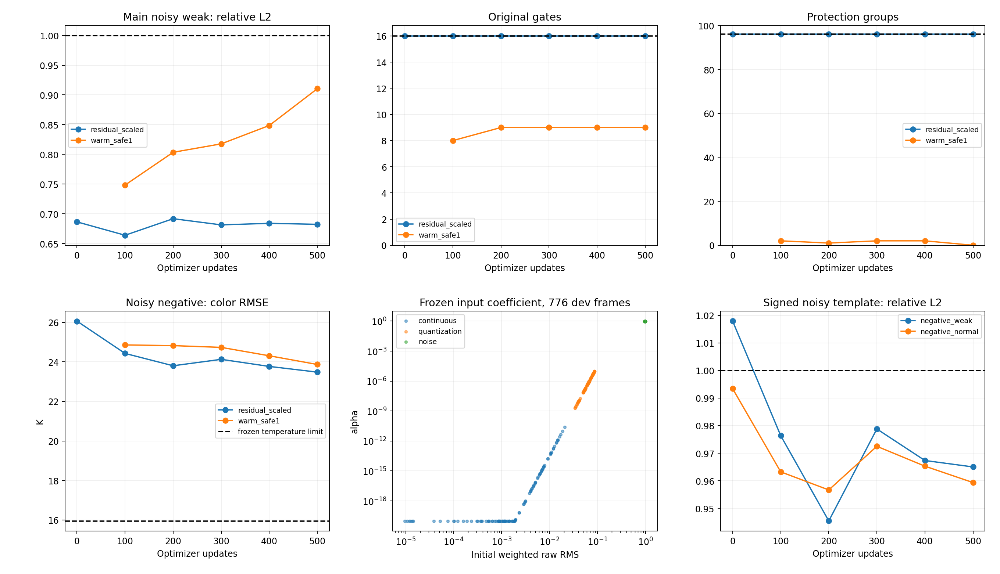

# v4.3 本地有限对照：冻结原始残差系数

本轮是单视场重叠输入的物理反演后CNN校正；5797参数、19通道、六次共享校正。只修改输出校正系数；物理、旧v4/update2000初始化、前500次训练抽样、safe1损失、lr3e-5、累积4、clip1与seed4101均与旧safe1相同。

新结果仅在E盘本地保存，未推送；最终测试未打开。每个checkpoint独立验收，不合并不同权重的优势。

|更新|原检查/16|保护/96|主弱L2|主正常RMSE e|含噪温度通过|联合合格|同更新warm_safe1弱L2|
|---:|---:|---:|---:|---:|---|---|---:|
|0|16|96|0.686383|9.5930|False|False|初始权重为旧v4/update2000|
|100|16|96|0.663912|9.6274|False|False|0.748390|
|200|16|96|0.691751|9.6477|False|False|0.803467|
|300|16|96|0.681369|9.7224|False|False|0.817663|
|400|16|96|0.683959|9.7654|False|False|0.848559|
|500|16|96|0.682292|9.5767|False|False|0.910489|

联合合格checkpoint：无。

## 系数的证据边界

rho由固定物理预测与raw的加权残差计算，alpha=sigmoid(9×log(rho/0.3124117966))。所有2576个训练输入的raw残差及训练输入类型确定tau与指数；没有用truth误差数值定标。系数在CNN运行前固定，不可由CNN修改自身残差来改变。

方案设计动机受此前已查看的开发验证残差间隔启发，这是开发诊断，不能称独立验证。近乎分开的合成噪声模式不能推及真实相机；raw残差较小不保证truth误差小。负模板仍可输出负值，未使用truth、case_id、condition进行推理或屏蔽。

|输入类型|帧数|rho最小|rho中位|rho最大|alpha最小|alpha最大|
|---|---:|---:|---:|---:|---:|---:|
|continuous|120|9.57152e-06|0.0018468|0.0206594|0|2.41829e-11|
|quantization|120|0.033783|0.0622061|0.0865014|2.02179e-09|9.56439e-06|
|noise|536|0.968451|0.9791|0.986498|0.999962|0.999968|

## 温度失败组

原规则保持：每个含噪group的温度MSE不超过1.05×固定物理MSE+0.04 K²。negative_weak与negative_normal另列诊断，但没有替换原先合并的negative验收组。

|更新|辅助组|组别|帧数|色温RMSE K|物理RMSE K|原阈值 K|
|---:|---|---|---:|---:|---:|---:|
|0|True|negative|12|26.0611|15.5624|15.9479|
|100|True|negative|12|24.4265|15.5624|15.9479|
|200|True|negative|12|23.8030|15.5624|15.9479|
|300|True|negative|12|24.1279|15.5624|15.9479|
|400|True|negative|12|23.7693|15.5624|15.9479|
|500|True|negative|12|23.4809|15.5624|15.9479|

## 末次完整分层

|辅助组|条件|输入|帧数|模板RMSE e|相对L2|色温RMSE K|
|---|---|---|---:|---:|---:|---:|
|False|blank|continuous|24|0.0559|N/A|0.0684|
|False|blank|noise|128|2.3669|N/A|16.0806|
|False|blank|quantization|24|1.0587|N/A|1.5671|
|False|normal|continuous|24|1.6218|0.025988|0.7446|
|False|normal|noise|128|9.5767|0.172806|16.6790|
|False|normal|quantization|24|1.9408|0.031099|1.6985|
|False|strong|continuous|24|3.2964|0.026402|1.4757|
|False|strong|noise|128|11.0056|0.096943|16.9447|
|False|strong|quantization|24|3.4780|0.027857|2.0724|
|False|weak|continuous|24|0.2993|0.026173|0.1446|
|False|weak|noise|128|6.9657|0.682292|16.2618|
|False|weak|quantization|24|1.0873|0.095072|1.5665|
|True|negative_normal|continuous|6|3.1626|0.058353|0.7424|
|True|negative_normal|noise|6|51.9962|0.959358|29.5715|
|True|negative_normal|quantization|6|3.3342|0.061518|1.2577|
|True|negative_weak|continuous|6|0.7943|0.058618|0.2008|
|True|negative_weak|noise|6|13.0758|0.965024|15.1074|
|True|negative_weak|quantization|6|1.2896|0.095173|1.0214|
|True|positive_normal|continuous|6|3.2169|0.059354|0.7357|
|True|positive_normal|noise|6|14.9062|0.275027|15.4235|
|True|positive_normal|quantization|6|3.3743|0.062257|1.2396|
|True|positive_weak|continuous|6|0.8003|0.059067|0.1991|
|True|positive_weak|noise|6|9.3646|0.691125|14.6517|
|True|positive_weak|quantization|6|1.2864|0.094940|1.0222|

## 含噪有符号模板保真诊断

投影为sum(pred×truth)/sum(truth²)，按真值能量合并六帧；接近0提示与真值同向的信号几乎消失，理想为1。召回率沿用各帧abs(truth)支持域与固定±60 e阈值，表中为帧平均。此处不修改验收规则；联合eligible也不能替代这些分层结果。

|更新|条件|有符号投影|固定阈值召回率|
|---:|---|---:|---:|
|0|negative_weak|-0.002983|0.000000|
|0|negative_normal|0.008290|0.000000|
|100|negative_weak|0.041247|0.000000|
|100|negative_normal|0.038431|0.000000|
|200|negative_weak|0.073070|0.000000|
|200|negative_normal|0.045104|0.000000|
|300|negative_weak|0.039873|0.000000|
|300|negative_normal|0.029363|0.000000|
|400|negative_weak|0.047392|0.000000|
|400|negative_normal|0.036266|0.000000|
|500|negative_weak|0.049183|0.000000|
|500|negative_normal|0.042094|0.000000|

## 回执与诊断

500次实际更新、2000个微批次，逐例抽样与旧safe1完全相同；6个checkpoint的Adam步数与模型参数哈希重开已核对，3个代表帧原生预测复现通过。6×776条新验证记录与冻结旧结果生成31816条配对，raw、标签和物理缓存键全匹配；旧推理重跑0次。

所有checkpoint最大无效像素比例为0。144帧六阶段未衰减proposal与实际输出共288条记录保留负模板、色温及有效比例；12个固定训练帧梯度探针没有更新权重。

|训练臂|500次中裁剪次数|梯度范数中位数|平均main loss|平均safe loss|
|---|---:|---:|---:|---:|
|residual_scaled|73|0.326307|0.027892|0.069170|
|warm_safe1|498|395.379196|0.039021|9.553281|

完整逐例、失败、梯度、proposal输出和系数记录位于本报告同目录。个别梯度冲突或改善不证明唯一原因；该结果限于一个种子、500次预算与当前合成开发分布。

复现入口：在含冻结训练数据且没有本臂已有结果的新E/D工作副本中，设置E/D缓存和临时目录，执行CUDA解释器的 `python -B -m training_v4_3.scaled_train`；只读报告生成使用 `python -B -m training_v4_3.scaled_analyze --name residual_scaled`。跨日期重跑需登记新的有界截止，不能静默沿用本次时限。
