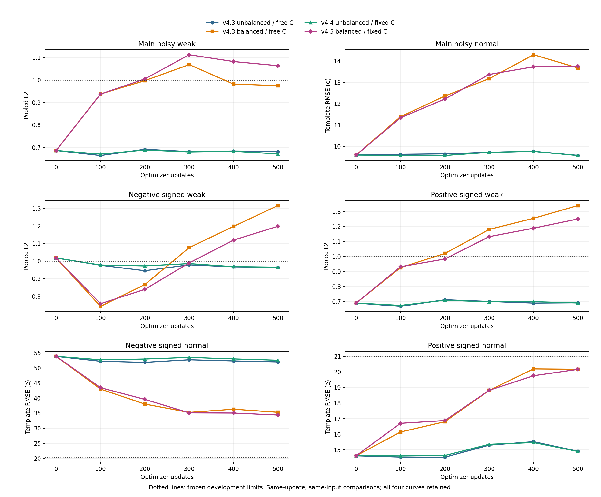
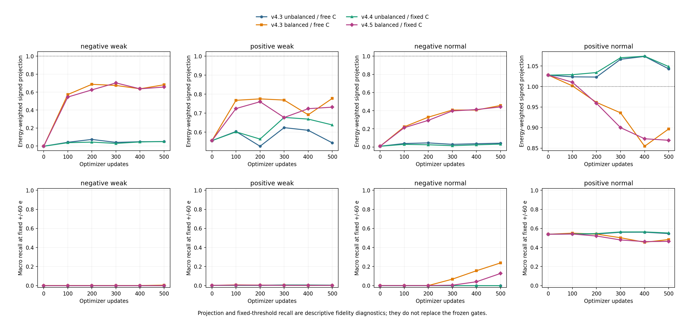

# v4.5 固定最终连续谱与既有负模板平衡抽样

六个检查点均未形成开发候选。按预登记硬停止规则，本次500更新收口，此小池不追加新种子、步数、损失或连续谱变体。

本臂从旧v4/update2000重新初始化，沿用v4.3 negative_balanced的500组抽样；新增训练案例0。阈值与v4.4冻结规则一致。以下均为开发结果，未使用最终测试。

|更新|原检查/16|保护/96|主weak L2|主normal RMSE e|含噪温度|旧eligible|新筛查|联合候选|失败signed条件|
|---:|---:|---:|---:|---:|---|---|---|---|---|
|0|16|96|0.686383|9.5930|True|True|False|False|negative_weak, negative_normal|
|100|16|96|0.937455|11.3389|True|True|False|False|negative_normal|
|200|16|96|1.004925|12.2213|True|False|False|False|negative_normal|
|300|16|96|1.112587|13.3720|True|False|False|False|positive_weak, negative_normal|
|400|16|96|1.082229|13.7313|True|False|False|False|negative_weak, positive_weak, negative_normal|
|500|16|96|1.063764|13.7524|True|False|False|False|negative_weak, positive_weak, negative_normal|

固定C两臂的最终连续谱与色温逐帧保持物理结果；色温恒等来自输出约束，不能计为学习收益。内部六阶段连续谱头仍参与signed修正。完整16项、96组、含噪温度与所有signed分层保留在comparison_summary.json；每个v4.5检查点的全部失败见checkpoint_failures.json。

|同一500更新末点|signed条件|L2|模板RMSE e|冻结RMSE上限e|投影|固定±60e召回|MSE通过|weak L2通过|
|---|---|---:|---:|---:|---:|---:|---|---|
|v4.3 unbalanced / free C|negative_weak|0.965024|13.0758|19.9195|0.049183|0.000000|True|True|
|v4.3 balanced / free C|negative_weak|1.316166|17.8337|19.9195|0.681766|0.004388|True|False|
|v4.4 unbalanced / fixed C|negative_weak|0.965521|13.0826|19.9195|0.049477|0.000000|True|True|
|v4.5 balanced / fixed C|negative_weak|1.197938|16.2317|19.9195|0.656548|0.000000|True|False|
|v4.3 unbalanced / free C|positive_weak|0.691125|9.3646|20.4570|0.544102|0.001895|True|True|
|v4.3 balanced / free C|positive_weak|1.339713|18.1527|20.4570|0.777872|0.002168|True|False|
|v4.4 unbalanced / fixed C|positive_weak|0.689739|9.3458|20.4570|0.638348|0.004263|True|True|
|v4.5 balanced / fixed C|positive_weak|1.250174|16.9395|20.4570|0.731785|0.001944|True|False|
|v4.3 unbalanced / free C|negative_normal|0.959358|51.9962|20.4189|0.042094|0.000000|False|True|
|v4.3 balanced / free C|negative_normal|0.651188|35.2937|20.4189|0.457063|0.237787|False|True|
|v4.4 unbalanced / fixed C|negative_normal|0.969648|52.5539|20.4189|0.031985|0.000000|False|True|
|v4.5 balanced / fixed C|negative_normal|0.634489|34.3886|20.4189|0.441250|0.127206|False|True|
|v4.3 unbalanced / free C|positive_normal|0.275027|14.9062|21.0005|1.042931|0.545683|True|True|
|v4.3 balanced / free C|positive_normal|0.372197|20.1727|21.0005|0.896698|0.483153|True|True|
|v4.4 unbalanced / fixed C|positive_normal|0.274818|14.8949|21.0005|1.048529|0.551812|True|True|
|v4.5 balanced / fixed C|positive_normal|0.372051|20.1647|21.0005|0.869063|0.464034|True|True|

历史两条v4.3曲线的signed上限仅用于同一开发规则下的描述性对照，不把它们加入v4.5候选池。正负weak与normal全部列出，投影和固定阈值召回作为保真诊断保留。

逐case描述性交互差为 `(v4.5−v4.4)−(v4.3 balanced−v4.3 unbalanced)`，单位e²。负值表示在这些固定开发输入上，平衡抽样的MSE变化在固定C条件下更低；它不构成独立验证或因果机制证明。

|500更新组|v4.3非平衡 MSE|v4.3平衡 MSE|v4.4固定C MSE|v4.5平衡固定C MSE|交互差e²|
|---|---:|---:|---:|---:|---:|
|main_weak|48.52138|99.09744|46.97046|117.94584|20.39932|
|main_normal|91.71379|187.09968|91.56989|189.12722|2.17144|
|negative_weak|170.97700|318.04080|171.15313|263.46924|-54.74770|
|positive_weak|87.69502|329.52230|87.34362|286.94729|-42.22360|
|negative_normal|2703.60204|1245.64554|2761.91026|1182.57600|-121.37776|
|positive_normal|222.19445|406.93748|221.85665|406.61695|0.01728|

全部6个更新点共4656组四格配对，逐case记录中的raw/label SHA256、cache键、cache文件及其元数据SHA256均核对一致。实际数组字节审计属于独立数据审计范围；本分析只读记录。所有更新的逐case值与组均值分别见paired_four_cell.jsonl、interaction_summary.json。

四条曲线使用同一更新数，选择不拼接不同检查点的优势。v4.5实际500次更新、2000微批次、6个检查点及Adam/原生重放的训练回执已核对。本分析模型推理、物理求解、GPU和原始数组读取均为0；独立最终评估须另有冻结候选与协议。

冻结选择规则：After completing the registered comparisons, among candidates passing old eligible and all new screens, minimize main weak L2; ties use normal RMSE then earlier checkpoint.

分析输入哈希、图像重开及派生文件回执见analysis_receipt.json；历史分析尝试和失败记录保存在analysis_runs/。
