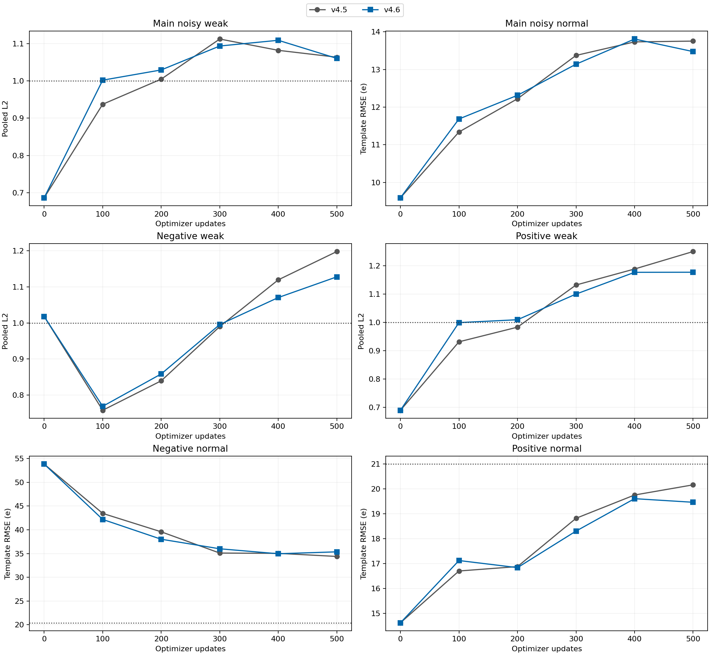

# v4.6 负含噪母场景和噪声覆盖对照

六个检查点均未形成开发候选。本次有限数据对照关闭，不追加种子、步数、损失或采样试验。

全部结果来自已反复查看的776帧开发集。新确认集和最终测试均未打开；本报告不能提供独立泛化或真实测温结论。

相对v4.5，仅对513个负含噪位置执行预定母体/噪声重采样，其中11个位置恰好返回旧case，因此实际ID变化502个；其余1487个位置逐项原样保留。两负含噪条件各覆盖36母体、每母体两次独立噪声，每个raw被抽3或4次。生成432条TRAIN输入，实际新增反演与训练输入120条；新正组及无噪/量化组未用于本次训练。

母体覆盖与噪声重复同时改变，不能分别归因。固定最终连续谱、旧初始化与空Adam、优化器、预算、条件时序和全部筛查相同。温度逐帧等于物理基线，属于结构恒等。

|更新|旧eligible|新增筛查|联合候选|主weak L2|主normal RMSE e|失败signed组|
|---:|---|---|---|---:|---:|---|
|0|True|False|False|0.686383|9.5930|negative_weak, negative_normal|
|100|False|False|False|1.002103|11.6845|negative_normal|
|200|False|False|False|1.029582|12.3134|negative_normal, positive_weak|
|300|False|False|False|1.093808|13.1393|negative_normal, positive_weak|
|400|False|False|False|1.109187|13.8075|negative_weak, negative_normal, positive_weak|
|500|False|False|False|1.060628|13.4741|negative_weak, negative_normal, positive_weak|

|500更新|条件|模板RMSE e|冻结RMSE上限e|pooled L2|signed投影|通过|
|---|---|---:|---:|---:|---:|---|
|v4.5|negative_weak|16.2317|19.9195|1.197938|0.656548|False|
|v4.5|negative_normal|34.3886|20.4189|0.634489|0.441250|False|
|v4.5|positive_weak|16.9395|20.4570|1.250174|0.731785|False|
|v4.5|positive_normal|20.1647|21.0005|0.372051|0.869063|True|
|v4.6|negative_weak|15.2806|19.9195|1.127744|0.591795|False|
|v4.6|negative_normal|35.3616|20.4189|0.652440|0.407393|False|
|v4.6|positive_weak|15.9489|20.4570|1.177063|0.773957|False|
|v4.6|positive_normal|19.4642|21.0005|0.359125|0.888397|True|

每个更新点逐case核对raw、标签、物理缓存及其元数据身份，共4656组配对；0更新的全部776条记录与v4.5完全相同。每母体/条件/输入类型的描述性误差差值保留在paired_parent_summary.json；它们不是独立像素统计显著性。

完整旧16门禁、96保护组、温度筛查和signed分层见comparison_summary.json及原始训练报告。本文仅读取保存的结果，模型推理、物理反演和GPU调用均为0。
